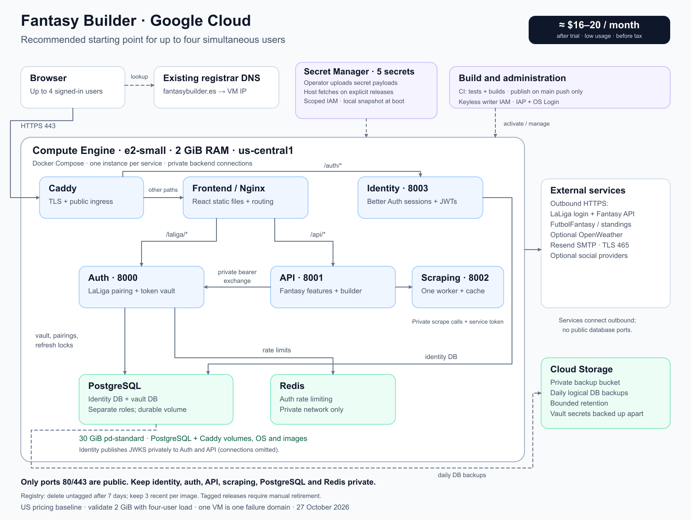

# LaLiga Fantasy Builder architecture

The application serves lineup planning, player information, standings, and
user-confirmed Fantasy market operations. Its services share one browser origin
while keeping application identity separate from the user's delegated LaLiga
connection. This document covers the current code and the Google Cloud deployment
template for at most four concurrent users. The cloud topology is a deployable
template; it has not been provisioned or load-tested in the user's project.

## 1. Backend

| Service | Implementation | Internal port | Owns |
| --- | --- | --- | --- |
| Identity | TypeScript, Node 24, Express 5, Better Auth; Bun for dependency/build tooling | 8003 | Credentials, optional social providers, email verification/recovery, sessions, signing keys, application JWTs. |
| Auth | Python 3.14, FastAPI | 8000 | LaLiga pairing, encrypted token vault, refresh, connection ownership, private bearer exchange. |
| API | Python 3.14, FastAPI | 8001 | Leagues, teams, players, calendar, standings, market, buyout, and read-only lineup recommendations. |
| Scraping | Python 3.14, FastAPI, downloader/parser | 8002 | Private FutbolFantasy data and official standings extraction; no LaLiga credentials. |

### Boundaries and request flow

Identity stores users, sessions, provider accounts, and JWT signing material in
its own PostgreSQL database. The auth service stores pairing state, encrypted
LaLiga connections, and refresh locks in a separate database with its own
non-superuser role. The production auth rate limiter uses Redis. Sharing a
PostgreSQL server does not grant either runtime access to the other's database.

```mermaid
sequenceDiagram
    participant Browser
    participant Identity
    participant API
    participant Auth
    participant LaLiga
    Browser->>Identity: Same-origin /auth sign-in; secure session cookie
    Browser->>Identity: GET /auth/token using session
    Identity-->>Browser: Short-lived Ed25519 application JWT
    Browser->>API: /api/... with Bearer application JWT
    API->>API: Verify JWT via identity JWKS; authorize sub
    API->>Auth: Private bearer request, application JWT + service token
    Auth->>Auth: Verify identity and ownership; decrypt/refresh connection
    Auth-->>API: Short-lived LaLiga bearer on private connection
    API->>LaLiga: Caller-scoped upstream request
    LaLiga-->>API: Fantasy data
    API-->>Browser: Validated JSON; no LaLiga credentials
```

Authorization comes from the verified JWT `sub`, never a caller-supplied user ID.
The browser retains the application JWT only in memory. LaLiga tokens stay in the
auth vault and transient API memory; they are excluded from browser responses,
logs, and API persistence. Cookie-authenticated identity actions retain framework
origin and CSRF protections. Private endpoints require service-token checks and
must remain inaccessible through public ingress.

Application sign-in and LaLiga linking are independent. The configured native
pairing flow remains available after sign-in. Browser LaLiga login requires an
approved client and registered HTTPS callback, which the current
[capability record](docs/authentication/laliga-sso-capability.md) does not establish.

### Code organization and contracts

New Fantasy functionality follows **API controller → service → repository →
upstream client**. `backend/api/src/fantasy_api/api/deps.py` owns process-lifetime
dependency wiring; the shared HTTP clients have bounded timeouts and close during
shutdown. Auth uses domain/application/ports/adapters boundaries and does not
import API or scraper implementations. Scraping isolates retrieval from parsing.

Pydantic validates HTTP and upstream models. Writes reject unexpected fields;
reads allow compatible upstream extensions. Unexpected upstream shapes or invalid
JSON become sanitized 502 responses. Aggregated player detail can return HTTP 200
with explicit `segment_errors` for failed optional segments. All upstream path
segments are encoded. A squad-entry `playerTeamId` is distinct from a catalog
`playerId`, including where upstream payload names are misleading.

Scraping checks robots policy, identifies its caller, bounds concurrency, and
uses TTL caches and circuit breakers. Its current cache and limiter live in one
process, so the initial deployment runs one worker. The API also uses in-process
TTL caches. Lineup planning bounds source retrieval and search, moves CPU search
off the event loop, allows at most two builds per process, and has a 120-second
request budget. A recommendation does not execute Fantasy transactions. CLIs and
browser-session automation remain read-only for bids, clauses, and shields.

Detailed guides: [backend architecture](docs/architecture.md),
[API domains](docs/api/README.md), [identity](backend/identity/README.md),
[auth](backend/auth/README.md), and [scraping](docs/scraping/README.md).

## 2. Frontend

The frontend is React 19 and TypeScript, built by Vite with Bun tooling. React
Router owns navigation, TanStack Query owns remote data caching/refetching, and
Zod validates API responses and write contracts. Feature modules cover the lineup,
market, player catalog and profiles; the application shell, authentication,
shared API layer, and reusable UI components sit alongside them.

| Area | Location / responsibility |
| --- | --- |
| Application composition and routing | `frontend/src/app`; providers, route boundaries, lazy player-detail loading. |
| Identity and LaLiga connection state | `frontend/src/auth`; Better Auth client, in-memory JWT, account and linking flows. |
| Data contracts and clients | `frontend/src/api`; paths, schemas, mappers, queries, and streaming builder calls. |
| Product features | `frontend/src/features`; lineup, market, players, and shared shell. |
| Shared interaction primitives | `frontend/src/components`; accessible controls, feedback, dialogs, and visual components. |

The browser uses one origin, `https://fantasybuilder.es` in the cloud template:

| Path | Destination |
| --- | --- |
| `/`, `/market`, `/players`, `/account`, and other UI routes | Static frontend; Nginx falls back to `index.html` for client-side routes. |
| `/auth/*` | Identity; HTTPS Caddy routes directly and replaces the client-IP header. |
| `/laliga/*` | Nginx → auth, retaining the prefix. |
| `/api/*` | Nginx → API, removing `/api` before forwarding. |
| `/internal/*` | Rejected by the public web configuration. |

Local Vite proxying mirrors these service paths. Production builds contain no
server secrets. Query cancellation, session/account changes, and response
validation preserve user scope; logout clears sensitive application state. Market
writes use explicit UI confirmation. Builder output becomes a local draft before
the user chooses to save a lineup. Nginx retains its 130-second API timeout to
support the longer planning request and streaming progress.

See [frontend behavior and design](docs/frontend.md),
[Vite proxy configuration](frontend/vite.config.ts), and
[production Nginx routing](frontend/nginx.conf).

## 3. Cloud architecture

### Deployment topology



The [Terraform module](infra/gcp/README.md) provisions one regular `e2-small`
Compute Engine VM in `us-central1`, using a dedicated VPC/subnet, a reserved
Standard Tier IPv4 address, and a 30 GiB standard persistent disk. Caddy terminates
HTTPS, Nginx serves the frontend, and Docker Compose runs each backend and data
service as a separate container. This preserves microservice boundaries while
sharing the server's resources across four users.

Only ports 80 and 443 accept public traffic. SSH uses IAP and OS Login. Backend
ports and PostgreSQL/Redis have no host publications. Compose's `internal`
network carries private traffic; services requiring external providers also join
an egress-capable network. Identity receives the actual client address from the
trusted Caddy ingress. Adding another proxy requires explicit trusted-proxy
configuration before relying on client-IP rate limits.

The VM has Shielded VM settings, project SSH keys are blocked, and a dedicated
service account has only repository-read, per-secret-read, and backup-object-create
permissions. Administrators may be configured explicitly through Terraform IAM
members. Docker forwarding rules block container HTTP access to the VM metadata
server so containers cannot obtain the host's Secret Manager identity. Metadata
DNS is unaffected. No service-account keys are generated.

### Configuration, releases, and persistence

Terraform creates an Artifact Registry repository, five Secret Manager secret
containers, and root-owned deployment scripts/systemd units. Operators upload
dotenv secret versions separately. With the optional GitHub publisher configured,
CI builds immutable amd64 images after tests pass and publishes them only on
pushes to `main`, once all five builds succeed. Pull requests never publish.
Keyless federation is restricted to this repository ID/name and the main CI
workflow; the publisher has repository writer access without VM or secret access.
Each successful publishing run produces the five image digests as a release
artifact. Updating runtime secret versions and activating the VM remain explicit
operator steps; manual image publishing is also available.
Artifact Registry cleans untagged versions older than seven days, except the three
most recent versions of each image. Tagged releases remain until operators retire
them; total registry storage is not automatically bounded. Keep active and needed
rollback digests tagged.

Secret payloads never pass through Terraform variables, data sources, state, or
instance metadata. Explicit releases stage configuration in root-only directories,
validate Compose, pull images, and wait for healthy startup before atomically
switching the committed local snapshot. Reboots use the committed snapshot and
cached images without contacting Secret Manager or the registry.
Only each backend's own environment file and required variables reach that
container.

Identity migrations run through a one-shot container; auth applies its additive
migrations at startup. Persistent Docker volumes hold PostgreSQL data and Caddy
certificates. The boot disk is managed separately, has `prevent_destroy`, and is
attached with `auto_delete=false`; VM deletion protection is enabled by default.
The OS image initializes only a new disk, so image-family updates do not replace
the populated database disk. Restart policies, bounded container logs, and
systemd startup are included in the production template.

Daily logical backups of both PostgreSQL databases go to a private regional
Cloud Storage bucket. A completion manifest is uploaded only after both database
dumps and uploads succeed. Backups and releases share an operation lock.
The VM can create new backup objects but cannot read or
delete them. Lifecycle rules expire live objects after 14 days by default, with
a further 7-day soft-delete recovery window. Secrets and role provisioning are
recovered independently; a dump alone cannot recover encrypted vault contents.
Restore exercises and backup-failure monitoring remain operator responsibilities.
The two logical database dumps are independent snapshots; they do not provide
cross-database point-in-time consistency.

### Cost, capacity, and availability

The cost model is about **$16–20/month before tax** after promotional credits,
assuming the stated US allowances, low traffic, small backups, and controlled
image retention. Standard IPv4 is a separate charge. An optional Terraform budget
monitors project usage before credits; alerts are not a hard spending limit.
The [dated cost assessment](docs/deployment/google-cloud-cost-architecture.md)
contains the pricing sources and alternatives.

Two GiB is a starting estimate, not a measured capacity guarantee. Validate the
complete production stack with four signed-in users, cold caches, and concurrent
lineup requests. Downsize to an eligible `e2-micro` only if memory/latency tests
pass; use `e2-medium` if measured pressure justifies it. A European region can
improve latency for Spanish users but needs different pricing and data-location
decisions. Managed SQL/Redis, GKE, and a load balancer add costs that this initial
workload does not require.

One VM is one failure domain. Maintenance or host failure stops the application
and database access together. The design accepts brief outages and recovery from
backups to reduce cost. It provides no failover, autoscaling, zero-downtime release,
or tested recovery-time guarantee. Cloud resources are created only when an
operator applies the template; DNS, provider registrations, actual secret values,
release validation, and cloud load testing still need to be supplied.

Deployment instructions: [infra/gcp/README.md](infra/gcp/README.md).
Release gates: [authentication runbook](docs/authentication/better-auth-cutover.md).
Editable diagram: [Mermaid](docs/deployment/google-cloud-architecture.mmd) and
[SVG](docs/deployment/google-cloud-architecture.svg).
