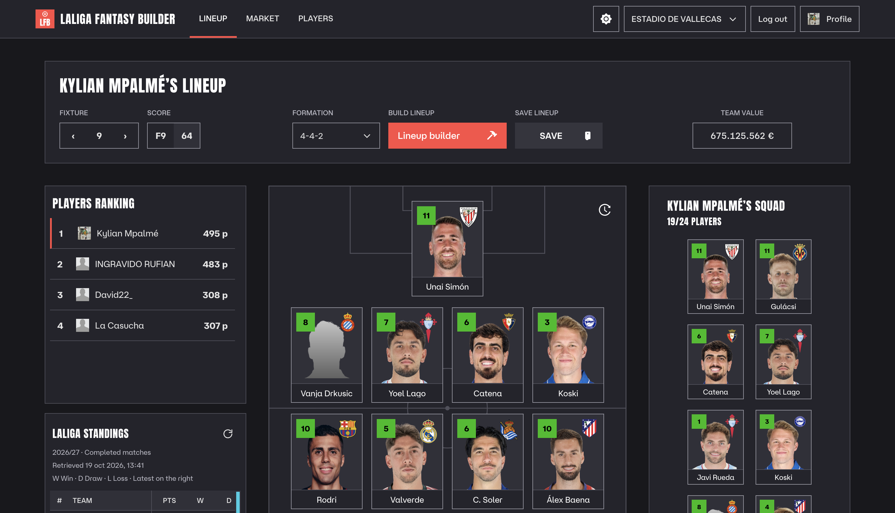

# LaLiga Fantasy Builder

Companion for a LaLiga Fantasy league: edit your lineup, browse player profiles,
and manage market bids from the browser, backed by an API that proxies Fantasy
data and user-confirmed writes with your linked account.

| Topic | Doc |
|-------|-----|
| Architecture and trust boundaries | [docs/architecture.md](docs/architecture.md) |
| UI behaviour (lineup, market, players) | [docs/frontend.md](docs/frontend.md) |
| API routes and CLIs | [docs/api/README.md](docs/api/README.md) |
| Agent / contributor rules | [AGENTS.md](AGENTS.md) |

## Main features

### Lineup (`/`)

- Sign in with Keycloak, link LaLiga once, pick a league from the shell.
- View matchweek standings and open another manager’s team via `/?team={teamId}`.
- Change formation and save the full lineup to Fantasy.
- Squad panel with pagination, fixture scores, and squad value in the toolbar.

### Market (`/market`)

- League market table: players, form, availability, seal countdown, and sellers.
- **Money toolbar** with a warning when balance is negative before matchday.
- **Bids:** hire LaLiga listings, purchase opponent listings, modify or cancel
  your bids; UI reflects `userBids` and listing `bid` state with optimistic
  updates and refetch reconciliation.
- **Received offers:** review, accept, or reject incoming offers from the
  notification panel on the market screen, or from a player's Options menu on
  market, lineup, and Players screens.
- **Release clauses:** pay opponent buyouts when unlocked (confirmed dialog);
  tooltips explain lock countdown or premium-only coach hires.
- **Hover detail:** FSYP breakdown, market-value history (high/low and 5d/14d
  ago with %), bid amounts, balance and clause warnings.
- **Seal end** turns red when less than one hour remains on a listing.

### Players (`/players`)

- Browse the player catalog with search, column filters, pagination, ownership,
  availability, position, and recent form.
- Use row actions for market operations and player details; bookmark players
  for quick identification.
- Open a profile for recent and upcoming fixtures, match conditions and
  countdowns, Fantasy indicators, per-match averages, news, and injury history.
- On narrow screens the table keeps the player photo, name, team, and details
  actions visible.

### Platform

- **Auth BFF** (`backend/auth`): sessions, OIDC, LaLiga vault, internal JWT.
- **API** (`backend/api`): leagues, teams, players, calendar, market,
  buyout — OpenAPI at http://localhost:8001/docs when running locally. Player
  detail stats aggregate catalog, calendar, and private scraping data.
- **Read-only CLIs** for market and buyout analysis; no automated bidding or
  clause payment in CLI or browser-session flows.

## Screenshots

Product screenshots supplied on 19 October 2026, captured from the local app.
League, roster, and player data reflect the session shown and can change over
time. The [screenshot index](docs/images/README.md) tags each capture by topic
and theme and identifies the separate synthetic demonstrations.

### Lineup




Ranking, LALIGA standings, pitch, and paginated squad:


[Synthetic dark-theme demonstration](docs/images/screenshots/lineup-standings-dark.png) ·
[Synthetic mobile demonstration](docs/images/screenshots/lineup-standings-mobile.png)


Builder results remain previews. Filter recommendations, inspect a starting XI
and its squad projection, then choose **Use as draft** to prepare local changes.


### Market and player catalog


### Player profile


## Quick start

`poe up` creates missing env files, then builds and starts Keycloak, auth,
the API, scraping, and the frontend:

```bash
uv run poe up
```

- App: http://localhost:3000 (`demo` / `demo`). First LaLiga link on macOS may
  need `cd backend/auth && uv run fantasy-browser-session` and allowing
  LaligaAuthredirect.
- API docs: http://localhost:8001/docs
- Scraping health: http://localhost:8002/health/live (Swagger at `/docs` when `SCRAPING_EXPOSE_DOCS=true`)
- Keycloak admin: http://localhost:8080 (`admin` / `admin`)

Postgres, Redis, and OpenTelemetry: set `USE_MEMORY_STORE=false`, vault key,
and JWT PEMs in `backend/auth/.env`, then
`docker compose --profile full up --build`.

**Services on the host (Vite HMR):**

```bash
docker compose up -d keycloak
uv run poe dev-clean
```

`dev-clean` stops Compose app containers and stale project Uvicorn servers,
then starts auth (`:8000`), API (`:8001`), scraping (`:8002`), and Vite
(`:3000`) with reload enabled. It reports occupied ports owned by other
processes instead of stopping them. The command creates missing service
`.env` files. Set `SCRAPER_CONTACT` in `backend/scraping/.env` to a contact
address before using the scraper against FutbolFantasy. Scraping API calls use
the shared token in `backend/scraping/.env`; the command passes it to the API
automatically.

From `frontend/` only: `bun install && bun run dev:all` (or `npm`).

Per-service notes: [auth](backend/auth/README.md), [API](backend/api/README.md),
[scraping](backend/scraping/README.md) (`fantasy-scraper`, `fantasy-parse`).

## Repository

| Path | Role |
|------|------|
| [`frontend/`](frontend/) | React lineup, market, players, and player-detail UI |
| [`backend/auth/`](backend/auth/) | Sessions, Keycloak, LaLiga pairing, internal JWT |
| [`backend/api/`](backend/api/) | Fantasy proxy routes and CLIs |
| [`backend/scraping/`](backend/scraping/) | FutbolFantasy scraper + parser (port 8002, private) |
| [`docs/`](docs/) | Architecture, authentication, API domain guides |
| [`docker/`](docker/) | Keycloak realm import, OTEL collector |
| [`assets/`](assets/) | Sample Fantasy JSON trees |

## Tests

```bash
uv run poe test
```

Frontend only: `cd frontend && bun run test`. Hooks lint (also a pre-commit and CI step):
`cd frontend && bun run lint`.

## Read-only lineup builder

See the [lineup builder guide](docs/api/lineup-builder.md) for the authenticated planning POST, CLI,
browser-session flow, source restrictions and optional explanation configuration.
