# LaLiga Fantasy Builder

Companion for a LaLiga Fantasy league: edit your lineup, browse player profiles,
study real LaLiga clubs, and manage market bids from the browser, backed by an API that proxies Fantasy
data and user-confirmed writes with your linked account.

| Topic | Doc |
|-------|-----|
| Changes in v0.4.0 | [CHANGELOG.md](CHANGELOG.md#040---2026-11-10) |
| Backend, frontend, and cloud architecture | [ARCHITECTURE.md](ARCHITECTURE.md) |
| Detailed service trust boundaries | [docs/architecture.md](docs/architecture.md) |
| Google Cloud Terraform deployment | [infra/gcp/README.md](infra/gcp/README.md) |
| UI behaviour (lineup, market, players, teams) | [docs/frontend.md](docs/frontend.md) |
| API routes and CLIs | [docs/api/README.md](docs/api/README.md) |
| Agent / contributor rules | [AGENTS.md](AGENTS.md) |

## Main features

### Spanish and English

- Choose Español or English from the globe selector in Options, beside the theme
  control. The app remembers the choice and preserves open dialogs and drafts.
- Application labels, dates, numbers and countdowns follow the selected language;
  currency stays EUR and fixture times stay in Europe/Madrid.
- English news headlines and injury notes use optional browser translation, with
  the original Spanish available and retained when the service is unavailable.
  See the [localization guide](docs/frontend-localization-plan.md).

### Lineup (`/`)

- Sign in with Better Auth, link LaLiga once, pick a league from the shell.
- View matchweek standings and open another manager’s team via `/?team={teamId}`.
- Change formation and save the full lineup to Fantasy.
- Squad panel with pagination, season points, form and starter-probability badges,
  filters, and squad value in the toolbar.
- Highlight empty positions and eligible replacements, scorers and clean-sheet
  goalkeepers; inspect fixture score breakdowns and manager matchweek totals.

### Market (`/market`)

- League market table: players, form, availability, seal countdown, and sellers.
- **Money toolbar** with a warning when balance is negative before matchday.
- **Bids:** hire LaLiga listings, purchase opponent listings, modify or cancel
  your bids; UI reflects `userBids` and listing `bid` state with optimistic
  updates and refetch reconciliation.
- **Received offers:** review, accept, or reject incoming offers from the
  notification panel on the market screen, or from a player's Options menu on
  market, lineup, and Players screens.
- **Release clauses:** pay opponent buyouts when unlocked (confirmed dialog);
  tooltips explain lock countdown or premium-only coach hires.
- **Hover detail:** FSYP breakdown, market-value history (high/low and 5d/14d
  ago with %), bid amounts, balance and clause warnings.
- **Seal end** uses a coral rail when less than one hour remains. The final minute replaces that rail with a warning icon.

### Players (`/players`)

- Browse the player catalog with search, column filters, pagination, ownership,
  availability, position, and recent form.
- Use row actions for market operations and player details; bookmark players
  for quick identification.
- Open a profile for recent and upcoming fixtures, match conditions and
  countdowns, Fantasy indicators, per-match averages, news, and injury history.
- See current age when a birth date is available and a seven-axis performance
  radar below Fantasy outlook when a reviewed 2026/27 publication exists.
  Six performance roles have accessible metric tables and source methodology.
- On narrow screens the table keeps the player photo, name, team, and details
  actions visible.

Radar reads require an application login and a configured local publication.
The local dataset verified on 3 November 2026 covers 333 players and 348 role
snapshots across all 20 clubs; 238 active-roster players remain unresolved.
Published data stays outside Git and requires durable storage. Native DataMB
comparisons remain disabled until their reference population is verified.
Terraform enables the weekly refresh by default; production activation still
requires reviewed inputs and deployment configuration. See
[coverage](docs/scraping/radar-laliga-2026-27.md) and the
[operations runbook](docs/scraping/radar-operations.md).

### Teams (`/teams`)

- Pick any of the 20 current LaLiga clubs from a crest strip; the page heading shows
  the club's league position and points. The club, section, competition and match
  window live in the URL, so refresh, Back and shared links keep the same view.
- **Performance:** wins, draws and losses, W/D/L form chips and home/away split for a
  competition (National league, European, Domestic cup, Other) and a 5, 10, 20 or
  whole-season window, beside previous and upcoming matches with the next match
  highlighted and each club linked.
- **Players:** the club's three MVPs by FSYP with photo, age, form, last five LaLiga
  scores, starter likelihood and radar, plus a sortable squad table of LaLiga season
  totals and a Hierarchy levels dialog. Players without minutes fold away.
- **Lineup:** the predicted XI on the Lineup pitch with starter chances, a coach
  report, and alternatives per position with form, role and points. A player dialog
  adds a radar, the last five matches and market actions.
- **News & Injuries:** one merged feed of club news and injured players, with Spanish
  wording translated locally and other text translated on demand.
- Every widget opens with a short About line; sections show skeletons while the
  dossier loads. The first read of a club can take about half a minute. See the
  [Teams UI](docs/frontend.md#teams-screen) and [Clubs API](docs/api/clubs/README.md).

### Favorites and scouting

- Save players with the bookmark before their name in Market or Players, or from
  player details. Favorites persist across devices; saved portrait tiles use
  `#FFC2BF` while row backgrounds stay unchanged.
- Open Favorites from either toolbar to search saved players, inspect basic data,
  open details, or adjust league alerts. Settings show the saved configuration
  and expand when needed.
- Enable alerts for market listings and release-clause unlocks, with advance
  warnings at 1, 6 or 24 hours. A background worker checks while the website is
  closed; alerts appear in the persistent in-app inbox when you return.
- Favorites are global to your account; alerts are configured per league and need
  a linked LaLiga account. Delivery follows polling, rather than being immediate.
  See the [scouting guide](docs/api/scouting/README.md).

### Platform

- **Identity** (`backend/identity`): Better Auth login, recovery, sessions and JWTs.
- **LaLiga auth** (`backend/auth`): pairing, encrypted vault and refresh.
- **API** (`backend/api`): leagues, teams, clubs, players, calendar, market,
  buyout — OpenAPI at http://localhost:8001/docs when running locally. Player
  detail stats aggregate catalog, calendar, and private scraping data.
- **Read-only CLIs** for market and buyout analysis; no automated bidding or
  clause payment in CLI or browser-session flows.

## Screenshots

These sixteen captures were taken from the signed-in application in a browser on
9 November 2026 (Europe/Madrid), with real league and player data, and cover the
Lineup, Market, Players and Teams tabs plus player details and the lineup builder.
Values and availability can change. See the
[capture notes](docs/frontend.md#product-captures).

### Light theme

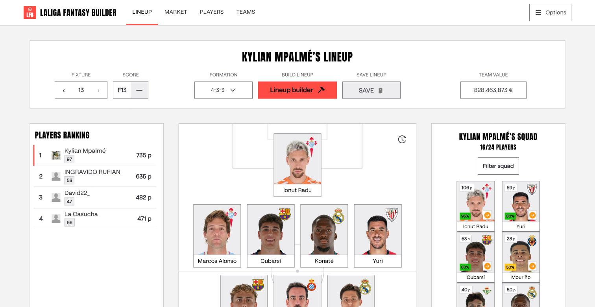

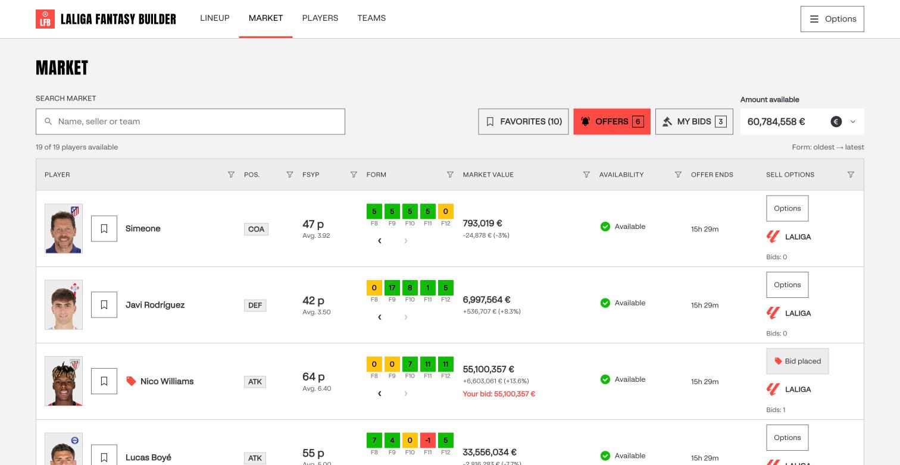

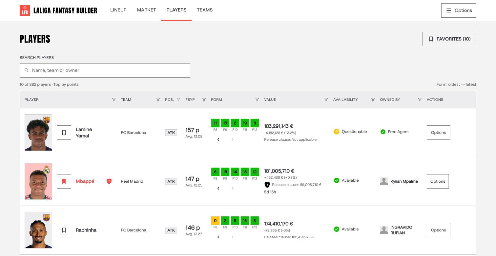

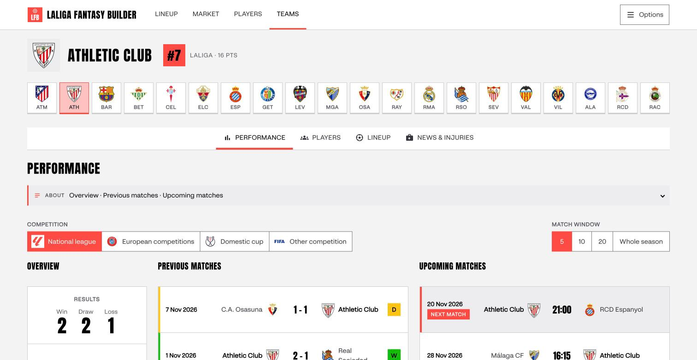

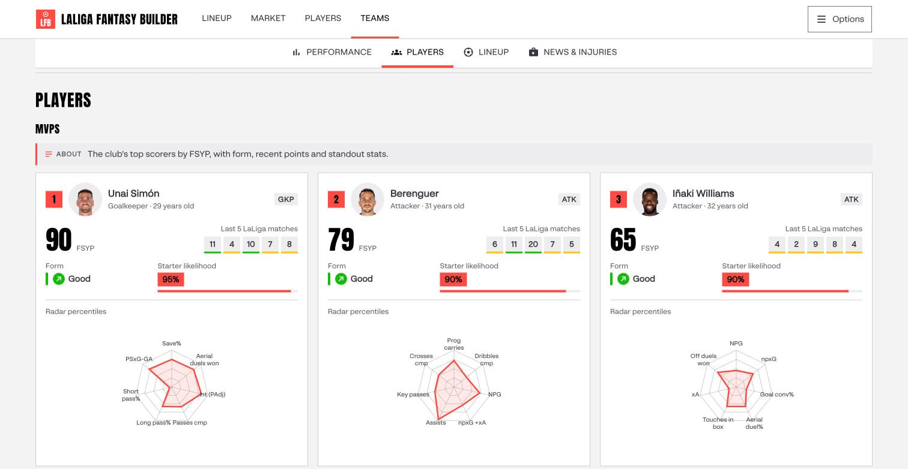

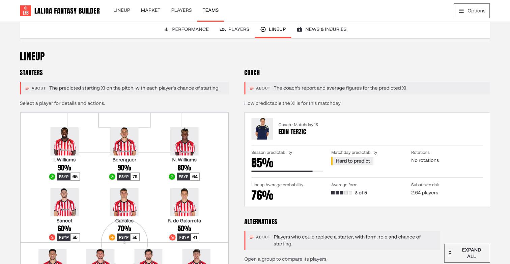

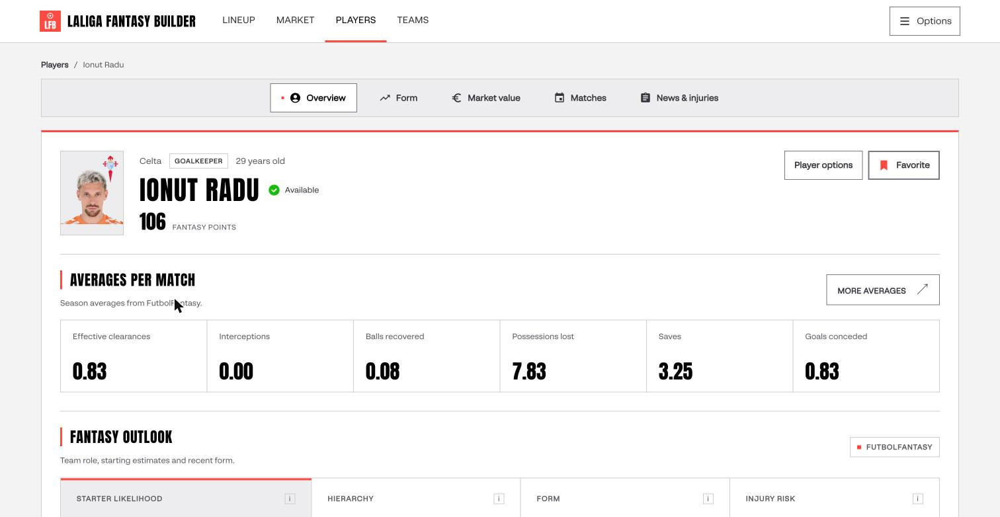

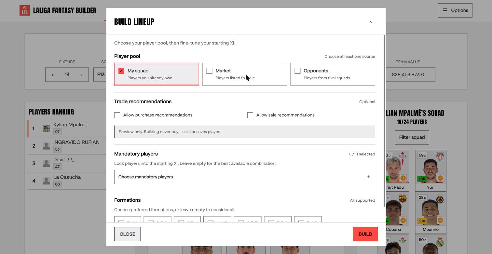

### Dark theme

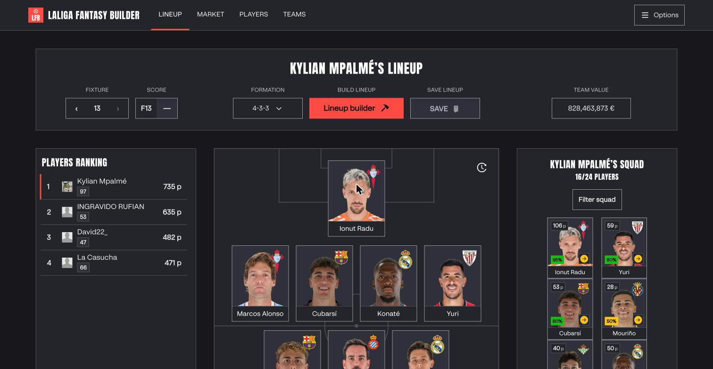

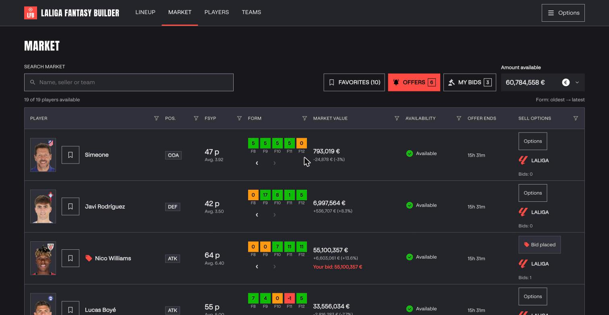

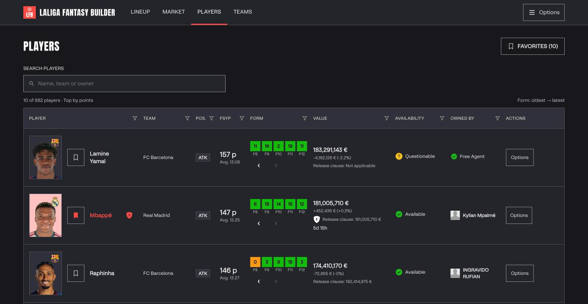

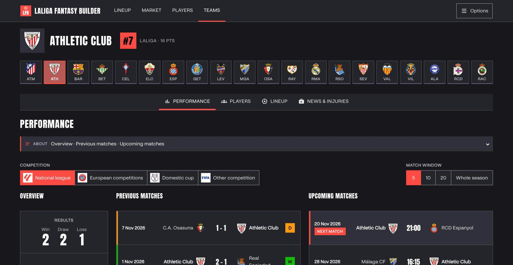

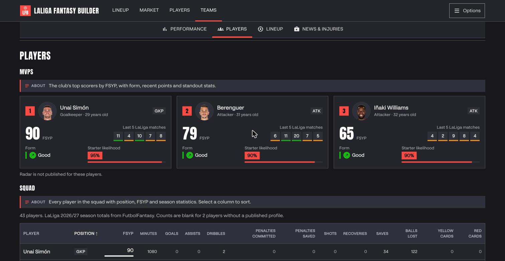

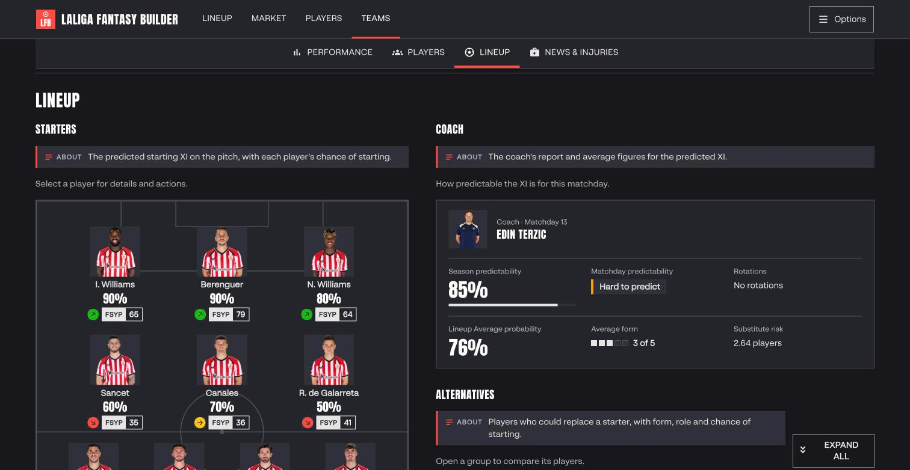

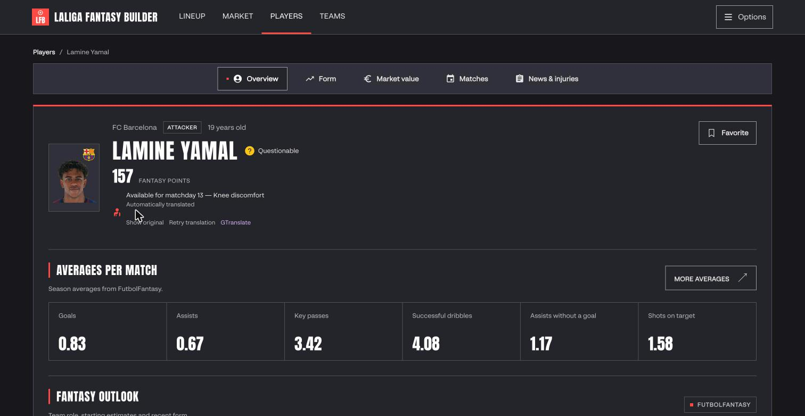

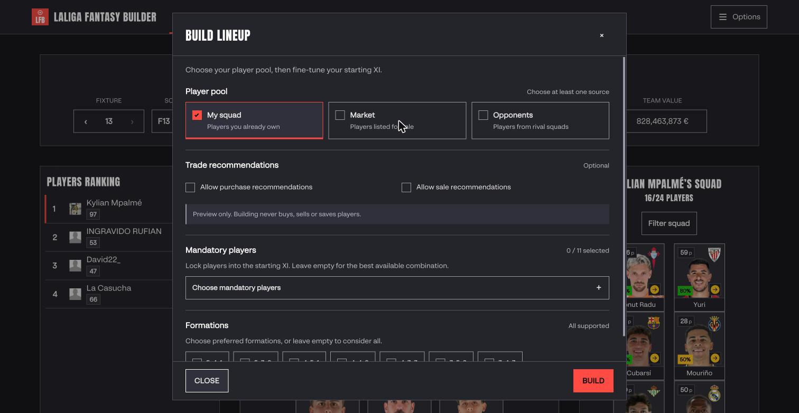

## Quick start

Create the ignored root `.env` from `.env.template` and set its
`SMTP_PASSWORD` to a Resend sending API key. Then `poe up` creates any missing
service env files and starts identity, Postgres, Redis, LaLiga auth, API,
scraping and the frontend:

```bash
test -f .env || cp .env.template .env
uv run poe install
uv run poe up
```

- App: http://localhost:3000 — register a new account; no shared demo password.
- Verification and recovery emails arrive in each user's own inbox through Resend.
- API docs: http://localhost:8001/docs.
- Scraping health: http://localhost:8002/health/live.

LaLiga linking offers the methods enabled by the server: an approved browser
callback, optional [manual desktop pairing](docs/authentication/manual-browser-pairing.md),
or the guided macOS helper described in the [auth setup](backend/auth/README.md).
Manual pairing and helper advertising are disabled by default until their release
checks pass. The helper runs with `./scripts/connect-laliga.sh` for cloud accounts.

Configure Google/Facebook/Apple credentials in `backend/identity/.env`.
Apple needs an HTTPS domain. Production configuration, provider setup and release
checks: [identity](backend/identity/README.md) and
[release checks](docs/authentication/release-checks.md). Persistent LaLiga storage
requires `USE_MEMORY_STORE=false` and a stable vault key; identity always uses Postgres.

**Services on the host (Vite HMR):**

```bash
docker compose up -d postgres redis
uv run poe dev-clean
```

`dev-clean` stops Compose app containers and stale project Uvicorn servers,
then starts auth (`:8000`), API (`:8001`), scraping (`:8002`), identity (`:8003`), and Vite
(`:3000`) with reload enabled, plus the scouting worker (no listening port).
It reports occupied ports owned by other processes instead of stopping them. The command creates missing service
`.env` files. Set `SCRAPER_CONTACT` in `backend/scraping/.env` to a contact
address before using the scraper against FutbolFantasy. Scraping API calls use
the shared token in `backend/scraping/.env`; the command passes it to the API
automatically. It also prepares missing local scouting settings with a shared token
and provisions the default Compose application database without replacing existing
credentials or data.

From `frontend/` only: `bun install && bun run dev:all` (or `npm`).

Per-service notes: [auth](backend/auth/README.md), [API](backend/api/README.md),
[scraping](backend/scraping/README.md) (`fantasy-scraper`, `fantasy-parse`).

## Repository

| Path | Role |
|------|------|
| [`frontend/`](frontend/) | React lineup, market, players, and player-detail UI |
| [`backend/identity/`](backend/identity/) | Better Auth identity and application JWTs |
| [`backend/auth/`](backend/auth/) | LaLiga pairing and encrypted vault |
| [`backend/api/`](backend/api/) | Fantasy proxy routes and CLIs |
| [`backend/scraping/`](backend/scraping/) | FutbolFantasy scraper + parser (port 8002, private) |
| [`docs/`](docs/) | Architecture, authentication, API domain guides |
| [`docker/`](docker/) | Identity, vault and app database initialization, HTTPS ingress, OTEL collector |
| [`assets/`](assets/) | Sample Fantasy JSON trees |

## Tests

```bash
uv run poe test
```

Frontend only: `cd frontend && bun run test`. Hooks lint (also a pre-commit and CI step):
`cd frontend && bun run lint`.

## Read-only lineup builder

See the [lineup builder guide](docs/api/lineup-builder.md) for the authenticated planning POST, CLI,
browser-session flow, source restrictions and optional explanation configuration.

## Infrastructure upgrade for favorites

The API and `scouting-worker` now share a third logical PostgreSQL database,
`fantasy_app`, owned by `fantasy_api`. The worker uses the existing API image;
there are still five application images. It exposes no HTTP port. Auth retains
revocable league grants and encrypted credentials in its own database.

Fresh Compose volumes provision all three databases. Existing volumes need
explicit app database provisioning; rerunning the init script or changing dotenv
passwords does not upgrade them. Host `poe dev` / `poe dev-clean` prepares the
default local Compose database; custom database URLs need separate provisioning.

For production, configure `APP_DB_PASSWORD` and `SCOUTING_SERVICE_TOKEN` in the
runtime secret before deploying. The production Compose template wires the app
connection and matching worker token to the required services. Backups now contain
three dumps and a completion manifest. Follow the
[deployment upgrade checklist](infra/gcp/README.md#upgrading-an-existing-installation-for-scouting)
and [storage/recovery contract](docs/api/scouting/README.md#storage-and-operation).
CI updates image references only; it does not provision the database, add missing
secrets, or refresh installed host scripts.
