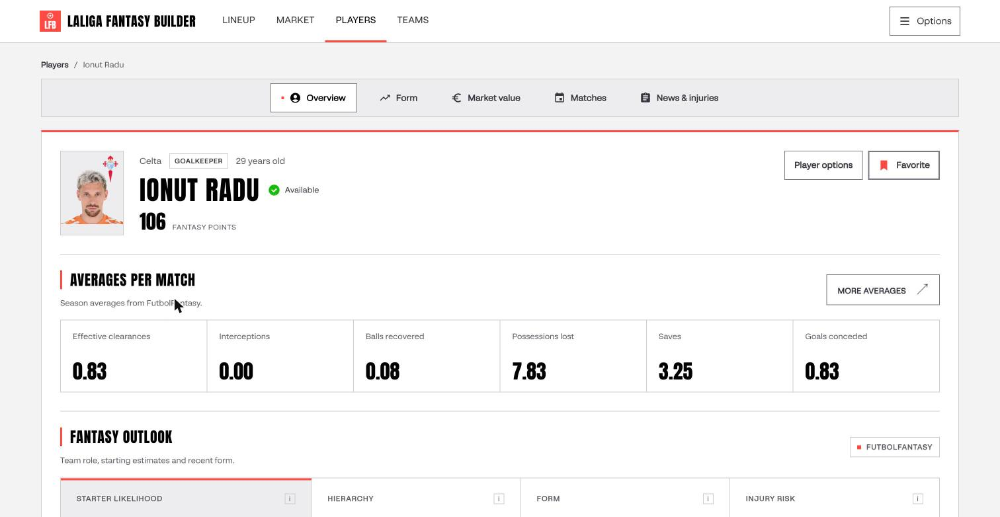
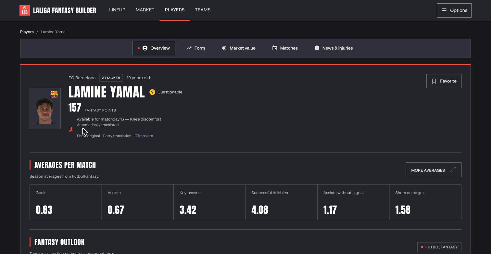

# Players API

Catalog and market value are **public**; the league card is authenticated
(JWT + LaLiga bearer). To add a route, follow
[Adding endpoints](../adding-endpoints.md).

Segmented player stats (FutbolFantasy via the scraping service, LaLiga catalog
and market history, optional OpenWeather) live under `/players/{player_id}/stats/*`.
The UI should prefer **`/stats/detail`** over client-side `--segment all`.
See the [scraping service](../../scraping/README.md) for scraper behavior.

The live [catalog](../../frontend.md#product-captures) and player profiles were
captured in both themes on 27 October 2026. The light profile shows Ionut Radu;
the dark profile shows Lamine Yamal.





## Routes

| Method | Path | Upstream | Auth | Response model |
|--------|------|----------|------|----------------|
| `GET` | `/players` | `{CMP}/players` | None | `list[CatalogPlayer]` |
| `GET` | `/players/{player_id}/market-value` | `{CMP}/player/{id}/market-value` | None | `list[PlayerMarketValue]` |
| `GET` | `/players/{player_id}/league/{league_id}` | `{CMP}/player/{id}/league/{leagueId}` | Internal JWT | `LeaguePlayer` |
| `GET` | `/players/{player_id}/stats` | Catalog (+ config probe) | Internal JWT | `PlayerStatsIndex` |
| `GET` | `/players/{player_id}/stats/fixtures` | Catalog, scraping, calendar | Internal JWT | `PlayerFixtureStatsResponse` |
| `GET` | `/players/{player_id}/stats/market` | `{CMP}/player/{id}/market-value` | Internal JWT | `PlayerMarketResponse` |
| `GET` | `/players/{player_id}/stats/matches/recent` | Scraping, calendar | Internal JWT | `RecentMatchesResponse` |
| `GET` | `/players/{player_id}/stats/matches/upcoming` | Scraping, calendar, OpenWeather | Internal JWT | `UpcomingMatchesResponse` |
| `GET` | `/players/{player_id}/stats/profile` | Scraping, catalog | Internal JWT | `PlayerProfileResponse` |
| `GET` | `/players/{player_id}/stats/radar` | Configured snapshots; optional private DataMB adapter | Internal JWT, no LaLiga bearer | `RadarResponse` |
| `GET` | `/players/{player_id}/stats/detail` | Aggregate of stats segments | Internal JWT | `PlayerDetailResponse` |

The detail route returns fixtures, market, recent and upcoming matches, and
profile in one round trip. Individual segment routes remain for direct access
and CLI `--segment all` (sequential). A **200** response can include
`segment_errors` when one or more segments failed or were disabled; auth and
catalog failures still use 401 and 404. Query defaults: `last=5`, `limit=5`,
`preset=season` (when `from`/`to` are omitted), all segments in `include`.
The `competition` query parameter can be repeated to filter fixture stats by
competition (for example, `competition=laliga`). It filters the `fixtures`
segment only; recent and upcoming match segments remain unfiltered.
A missing OpenWeather key still returns upcoming matches; weather on those
rows is disabled.

Player matches and the [calendar weather aggregate](../calendar/README.md#optional-stadium-weather)
share provider caching and forecast-slot selection. Existing player response
fields and unavailable reasons remain unchanged. Missing temperatures do not
become 0°C; out-of-window or past kickoffs skip unnecessary forecast calls.

### Detail aggregate behaviour

- **`profile.birth_date`** is the optional FutbolFantasy birth date. The player
  overview calculates completed years using the current date in Europe/Madrid
  and omits age when the birth date is unavailable.

- **`segment_errors`**: only segments that failed upstream or were skipped
  because scraping is disabled (`SCRAPING_BASE_URL` unset). **`market` is never
  disabled.** **`upcoming` is not disabled** for a missing OpenWeather key.
- Typical **`SegmentError.code`** values: `disabled`, `scraping_unavailable`,
  `stats_source_not_found`, `player_alias_unavailable` (the known master player
  ID has no verified profile route), `stats_not_applicable` (coach entries have no
  player profile on the scraping source), `scraping_error`, and other
  `UpstreamError.category` strings from the segment that failed. **`detail`**
  is a fixed, sanitised message (never raw upstream bodies).
- When the public player catalog omits a club name, stats resolution looks up
  its `teamId` in the cached teams-master directory and uses that name to
  disambiguate short or shared player nicknames.
- **`profile.averages`** lists per-match figures derived from the scraped
  season totals (`seasonStats`) divided by matches played, including saves and
  goals conceded for goalkeepers. A missing code is `value: null`. The player
  detail screen fills supported missing values from the catalog's recent
  `lastStats` matchweeks and labels those shorter Fantasy samples separately.
- **`profile.form`** carries a published numeric value when available, or an
  arrow rating (`very_bad`, `bad`, `mid`, `good`, `very_good`) from FutbolFantasy's form
  widget. Arrow ratings have `visual_only: true` and no numeric value.
  **`profile.start_probability`** carries the published
  percentage and matchweek.
- The profile screen builds its per-match average table from `profile.averages`
  and fills missing supported metrics from the player's LaLiga Fantasy
  `lastStats` catalog data. The fallback averages count only played weeks and
  report their source and sample size in the UI; they do not change the API's
  scraped average values.
- **Fixture-point provenance:** each `StatValue` keeps published Fantasy and
  DAZN values separate. When a published Fantasy value is unavailable, the API
  may calculate it from the official scoring rules using the player's position,
  minutes and observed stat counts; this has
  `source: "computed_official"`. `null` means that the source did not publish
  a value; it is never silently converted to zero. Computed values are returned
  only when their explained action total, either alone or together with DAZN,
  agrees with the match total. Otherwise the API retains the unavailable value
  and adds a `computed_points_mismatch` warning.
- Availability is available as `injury.availability_text` and in the
  structured `profile.availability` field.

Models: `fantasy_api.schemas.players` (catalog/league card) and
`fantasy_api.schemas.player_stats` (stats segments). Catalog `weekPoints` stays
an explicit recursive JSON value (upstream uses week objects; league rosters use a scalar).
Pydantic validates player and stats payloads, including query bounds; frontend API
responses and query inputs use camelCase Zod contracts before entering UI state.

## Identifiers

| Id | Source |
|----|--------|
| `playerId` | Master footballer id from `GET /players` (`id`) |
| `playerTeamId` | Squad entry id on league cards / lineup (not master `playerId`) |
| `leagueId` | `GET /leagues` (`id`) |

## Notes

- Public reads send no `Authorization` upstream; a header on those routes is
  ignored.
- League-card path ids are master `playerId` even when the body embeds
  `playerTeamId`, buyout, shield, or market blocks. Paying or raising a
  clause and checking or activating a shield use
  [Buyout](../buyout/README.md), keyed by `playerTeamId`.

```bash
cd backend/api
uv run fantasy-players
uv run fantasy-players --player-id 7 --league-id 42 --jwt "$INTERNAL_JWT"
uv run fantasy-player-stats --player-id 4288 --segment index --jwt "$INTERNAL_JWT"
uv run fantasy-player-stats --player-id 4288 --segment detail --jwt "$INTERNAL_JWT"
```

Catalog `teamId` accepts an integer or a decimal-digit string; malformed values
produce a sanitized 502, with the resolver retaining its bounded stale-cache fallback.
League cards validate known manager, market and master-player nested fields.
Statistics validate `TeamsMasterRow` and `MarketHistoryPoint` provider DTOs before
club lookup and history normalization; malformed samples fail the market segment.
The frontend validates all stats query bounds and date-window combinations before
fetch, including repeated `include` segments on the detail endpoint.

Builder profile facts preserve structured availability, official season total and
played-match denominator, and parsed injury-history coverage. A missing official
points block remains unavailable instead of its parser placeholder zeros.

Fixture references in fixture stats, recent and upcoming matches preserve optional
`home_badge`, `away_badge`, `opponent_badge` and `competition_badge` URLs published
by the scraping source. These fields can be null for missing images or unknown
sides; callers should retain catalog/local fallbacks. No image fetching proxy is
introduced. See [badge sources](../../frontend-club-crest-sources.md).

## Role-specific performance radar

The active local 2026/27 dataset covers all current LaLiga clubs and serves only
reviewed La Liga observations with verified minutes, without a minimum-minute
cutoff. Inactive/historical catalog entries, other competitions and older seasons are excluded by a
hash-bound publication policy; unknown minutes are not treated as zero.
The 26 observations formerly excluded by the 300-minute cutoff are now served.
This selection does not establish a native percentile population or enable comparisons. See the
[league-wide discovery and weekly runbook](../../scraping/radar-laliga-2026-27.md)
for coverage, pending identities and the local Wednesday recurrence.

`GET /players/{player_id}/stats/radar?season=2026-27` is an independent optional
segment, authenticated with the application JWT **without LaLiga pairing**.
It follows controller → radar service → radar repository. It is deliberately not
added to `stats/detail`, so source failures never delay the existing aggregate.

| Query | Meaning |
| --- | --- |
| `season` | Required canonical consecutive season, for example `2026-27` |
| `profile` | Optional versioned profile: `defense_progression_v1`, `defense_fullback_v1`, `goalkeeper_v1`, `attacker_finishing_v1`, `attacker_winger_v1`, `midfielder_v1` |
| `compare_player_id` | Optional different master player ID; comparison is checked on the server |

The response is `RadarResponse`: available seasons, ordered profiles, complete
seven-axis views, known compatible player choices, and optional comparison.
A player with no configured data returns `status: unavailable`, a reason, and
`radars: []`; imported examples are never substituted for the requested player.
Invalid configured or upstream structures return sanitized 502 errors.
A failed comparator preserves the primary radar and supplies `comparison_reason`.
Unknown populations, incomplete metrics and insufficient documented minutes have
no comparison key. Same position alone does not establish compatibility.

Configure `RADAR_DATASET_ROOT` to read immutable publications. GET never accesses
DataMB. `RADAR_STORE_PATH` is retired and a nonempty value fails startup with a
migration message. Import snapshots through the reviewed ingestion pipeline;
then validate, publish and point the API at the release directory.

An imported snapshot has this structure (ID `1` is illustrative; replace it with
a verified Fantasy master ID before use):

```json
{
  "snapshots": [{
    "player_id": "1", "player": "Reviewed player", "club": "Reviewed club",
    "age": 23, "season": "2026-27", "competition": "laliga",
    "period": "league season", "minutes": 769, "profile": "midfielder_v1",
    "source": "imported", "method": "published_percentile",
    "recipe_version": "reviewed-import-v1", "snapshot_id": "reviewed-capture-1",
    "fetched_at": "2026-11-01T12:00:00Z", "cohort": null,
    "percentiles": {
      "duel_win_pct": 44.3, "possessions_won_p90": 55.7,
      "progressive_carries_p90": 63.9, "forward_passes_completed_p90": 87.9,
      "forward_pass_completion_pct": 59.4, "key_passes_p90": 84.8,
      "progressive_passes_p90": 97.1
    },
    "warnings": ["Illustrative import; verify identity and population."]
  }],
  "datamb_mappings": []
}
```

Supply `cohort` only when verified: `id`, `label`, `reference_snapshot`,
`eligibility`, optional `size` and `minimum_minutes`. Its scope must include the
actual source population, position and season. A cohort does not become LaLiga
merely because the player plays there. Changing definitions, source recipe,
population reference or period invalidates comparison compatibility.

DataMB acquisition runs only through reviewed identity records and supply audits
in `fantasy-radar-sync`. Configure the private scraping service there; mappings
in read stores are rejected, including in legacy releases.

The reviewed DataMB adapter validates identity, source position, labels and
season. A source profile is current-season data, not a historical API: a season
mismatch fails explicitly. HTTP availability, reuse conditions and remaining
position coverage still require verification before enabling ingestion.
No request-time percentile computation or automatic cross-provider fallback is
implemented. Application-calculated percentiles can be imported with an explicit
recipe/population only after the required population dataset is validated.

```bash
cd backend/api
uv run fantasy-player-stats --player-id 1 --segment radar --season 2026-27 --json
uv run fantasy-player-stats --player-id 1 --segment radar --season 2026-27 \
  --profile midfielder_v1 --compare-player-id 2 --json
```

The CLI uses shared automated application login/JWT handling. Invalid radar
selections fail before login. `--segment all` retains its existing scope.

### Published catalog coverage

Set `RADAR_DATASET_ROOT` to the durable publisher root to serve immutable local
releases. The retired `RADAR_STORE_PATH` setting must be unset.
A request pins `current.json` once: primary values, coverage and comparison all
come from that release. Published reads never contact scraping or LaLiga.
The persistent comparison index survives worker restarts and previous visits.

`RadarResponse` additionally returns `default_profile` and optional `coverage`:
identity state, data state, stable `reason_code`, available profiles, per-profile
errors, last attempt/success, dataset/catalog IDs and freshness. Product clients
translate reason codes; they should not render raw operator/provider errors.
Unknown IDs/coaches return `out_of_scope`; an unpublished season returns
`season_unavailable` without silently replacing it. An invalid release remains
an operational 502. One failed role does not remove another valid role.

Published freshness is configurable with `RADAR_STALE_DAYS=8` and
`RADAR_MAXIMUM_DAYS=30`. Expiration is checked again on reads, even if the job
stopped running. Expired observations remain archived on disk; they are excluded
from active radars and comparison candidates. Reads never renew a source date.
All API reads use the configured publication freshness thresholds.
`compatible_players` now includes the snapshot club for understandable searching.
