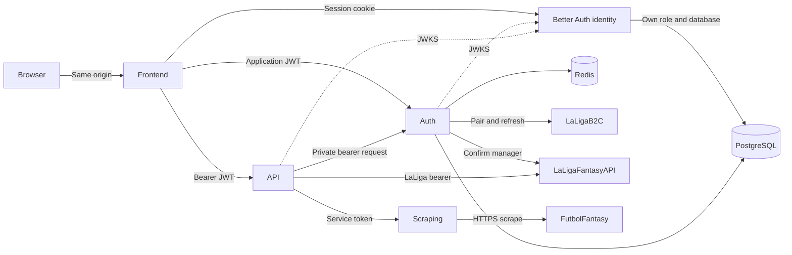
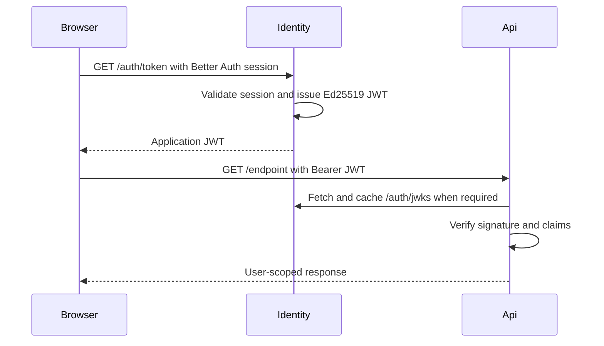
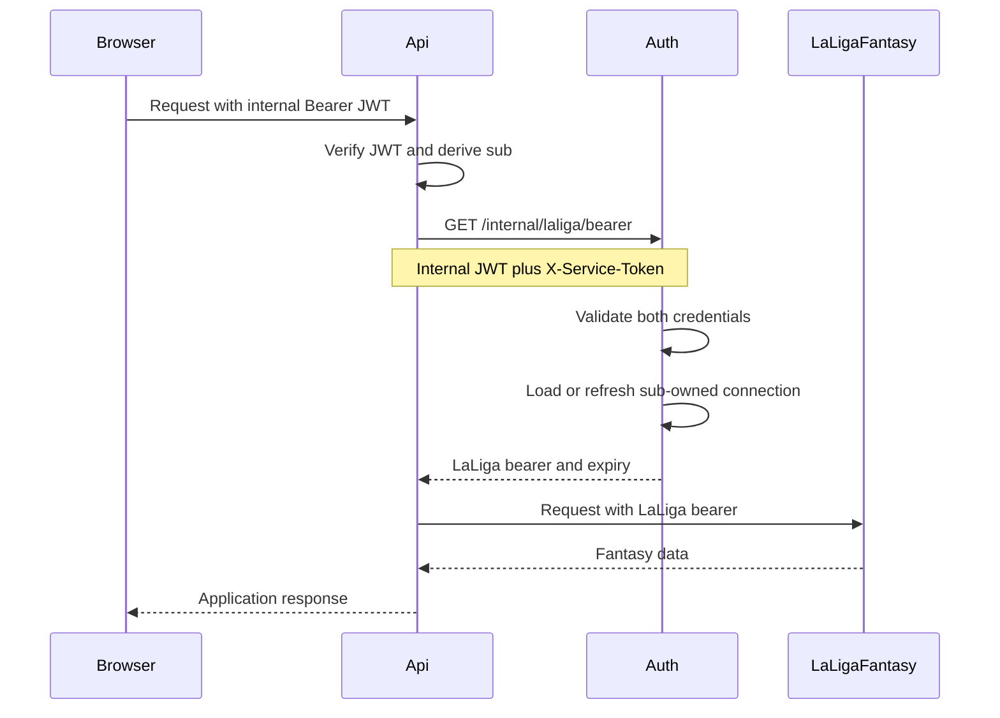

# Architecture

How to run the stack is in the [root README](../README.md). This page is the
map of what each part owns.

## Repository layout

```text
frontend/          React app — lineup, market, and player profiles (Bun, Vite). Nginx in Docker.
backend/auth/      LaLiga pairing, vault and refresh
backend/identity/  Better Auth sessions, credentials, providers, application JWTs
backend/api/       Fantasy features. Calls LaLiga with a bearer from auth
backend/scraping/  Private scraper + parser on port 8002 (`internal` + `egress`)
docker/            Identity database setup, HTTPS ingress and OTEL collector config
```

Identity always uses PostgreSQL with its own role/database. The vault uses Postgres
and Redis when `USE_MEMORY_STORE=false`. OpenTelemetry is optional.

Nginx/Vite proxy `/auth` to identity, `/laliga` to Python auth and `/api` to the API.
The browser uses one origin and keeps its application JWT only in memory.

## System context



For native helper pairing, the user's Mac exchanges the initial authorization
code with LaLiga using PKCE, then sends the transient token bundle to Auth over
HTTPS. Auth verifies the challenge, profile, and immutable application owner
before sealing credentials. The browser and Fantasy API receive no LaLiga token.

## Browser login

Better Auth owns application identity. Its React client uses `/auth` on the shared
frontend origin for Google/Facebook/Apple and verified username/email credentials.
The JWT plugin issues short-lived Ed25519 tokens used by both Python services.
LaLiga is an independent delegated connection. `POST /laliga/login` requires a JWT
and returns an authorization URL only when a registered HTTPS callback is configured.
`GET /laliga/callback` consumes an independent one-time state/nonce/PKCE challenge.
The native CLI uses its separate registered custom-scheme callback. See
[Authentication](authentication/authentication.md).

## Service responsibilities

### Frontend

`frontend/` is the browser app (lineup at `/`, market at `/market`, player
catalog at `/players`, and player profiles at `/players/:playerId`). It signs
in through auth, keeps the internal JWT in memory, and calls the API for
leagues, standings, lineups, squads, player data, and market/buyout actions.
Market bids and release-clause payment are user-confirmed in the UI only; CLIs
stay read-only. It does not call LaLiga directly or persist tokens. Detail:
[Frontend](frontend.md).

In Docker, Nginx on port 3000 serves the built app and proxies `/auth`,
`/laliga`, and `/api`. `bun run dev` does the same proxy for local UI work.

### Auth BFF

`backend/auth` is the security boundary and owns:

- Better Auth JWT verification from a configured JWKS;
- independent native pairing challenge persistence;
- LaLiga pairing and ownership confirmation;
- LaLiga access and refresh tokens;
- AES-GCM vault encryption;
- token refresh and `needs_reauth` state;
- the private credential endpoint.

Auth follows a ports-and-adapters structure:

```text
api/          HTTP routes and request dependencies
application/  Pairing and credential use cases
domain/       Users, tokens, and errors
ports/        Storage, identity, vault, and client protocols
adapters/     HTTP, JWKS, JWT, Postgres, Redis, and AES-GCM implementations
```

### Fantasy API

`backend/api` owns application features and:

- validates Better Auth-issued application JWTs using identity JWKS;
- derives the current user exclusively from the verified `sub`;
- requests short-lived LaLiga bearers through the private auth interface;
- calls LaLiga Fantasy on behalf of that verified user;
- maps auth and upstream failures into stable API errors;
- exposes OpenAPI/Swagger from committed `backend/api/openapi.json`.

Player stats are aggregated by `PlayerStatsService`: catalog data and recent
Fantasy matchweek statistics come from LaLiga Fantasy, while profile and
fixture segments can use the private FutbolFantasy scraping service. Partial
segment failures are returned as sanitized `segment_errors` by the detail
aggregate; the browser never receives scraped HTML.

The API does not open encrypted credentials, refresh LaLiga tokens, or accept
auth session cookies.

#### Module layout

```text
backend/api/src/fantasy_api/
├── api/              # FastAPI controllers (leagues, teams, players, calendar, market, buyout, me)
├── services/         # JWT → LaLiga bearer → repository orchestration
├── repositories/     # Upstream path construction (per domain)
├── clients/          # AuthCredentialsClient, LaligaFantasyClient
├── schemas/          # Pydantic models (OpenAPI source)
├── domain/           # AppUser, UpstreamError, …
├── security/         # Internal JWT validation
├── openapi.py        # OpenAPI generation and ERROR_RESPONSES
└── cli/              # fantasy-leagues, fantasy-teams, fantasy-players, fantasy-calendar, fantasy-market, fantasy-buyout
```

Process-lifetime wiring lives in `api/deps.py` (`AppContainer`): one shared
`LaligaFantasyClient` and `AuthCredentialsClient` per worker, closed on
shutdown.

#### LaLiga proxy domains

LaLiga-backed features follow the same **controller → service → repository →
client** (CRS) stack. Each domain gets its own service and repository; they
do not share a generic proxy class.

| Domain | Public prefix | Upstream prefix | Methods |
|--------|---------------|-----------------|---------|
| Leagues | `/leagues/...` | `{CMP}/leagues/...` | GET (reads) |
| Lineup builder | `/lineup-builder/leagues/{league_id}/build` and `/build/stream` | Existing read-only services | POST planning only; JSON or request-scoped progress stream; JWT membership verified |
| Teams | `/teams/...` | `{CMP}/teams/...` | GET + PUT (lineup write) |
| Players | `/players/...` | `{CMP}/players`, `{CMP}/player/...` | GET (catalog + market value public; league card and stats authenticated) |
| Calendar | `/calendar/...` | `{CMP}/week/...`, `{CMP}/calendar`, stats host; optional OpenWeather | GET (internal JWT; public Fantasy reads; per-match optional stadium forecasts) |
| Standings | `/competitions/{id}/standings` | Public Fantasy calendar + teams-master; private official LaLiga scraper | GET (internal JWT; completed only) |
| Market | `/market/...` | `{CMP}/league/{leagueId}/market/...` | GET + POST/PUT/DELETE (reads High; mutations Medium) |
| Buyout | `/buyout/...` | `{CMP}/league/{leagueId}/buyout/...`, `.../player-team/.../check-shield`, `.../shield/player` | GET + POST/PUT (Medium) |

`{CMP}` = `{LALIGA_FANTASY_ORIGIN}/api/v1/competition/{LALIGA_COMPETITION_ID}`.

Guides: [Adding endpoints](api/adding-endpoints.md),
[feature READMEs](api/README.md),
[Proxy endpoint pitfalls](api/proxy-endpoint-pitfalls.md).

Feature notes for every domain: [API documentation](api/README.md).

#### Shared proxy building blocks

Cross-domain helpers (extend these rather than duplicating logic):

| Module | Role |
|--------|------|
| `services/laliga.py` | `with_laliga_bearer(credentials, jwt, repo_method, …)` |
| `repositories/paths.py` | Percent-encode path segments; build `{CMP}/…` paths |
| `schemas/payload.py` | `as_object`, `as_object_list`, `as_market_snapshot` — fail on unexpected JSON shape |
| `api/payload.py` | Map parser `ValueError` → `UpstreamError` (502) |
| `clients/laliga_fantasy.py` | GET/PUT/POST/DELETE; JSON errors → `UpstreamError` |
| `schemas/common.FlexibleModel` | Read models with `extra="allow"` for upstream passthrough |

Write routes use **separate** request models (`extra="forbid"`, required fields
for full-replace upstream semantics). Read routes must not silently coerce bad
upstream JSON into empty `{}` or `[]` — see the pitfalls doc.

#### Helper CLIs

`fantasy-leagues`, `fantasy-teams`, `fantasy-players`, `fantasy-calendar`,
`fantasy-market`, and `fantasy-buyout`
are not part of the runtime API. They accept `--jwt` / `INTERNAL_JWT` and call
local API routes (players public reads need no JWT). Shared flags live in
`cli/common.py`; interactive Better Auth login is provided by the browser helper.

Interactive login: `fantasy-browser-session` in `backend/auth`.

`fantasy-standings` and `fantasy-browser-session standings-analysis` fetch real
club classification through the API without LaLiga pairing. The default source
computes totals and form from all 38 public Fantasy calendar weeks (four concurrent
reads) and reconciles them with the private official LaLiga classification scraper.
Official positions and adjusted points are preserved. Public reads use no LaLiga
bearer; the scraper requires its service token and holds no LaLiga credentials.
Each successful snapshot is cached for one hour. The optional `api-football` source
uses a server-side key with current-season entitlement. Live mode returns 503.
See [Standings API](api/standings/README.md).

## Trust boundaries

### Public browser-to-auth boundary

Identity owns `/auth/*` cookies and uses Better Auth origin/CSRF protections.
Python `/laliga/*` reads, starts, and deletes require a verified application Bearer
JWT. Native/helper completion instead requires a one-time pairing challenge.

### Public browser-to-API boundary

API routes accept an internal Bearer JWT. They do not accept auth cookies.
Because authentication is in the `Authorization` header rather than ambient
cookies, API routes do not use the auth service's CSRF mechanism.

### Private API-to-auth boundary

The private credential route requires:

1. an internal JWT that identifies the application user;
2. `X-Service-Token`, supplied only by the API;
3. network isolation for `/internal/*`.

The internal JWT prevents the API from selecting an arbitrary user. The
service token and private network prevent browsers from using the credential
route directly.

### Private API-to-scraping boundary

The API receives `SCRAPING_BASE_URL` (`http://scraping:8002` on Compose) and a
separate `SCRAPING_SERVICE_TOKEN`. The scraping process is on the `internal`
network and on `egress` (outbound internet). It is not on `public`. Host port
8002 is published for local Compose only.

The scraper resolves player names (sitemap + Hamming/Levenshtein), downloads
FutbolFantasy pages with caching and rate limits, and serves parsed player
profile data to the API. The parser extracts profile form ratings and starter
probability as well as other player status fields. `/internal/scrape/*`
requires `X-Service-Token`. The parser in the same image turns `ScrapedPage`
HTML into JSON/Markdown (`fantasy-parse` or `ParserService`). Uvicorn runs a
**single worker** so the in-process limiter matches deployment. Detail:
[Scraping](scraping/README.md).

### Auth-to-LaLiga boundary

Only auth communicates with LaLiga B2C for pairing and refresh. Both auth and
API may call LaLiga Fantasy, but the API gets only the current short-lived
bearer required for that call.

## Main request flows

### Authenticated application request



### LaLiga-backed application request



### LaLiga pairing inside auth

After the browser hop above, auth exchanges the authorization code, verifies
the LaLiga JWT, confirms the manager with `GET /api/v4/user/me`, and seals
the token bundle. The helper and the CLI complete route receive a public
profile only. `POST /laliga/pairings` remains for those developer CLIs.

## Persistence and lifecycle

Memory adapters are intended for tests and local development.

With `USE_MEMORY_STORE=false`:

- separate PostgreSQL databases/roles store identity sessions/keys and LaLiga
  pairing challenges/connections;
- pairing consumption is an atomic database update;
- connection token bundles are encrypted before persistence;
- Redis stores distributed rate-limit windows; PostgreSQL advisory locks serialize
  refresh, pairing completion, cancellation and unlink for each owner;
- startup validates required secrets and connectivity;
- migrations can be applied under a PostgreSQL advisory lock;
- readiness checks verify PostgreSQL and Redis;
- shutdown closes both clients.

The deterministic development vault key is not a production feature. Production
requires a configured vault key; only identity owns application signing keys.

## Error model

Auth produces stable categories:

- `unauthorized`: missing or invalid application JWT/service credential;
- `needs_reauth`: LaLiga connection is absent or cannot refresh;
- `forbidden`: ownership violation;
- `jwt_invalid` or validation categories: invalid signed token;
- pairing categories such as replay, expiry, or rate limit;
- provider categories without leaking upstream response bodies.

The API maps outcomes through `fantasy_api.domain.errors` and global handlers
in `main.py`. Responses use a stable `{ "error", "detail" }` body; upstream
Fantasy or auth bodies are never forwarded verbatim.

| API `error` | Typical cause | HTTP |
|-------------|---------------|------|
| `unauthorized` | Missing/invalid internal JWT | 401 |
| `needs_reauth` | No LaLiga connection or refresh failed | 401 |
| `fantasy_unauthorized` | Fantasy rejected the bearer | 401 |
| `fantasy_error` | Fantasy non-2xx, non-JSON body, or unexpected payload shape | 502 / forwarded status (e.g. 503) |

Validation errors on request bodies (unknown JSON keys, missing required write
fields) return **422** before any upstream call.

Resource ownership for mutations (e.g. which `team_id` a JWT may update) is
enforced by LaLiga Fantasy unless the feature docs state an explicit API-side
check. Clients should obtain ids from authenticated list routes (e.g.
`GET /leagues`).

## Quality gates and OpenAPI

Local and CI checks keep the monorepo consistent:

- **Pre-commit** (repo root): ruff, black, OpenAPI and endpoint-schema
  regeneration when API routes/schemas change, pytest with ≥90% coverage on
  `backend/auth` and `backend/api`, and ≥80% on the FutbolFantasy parser in
  `backend/scraping`.
- **GitHub Actions** (`.github/workflows/ci.yml`): same lint and test pipeline
  on push to `main` and on pull requests.

OpenAPI is generated from route `response_model`, `ERROR_RESPONSES`, and
Pydantic schemas (`fantasy_api.openapi.build_openapi_schema`). The committed
`backend/api/openapi.json` and generated
[`docs/api/endpoint-schemas.md`](api/endpoint-schemas.md) must match the
generators before merge. See [OpenAPI / Swagger](api/openapi.md).

## Deployment constraints

Run commands live in the [root README](../README.md).

- Auth, API, scraping, and frontend each have their own image. Python services use
  `python:3.14-slim-trixie` with uv only in the builder. The frontend image
  builds with Bun and serves static files plus `/auth`, `/laliga`, and `/api`
  proxies from Nginx.
- Compose profile `apps` runs identity, auth, API, scraping and frontend, with
  PostgreSQL and Redis. Identity sends email through configured SMTP. `full` adds OTEL.
  Identity owns its own logical database and role.
- API and auth share a private network for `/internal/*`. Scraping joins that
  network and an `egress` network so a future downloader can reach the public
  internet without putting the API on egress.
- The Better Auth encryption secret, the vault key, and the service token belong in a secret
  manager, not source control.
- Auth and API must use the same internal JWT issuer and audience.
- `AUTH_JWKS_URL` must reach the identity `/auth/jwks` endpoint.
- Key rotation must keep old public keys until issued tokens expire.

## Lineup builder

The `/lineup-builder` domain requires JWT membership resolution and authenticated
roster/money/market reads. Its public calendar/stat reads remain bearer-free.
Controller → service → typed snapshot repository → existing services feeds a pure
scoring and bounded search engine. Recommendations never execute Fantasy writes.
See [lineup builder](api/lineup-builder.md).
