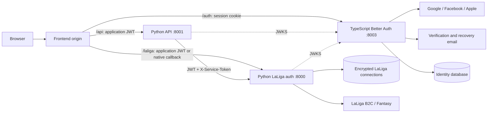

# Better Auth implementation plan

Status: proposed, 23 October 2026. Planning only; authentication has not changed.
Scope clarified on 24 October 2026: fully replace Keycloak and custom application
authentication with Better Auth's standard APIs and plugins.

Replace Keycloak and the custom application authentication implementation with
Better Auth. Support **Google, Facebook, Apple, and username/password**. For
password accounts, collect and verify an email address for recovery; also allow
email/password sign-in through the same credential account. Keep LaLiga delegation
as a separate connection owned by the authenticated application user.

## Framework ownership and mandatory removal gate

Better Auth becomes the sole application authentication authority. Its standard
provider integrations, credential authenticator, username plugin, session APIs,
account-linking APIs, recovery flows, and JWT plugin own these behaviors. The
implementation must configure and consume those APIs rather than recreate the
existing Python authentication system behind new endpoint names.

Custom code is limited to application screens, email delivery, deployment wiring,
Python verification of framework-issued tokens, ownership migration, and LaLiga
delegation. The retained Python `backend/auth` service owns LaLiga pairing and
encrypted credentials; it no longer authenticates application passwords, manages
application sessions, performs application-provider login, or issues application
tokens. LaLiga's own identity provider remains an upstream dependency of pairing.

The migration is complete only after all of these checks pass:

- A clean install and normal startup support every requested sign-in method
  without a Keycloak container, realm import, configuration, credentials, or
  network request.
- Frontend and CLI application authentication use Better Auth's configured APIs.
  The old Python application login, callback, session, CSRF, and token-issuance
  implementations are removed from active code and routes.
- Keycloak-specific dependencies, environment examples, scripts, tests, CI,
  Compose wiring, and operational instructions are removed or updated. Historical
  migration documentation and inert archived backups may retain references.
- Both Python services verify Better Auth-issued tokens and reject old application
  credentials after the bounded migration window.
- Integration tests demonstrate each sign-in/recovery flow and LaLiga ownership
  through the new system. A final repository/reference audit accounts for every
  remaining Keycloak or legacy authentication reference.

Temporary legacy support exists only for migration and rollback. Removing it is
a required delivery task, not optional follow-up work.

## Current implementation and migration constraints

The current flow is documented in [Architecture](../architecture.md) and
[Authentication](authentication.md). These implementation points determine the work:

| Area | Current implementation | Migration consequence |
| --- | --- | --- |
| Application identity | Python `SessionService`, Keycloak OIDC, `fantasy_session` and `fantasy_csrf` cookies | Move login, credentials, sessions, verification, recovery, and logout into Better Auth. |
| API authentication | `POST /auth/token` issues an RS256 JWT; API validates auth's JWKS | Move issuance to Better Auth and update both Python token consumers. |
| LaLiga connection | Python pairing, B2C verification, AES-GCM vault, refresh locks | Retain these domain services and their private credential contract. |
| Native callback | `authredirect://com.lfp.laligafantasy`; callback state and PKCE secrets live in `SessionRecord` | Extract pending LaLiga browser challenges before removing application sessions. |
| Ownership | `connections.user_id` and `pairings.user_id` contain the old OIDC subject | Explicitly migrate ownership to the new application user ID. |
| Frontend | `AuthProvider`, `AuthClient`, memory JWT store, refresh timer, LaLiga connection gate | Adopt Better Auth's React session client and preserve application-specific connection state. |
| Developer tools | Keycloak form automation, session/CSRF exports, custom token response contracts | Replace login automation and update every token-exchange caller. |
| Local deployment | React/Vite static frontend; Python services; Postgres currently in `full` profile | Add a TypeScript auth runtime and make identity persistence available in normal app startup. |

Relevant code: [`api/auth.py`](../../backend/auth/src/fantasy_auth/api/auth.py),
[`api/pairings.py`](../../backend/auth/src/fantasy_auth/api/pairings.py),
[`ports/repos.py`](../../backend/auth/src/fantasy_auth/ports/repos.py),
[`InternalJwtValidator`](../../backend/api/src/fantasy_api/security/internal_jwt.py),
and [`AuthProvider`](../../frontend/src/auth/AuthProvider.tsx).

## Proposed architecture

Add `backend/identity/`, a TypeScript ESM service using Node and a small Express
adapter, on port **8003**. Use Bun for dependency installation, lockfiles, and
package scripts, consistent with the frontend. Pin a supported Node release and
the same stable Better Auth version on server and client. Better Auth documents
an Express handler that must be mounted before body parsing; there is no need to
convert the React/Vite app to a different frontend framework.
[Express integration](https://better-auth.com/docs/integrations/express).



Nginx and Vite route `/auth/*` to identity, `/laliga/*` to Python auth, and
`/api/*` to the API. Set Better Auth's `basePath` to `/auth`, avoiding a collision
with the existing `/api` proxy. The browser continues to use one origin.
`/internal/*` remains inaccessible through the public frontend.

Use PostgreSQL for identity, including local development. A separate logical
identity database and database role on the existing Postgres instance keep Better
Auth migrations independent of Python auth migrations. Unit tests can substitute
storage; disposable database fixtures cover integration tests. Better Auth
supports PostgreSQL directly and schema generation/migration.
[PostgreSQL adapter](https://better-auth.com/docs/adapters/postgresql).

## Authentication and account policy

### Sign-in methods

| Method | Implementation | Setup and acceptance requirements |
| --- | --- | --- |
| Google | Built-in `socialProviders.google` | Separate environment credentials; callback `/auth/callback/google`; minimal identity scopes; cancellation and denied-consent handling. |
| Facebook | Built-in `socialProviders.facebook` | App ID/secret, registered `/auth/callback/facebook`, required app configuration for public use; handle absent email without inventing a verified address. |
| Apple | Built-in `socialProviders.apple` | Service ID, Team ID, Key ID, private key, and renewable client-secret JWT; registered HTTPS `/auth/callback/apple`; preserve first-login profile and relay email behavior. |
| Username/password | `emailAndPassword` plus `username()` | Registration with name, unique normalized username, email and password; email verification, recovery, password change, and email/password alternative. |

Provider configuration follows the official
[Google](https://better-auth.com/docs/authentication/google),
[Facebook](https://better-auth.com/docs/authentication/facebook), and
[Apple](https://better-auth.com/docs/authentication/apple) guides. Apple needs an
HTTPS development/staging domain rather than a localhost return URL. Its signing
secret needs renewal, and its documented trusted-origin requirement must be added
alongside the application origin. Validate its callback and cookie behavior in a
real browser. Facebook can return no email; Apple returning users can omit profile
fields. Existing provider accounts must resolve by their stable provider account
identifier even when those fields are absent.

Use the framework's credential hashing and verification rather than retaining a
custom password store. Configure transactional email delivery, sender domain,
verification links, and reset links. Require verified email for credential login;
check this policy on the username path too. Password reset and verification tokens
must expire and be consumed once. Revoke other sessions after a password reset.
Use generic recovery responses, rate limits, and password-manager-compatible
forms. No Keycloak password or hash import is assumed.
[Email/password](https://better-auth.com/docs/authentication/email-password),
[username plugin](https://better-auth.com/docs/plugins/username).

### Identity and account linking

- Use the Better Auth application `user.id` as JWT `sub`. Provider IDs, usernames,
  emails, and LaLiga manager IDs are separate identifiers.
- Disable implicit same-email linking. Offer explicit provider linking from a
  recently authenticated account, with proof of the additional provider.
  Apple's relay address can differ from the account email; enable different-email
  linking only within that authenticated flow. Require a usable remaining login
  method before unlinking a provider.
- For a first-time social account with no usable email, use the pinned version's
  documented onboarding extension to collect and verify one before recovery or
  credential enrollment. Any internal placeholder must remain unverified and
  ineligible for mail delivery or identity matching. If that extension cannot be
  implemented safely, return an actionable missing-email error instead.
- Social-only accounts can add a password through verified recovery/enrollment;
  knowing an account's email must never be sufficient to attach credentials.
- Store provider credentials on the identity server, enabling OAuth-token
  encryption at rest. Disable unneeded browser-facing provider-token retrieval
  endpoints; the frontend needs the application JWT and public profile only.

Better Auth supports explicit account linking and configurable implicit linking.
Treat these as deliberate product settings rather than accepting defaults.
[Users and accounts](https://better-auth.com/docs/concepts/users-accounts),
[account options](https://better-auth.com/docs/reference/options).

### Sessions and API tokens

Use database-backed Better Auth sessions. Initially preserve the current one-day
session lifetime without silently adding sliding renewal, and keep session-cookie
caching disabled. Retain framework origin and CSRF protections, secure production
cookies, narrowly configured proxy trust, and exact trusted application origins.
Do not reuse the legacy double-submit CSRF contract on Better Auth endpoints.
[Session management](https://better-auth.com/docs/concepts/session-management),
[security](https://better-auth.com/docs/reference/security).

Use Better Auth's JWT plugin and React client plugin for application tokens:

- Explicit configured issuer, audience `fantasy-api`, 15-minute maximum lifetime,
  stable `sub`, and a minimal payload. Include only required public profile claims.
- Select EdDSA/Ed25519, the plugin's documented default; update the existing
  RS256-only Python validators explicitly. Prove compatibility with installed
  PyJWT/cryptography in the first integration stage.
- Fetch from `/auth/token`, which returns `{ token }`; adapt the frontend and CLI
  response contracts. Derive refresh scheduling from token expiry without using
  unverified decoded claims for authorization.
- Publish `/auth/jwks`, configure key rotation, and retain old verification keys
  beyond the maximum token lifetime plus clock skew. Both Python services use a
  configured, cached JWKS URL; never follow a token-supplied key URL.

These are uses of the framework's token plugin, not a second bespoke issuer.
[JWT plugin](https://better-auth.com/docs/plugins/jwt).

Logout/revocation stops session use and new token issuance. Already issued
self-contained API tokens remain valid until expiry, as with the current design.
Clear browser tokens immediately and document the bounded server-side window.
Reset/revocation acceptance tests must distinguish session invalidation from JWT
expiry; immediate API-token revocation would require an additional mechanism.

## HTTP contract changes

| Current contract | Target contract |
| --- | --- |
| `GET /auth/login` and `/auth/callback` | React sign-in screen; Better Auth social and credential endpoints; `/auth/callback/{provider}`. |
| `GET /auth/me` | Better Auth `getSession` / `useSession`, normalized to the UI's public user shape. |
| `POST /auth/logout` with legacy CSRF | Better Auth `signOut`. |
| `POST /auth/token` returning `access_token` and expiry fields | JWT client call to `GET /auth/token`, returning `{ token }`. |
| Python `GET /.well-known/jwks.json` | Identity `GET /auth/jwks`; update service configuration and callers. |
| Cookie-authenticated `GET /laliga/login` redirect | JWT-authenticated `POST /laliga/login` returning a validated authorization URL; frontend then navigates. |
| Cookie/CSRF-authenticated `/laliga/connection` and pairing creation | Application Bearer JWT; derive owner from verified `sub`. |
| Pairing completion routes | Preserve one-time challenge/native callback authentication and request shapes where possible; these routes have their own pairing proof. |
| Private `/internal/laliga/bearer` and retry route | Preserve JWT plus `X-Service-Token`; validate identity-issued JWT instead of a locally issued token. |

There is no permanent legacy-session compatibility layer. During the migration
window, old authentication is isolated from the normal new-login path. Update all
callers in the same cutover release; temporary aliases, if needed operationally,
must have an owner and removal date.

## Delivery stages

### 1. Prove the integration and provision dependencies

Add the identity package, pinned dependencies/lockfile, environment example,
build/typecheck/test scripts, and a minimal Better Auth service. Generate a schema
from its actual configuration, including JWT and username plugins. Establish
provider callback registrations and email delivery in development/staging.

Acceptance: a real identity-issued token validates in both Python services, with
the correct issuer, audience, subject, algorithm, and JWKS; invalid tokens fail.
Generate SQL with the pinned CLI and review it before applying it. Record the
tested versions; documentation currently advertises 1.7.12, but resolve the stable
release again when implementation starts.

### 2. Implement identity methods and account lifecycle

Configure all three social providers, credentials, username rules, verification,
reset/change password, session expiry, explicit account linking, and unlink
restrictions. Add validated server configuration and readiness checks. Use a
local email sink for tests and development; production delivery uses an injected
transport with secrets supplied outside source control.

Acceptance: each method creates or returns the correct application user;
verification and recovery work; same-email collisions require explicit linking;
one provider never grants access to another account's LaLiga connection.

### 3. Decouple Python LaLiga auth from application sessions

In `backend/auth`, introduce an independent pending browser-pairing record/store
containing the verified owner, state, nonce, pairing reference, PKCE verifier,
secret, and expiry. Add equivalent memory and Postgres adapters, indexed state
lookup, atomic completion, and expiry cleanup. Migrate live flows by expiring old
pending challenges and asking users to restart them.

Switch LaLiga browser reads/start/unlink and CLI pairing creation to verified
application JWTs. Keep native callback verification, manager confirmation, vault
encryption, ownership checks, rate limiting, and refresh singleflight. Bind every
challenge permanently to its initiating `sub`; cancellation/logout should cancel
pending challenges, and completion must never attach to a later browser user's
account. Preserve the native helper's no-cookie callback path and test its
completion/cancellation races.

Replace Python auth's local token validation with an identity-JWKS adapter.
Separate token verification from token issuance so the vault does not depend on
a signing private key. Do not import `fantasy_api` or identity internals into
Python auth; share the documented wire contract and fixtures instead.

Acceptance: pair, reconnect, unlink, refresh, replay/expiry rejection, and the
private bearer exchange pass independently of the old `SessionRecord`.

### 4. Adapt API authentication and frontend flows

Update API JWT settings/validation and its existing test doubles. Keep public,
application-authenticated, and LaLiga-authenticated route requirements intact.

Add `frontend/src/auth/auth-client.ts` using Better Auth's React client and the
JWT/username client plugins. Refactor `AuthProvider` to consume its session state;
retain memory-only API tokens, bounded refresh, cancellation/generation guards,
and the existing LaLiga gate states. Clear all user-scoped queries, tokens, and
in-flight work on logout, expiry, or account change.

Add routed sign-in, registration, verify-email, forgot/reset-password, and account
sign-in-method screens. Reuse existing Base UI components, Zod contracts, CSS
tokens, themes, and accessible field/focus patterns. Social sign-in returns to
application onboarding; LaLiga pairing follows as a separate step. Preserve the
ability to use application-only features without a LaLiga connection.

Acceptance: all four sign-in choices are usable on phone/desktop and in both
themes; recovery and collision errors are actionable; refresh and cross-tab
logout cannot restore a previous user's token or cached data.

### 5. Replace developer authentication and deployment wiring

Update `backend/api/.../cli/common.py`, independent CLI auth contracts, Python
auth's CLI clients, `scripts/authenticate-laliga.sh`, and browser-session flows.
Keep `--jwt` / `INTERNAL_JWT`. Replace Keycloak credential-form automation with
interactive browser login to the application, supporting credentials and social
sign-in, then extract the application token through the authenticated session.
Do not automate entry of users' Google, Facebook, or Apple passwords.

Use a local credential account plus captured email verification for deterministic
automation; mock providers in CI. Preserve `--no-pair` and read-only analyses.
Remove/deprecate Keycloak username/password flags and `FANTASY_SESSION` /
`FANTASY_CSRF` exports with clear migration help. Update native-helper URLs where
they currently target the Python origin rather than the shared frontend origin.

Add identity to Compose, Docker builds, local startup/cleanup, health checks,
installation tasks, and CI. Move Postgres into normal application startup; retain
Redis where Python refresh locks/rate limits need it, and configure shared
identity rate-limit storage for multi-instance deployments. Add explicit proxy
rules in Vite/Nginx, forwarded-origin handling, and separate identity/vault
database credentials. Provide a repeatable HTTPS staging/development setup for
Apple. Keep identity secrets out of `VITE_*` and browser bundles.

Acceptance: local startup and container startup work without Keycloak; CLIs can
authenticate and run application-only and LaLiga-backed read flows.

### 6. Preserve existing account ownership

First inventory persistent connections and users; memory-only demo state is not
an authoritative user directory. Take a database backup and verify restoration.
For real existing accounts, provide a temporary migration flow requiring proof
of both the old authenticated application account and the new Better Auth account.
Store a unique mapping from `(old issuer, old sub)` to the new application user ID.
Never derive that mapping from matching email, username, or LaLiga manager name.

Transactionally rekey `connections.user_id` and any other inventoried owned data;
cancel pending pairings rather than transferring secrets between sessions.
Serialize migration against token refresh and pairing writes, reject destination
connection conflicts, and make the mapping/move idempotent. Preserve sealed blobs
and the vault key. The current AES-GCM envelope does not bind the database user ID
as additional authenticated data, so row ownership can change without exposing
token plaintext; test this with synthetic encrypted fixtures.

Keep a rollback journal and protect old data throughout the migration window.
Users unable to prove the old identity receive an explicit recovery/re-pair path;
do not silently transfer or delete their connection. If the inventory contains
only disposable demo users, document a clean re-registration/re-pair procedure
instead of implementing a production migration bridge. Old passwords require
fresh enrollment/recovery, not an assumed compatible hash import.

Acceptance: two-user migration tests preserve each user's connection, reject
conflicts/forged mappings, and demonstrate a reversible move. Do not remove the
legacy identity system until the chosen migration path is ready.

### 7. Cut over, document, and remove legacy authentication

Deploy additive schema/service changes first. In a controlled cutover, stop old
token issuance and pending logins, drain their maximum remaining JWT lifetime,
apply verified ownership migrations, switch proxy/JWKS settings and clients, and
require fresh Better Auth sign-in. Keep issuer/key trust configurations explicit;
do not accept old tokens indefinitely or mix verification keys without bounds.

Update `AGENTS.md`, architecture, authentication guides/endpoint tables, frontend
documentation, root/backend/service READMEs, environment examples, and operational
runbooks. Generate Python auth/API OpenAPI and endpoint schemas as applicable;
document Better Auth's configured endpoints separately from Python OpenAPI.
Keep rollback-compatible old session tables and code through the observation
window. Remove Keycloak, `APP_OIDC_*`, custom session/CSRF stores and login
validation, old signing keys/routes, demo credentials, and obsolete tests only
after migration and rollback checks pass. Keep LaLiga B2C verification code.

Rollback restores the previous routing and bounded JWT trust configuration,
reverses journaled ownership moves under a write pause, and forces re-login.
Preserve new identity records; define handling of accounts and links created
after cutover rather than reverting an old database snapshot over new writes.
Monitor sign-in failures by method, email delivery, token verification failures,
pairing completion, and refresh failures without recording credentials.

Acceptance: every requested method and recovery flow passes staging verification;
production startup has no Keycloak dependency; rollback has been rehearsed.

## Verification and completion criteria

| Boundary | Required checks |
| --- | --- |
| Identity | Social success/denial, callback state and replay, username normalization/uniqueness, password failure, unverified credential account, single-use reset/verification, rate limits, session expiry/revocation, CSRF/origin rejection. |
| Provider cases | Apple HTTPS callback and repeat login/relay profile, Facebook missing email, explicit linking with differing emails, credential enrollment, rejected last-method unlink. |
| JWT interoperability | Actual TypeScript-issued token in Python; expired token, wrong issuer/audience/algorithm/signature, empty/missing subject, unknown `kid`, rotation/grace period, JWKS failure. |
| LaLiga | Native callback without browser cookies, state/nonce/PKCE, cancellation/expiry/replay, concurrent completion and refresh, user ownership, `needs_reauth`, sanitized upstream failures, no credential leakage. |
| Frontend | Registration/sign-in/recovery, linked/unlinked/reauth states, API-only access, refresh/logout races, cross-tab/account cache isolation, keyboard/focus and mobile/theme checks. |
| Migration/operations | Two-user ownership transfer, destination conflict, retry/rollback, clean deployment, HTTPS proxy behavior, restart persistence, email transport failure. |

Use synthetic identities, mocked provider transports, a disposable Postgres
database, and an email sink for automated checks. Add a small staging smoke check
for each real provider; external app registrations and credentials are required
inputs, not something mocked tests can certify. Never submit live Fantasy bids,
clauses, shields, or lineup writes as authentication validation.

Run focused checks while implementing, then the repository gates:

```bash
uv run poe lint
uv run black --check backend main.py
uv run poe test
uv run poe generate-auth-openapi
uv run poe generate-openapi
uv run poe generate-endpoint-schemas
uv run poe check-openapi
```

From `frontend/`, run `bun run lint`, `bun run test`, `bun run build`, and the
affected Playwright flows. Give `backend/identity` equivalent lint, typecheck,
unit/integration, and image-build checks in CI. The current root test task requires
90% coverage for Python auth/API and 80% for the scraping parser; retain those
gates. Regenerate scraping OpenAPI only if its routes/schemas actually change.

Completion means Google, Facebook, Apple, and username/password work; verification
and recovery are delivered; existing ownership is preserved or explicitly
re-paired; native LaLiga delegation and read-only CLIs work; and normal startup no
longer requires Keycloak or the custom application session/JWT issuer.
