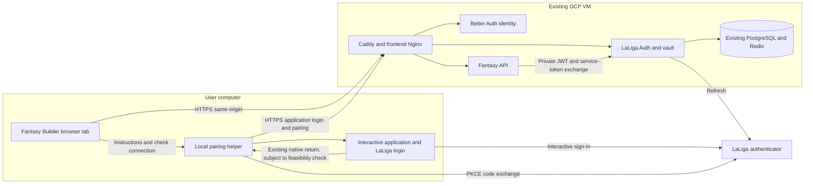

# LaLiga linking through a local helper and the cloud backend

Status: implementation in progress, 27 October 2026. The helper command,
capability route, guided screen, tests, and documentation are implemented.
A consented native-to-cloud trial passed with Google sign-in and read-only
lineup access. Token refresh, service restart, second-user isolation, other
sign-in methods, helper enablement, and deployment remain pending.

## Objective and decision

Let the four intended users connect their LaLiga account to Fantasy Builder at
`https://fantasybuilder.es` using a helper on their own computer. Keep Better Auth
login, the encrypted vault, refresh, and the Fantasy API in the existing GCP
deployment. After pairing, ordinary application use happens in the browser.

The owner cannot obtain a new LaLiga HTTPS callback registration. That registration
is therefore not a delivery dependency for this helper-based approach. A fully
browser-only LaLiga OAuth flow remains unavailable with the verified capabilities.

The first delivery is a guided CLI flow for macOS, using the existing helper.
Launching an installed app from the website is a separate, optional follow-up.
Windows, Linux, and mobile support must be assessed separately rather than inferred
from the existing Playwright fallback.

The helper currently uses the native client and
`authredirect://com.lfp.laligafantasy` return URI. Their presence in source does not
establish this application's ownership of that registration or official support.
First validate the existing consented development flow against the deployed
backend and record its limitations. Do not introduce a new takeover of another
application's callback, bypass provider restrictions, or describe this as approved
LaLiga web SSO. If the existing native integration cannot be used reliably and
appropriately, keep the UI informational and record that external limitation;
changing the cloud deployment cannot supply missing provider capabilities.

This plan covers linking after Fantasy Builder login. The separate
[LaLiga SSO plan](laliga-sso-implementation-plan.md) remains a proposal for a
different, browser-first identity flow, with its original upstream dependencies.

## Findings in the current repository

| Component | Current behavior | Consequence |
| --- | --- | --- |
| `frontend/src/auth/ConnectLaligaPage.tsx` | Automatically calls `connectLaliga()` for an unlinked user | It attempts a browser redirect even when this installation cannot complete it |
| `frontend/src/auth/client.ts` | Maps `browser_unavailable` to the reported error | Retrying does not make a missing registered callback available |
| `backend/auth/src/fantasy_auth/api/pairings.py` | `/laliga/login` requires a configured HTTPS callback; native pairing has independent routes | Preserve the browser guard and reuse the separate native pairing contracts |
| `cli/browser_session/__init__.py` | Starts pairing only when the selected analysis requires LaLiga | Running the command without a flow does not guarantee pairing |
| `cli/browser_session/args.py` | Accepts `--auth-base` and `--api-base` | The helper can already target the cloud deployment |
| `cli/browser_session/identity.py` | Signs in through a visible Playwright browser and obtains a Better Auth JWT | The helper authenticates its own session; it does not inherit the website tab's account |
| `cli/browser_session/pairing.py` and `cli/helper.py` | Create a challenge, obtain a native callback, exchange the code locally, submit tokens to Auth | Provider tokens transiently exist in the helper; Auth verifies and seals them |
| `cli/authredirect_macos.py` | Registers a macOS native handler and also writes a legacy completion script with a hardcoded localhost destination | Audit both callback paths; simply replacing one localhost string is insufficient |
| `cli/browser_session/playwright_capture.py` | Has a browser interception fallback and automation-related launch options | Do not assume compatibility with social providers or extend this as a bypass |
| `application/pairing.py` and persistent adapters | Verify nonce/JWT/profile, consume challenges, serialize owner operations, seal credentials | Reuse these controls instead of adding a second vault or application session system |

Paths beginning with `cli/` or `application/` above are under
`backend/auth/src/fantasy_auth/`. Relevant existing tests include
`test_session_pairing.py`, `test_authredirect_macos.py`,
`test_pairing_credentials.py`, and `test_browser_pairing_store.py`.

## Target architecture



The instructions arrow is a user action in the first delivery, not automatic
browser-to-process communication. The VM does not run a desktop browser or receive
the user's OS callback. Only ports 80/443 remain public; no new listening local
server, VM service, database, queue, or cloud resource is needed for the CLI flow.

## User journey

1. Sign in to Fantasy Builder with the existing application account.
2. Open `/connect-laliga`. In helper mode, show installation instructions, a
   copyable command without credentials, and **Check connection**. Do not start
   `/laliga/login` automatically.
3. Run the helper on the user's computer. It opens application login, obtains a
   short-lived application JWT in memory, and shows the authenticated account.
   Require confirmation before beginning LaLiga authorization. Explain that this
   must be the same account used in the website tab.
4. Create the existing one-time pairing through the cloud Auth service. Continue
   with the existing native LaLiga integration only after the feasibility check.
   The user enters provider credentials solely on the provider's page.
5. Complete the existing PKCE exchange and submit the result over HTTPS to Auth.
   Auth validates the challenge, tokens and Fantasy profile and seals credentials
   for the challenge's immutable application owner.
6. Report success without printing tokens. Open the fixed application
   `/connect-laliga` page, or instruct the user to return to their existing tab.
   Opening a URL does not transfer the helper's application session to that tab.
7. **Check connection** calls the existing owner-scoped connection endpoint. Only
   a verified linked connection with `needs_reauth=false` unlocks the application.
8. Normal refresh happens on the backend. Revocation or a permanent refresh failure
   returns the user to the same helper instructions; initial pairing is not a
   promise that reconnection will never be needed.

If the helper and website use different accounts, the website stays unlinked.
Explain the mismatch and allow a new attempt; never transfer a connection by email,
manager name, browser-provided user ID, or a status supplied by the helper.

## Delivery phases

### 0. Establish the native-to-cloud baseline

- Run a consented read-only trial from the owner's Mac against
  `https://fantasybuilder.es`, using the existing `leagues-analysis` flow to trigger
  pairing. Confirm normal DNS and HTTPS validation first; do not depend on
  `--resolve`, disabled TLS checks, or a local hosts override in the delivered flow.
- Confirm application JWT acquisition, a new pairing, native callback handling,
  PKCE exchange, profile verification, cloud vault persistence, and a browser
  connection check for the same user. Record sanitized outcomes only.
- Determine whether the legacy macOS handler runs an extra localhost completion
  request during the CLI flow, and whether it conflicts with another installed
  application. Do not make global handler replacement an installation default.
- Check an actual refresh and service restart against the existing connection;
  do not force failure by rotating live keys or revoking unrelated sessions.
- Record provider cancellation, unsupported login methods/platforms, and any
  restrictions of the existing native registration. Do not assume that success
  with one login method proves the others work.

Deliverable: update the capability record with observed native-helper results,
clearly separated from unavailable browser SSO. Work on the UI, tests, and local
configuration can proceed with deterministic mocks while this trial is pending.
Expose working connection instructions only after the supported path is proven.

### 1. Make the helper an explicit connection command

- Add `--pair-only` to `fantasy-browser-session`. It must create or check a LaLiga
  connection without requiring an analysis, player ID, or a financial operation.
  Reject incompatible combinations before opening a browser. Keep existing
  analysis commands and `--no-pair` behavior compatible.
- Add a repository wrapper, proposed `scripts/connect-laliga.sh`, which invokes the
  helper with the deployment's trusted origin and `--pair-only`. Its default
  installed experience needs no exported JWT, terminal token paste, or cloud SDK.
- Validate destinations before any credentialed request. Production accepts the
  configured exact HTTPS origin and `/api` base; local HTTP is limited to explicit
  loopback development configuration. Reject userinfo, fragments, unexpected base
  paths, lookalike hosts, and cross-origin HTTP redirects that could move secrets.
  A URL from a webpage, callback, or future deep link must not choose the backend.
- Display and confirm the application identity obtained from the authenticated
  session. If `--jwt` is retained for developer use, establish identity through
  verified server behavior, not an unverified JWT decode used as authorization.
- Keep the application JWT, PKCE verifier, pairing secret, and token bundle in
  memory wherever possible. Any necessary callback file must be user-private,
  bounded, removed on success/error/timeout, and excluded from logs and telemetry.
- Audit the macOS handler and legacy completion script together. Select one
  completion path per attempt, remove unintended localhost calls from cloud
  attempts, and prevent a callback from completing two different transactions.
  Keep exact scheme/host/path and state validation; do not accept arbitrary callbacks.
- Offer actionable cancellation, expiry, missing dependency, wrong-account,
  DNS/TLS, rejected-provider, and backend-unavailable messages. A possibly redeemed
  code is not blindly retried. After an uncertain completion, query the connection
  before offering a fresh attempt; do not claim exactly-once network delivery.
- Return to a fixed application path with no codes, JWTs, or pairing secrets in
  its URL. Never open an arbitrary `frontend_origin` supplied by an untrusted peer.

Deliverable: a connection-only command for a verified supported macOS setup,
plus setup/uninstall instructions. The helper needs no GCP IAM access, service
account, Secret Manager access, local vault key, or local application containers.
Preserve existing developer settings without copying production server secrets
onto the user's device. Audit any automatic `.env` creation in reused wrappers.

### 2. Advertise connection capabilities and build the guided web screen

Propose `GET /laliga/link-options` on Python Auth, requiring the existing application
Bearer JWT, with a validated response such as:

```json
{
  "browser_available": false,
  "helper_available": true,
  "helper_platforms": ["macos"]
}
```

These are proposed contracts. The real configuration must drive the values;
`helper_available` is advertised only after the baseline is verified and an
explicit proposed `LALIGA_HELPER_ENABLED` setting is enabled. Default it to false.
It controls this advertised flow; document separately whether legacy developer
pairing routes remain enabled. Do not treat a UI flag as an authorization control.
Keep capability ownership in Auth rather than duplicating LaLiga configuration
in Better Auth or embedding secrets in `VITE_*` variables.

- Extend `frontend/src/auth/schemas.ts`, `client.ts`, and `types.ts` for capability
  parsing. Keep `GET /laliga/connection` as the authority for actual connection
  state; capabilities alone never mean the user is linked.
- Update `AuthProvider.tsx` and `ConnectLaligaPage.tsx` to select the available
  journey. Helper mode displays the command/instructions and never calls the
  browser login endpoint. Browser mode retains its exact callback guard and
  browser-binding controls. Neither available produces an honest unavailable state.
- Model checking, instructions, waiting, connected, needs-reauth, and retryable
  failure. Avoid a permanent spinner labelled “Opening LaLiga” in helper mode.
- **Check connection** reuses `reload()`. Optionally check when a waiting tab gains
  focus; deduplicate requests, abort on unmount/logout/account switch, and do not
  poll indefinitely in the background. A stale result cannot restore a prior user.
- Preserve public browsing, keyboard focus, both themes, mobile instructions,
  and a useful unsupported-platform state. Copy actions copy commands only.
  Show the app account so the user can match it to the helper confirmation.
- Handle capability lookup failure separately from an unsupported configuration.
  Do not infer success or availability from a network failure or a 503 alone.

Deliverable: a user can complete pairing without using an analysis command or
interpreting the current callback error. The native callback does not traverse
the web callback endpoint or depend on its browser-binding cookie.

### 3. Deploy, document, and verify with the intended users

- Update Auth README, authentication/endpoints, frontend documentation, the
  capability record, the release runbook, deployment examples and architecture
  trust-boundary wording. The current statement that only server Auth exchanges
  LaLiga tokens must explicitly account for the local helper's initial exchange.
- Generate Auth OpenAPI for the capability route. API feature contracts remain
  unchanged; regenerate API schemas only if their inputs actually change.
- Publish application images through the existing main-branch CI. Activate the
  chosen immutable release using the documented VM helper after reviewing the
  deployment. CI image publication alone does not activate it.
- Enable the advertised helper mode only for the verified distribution/platform.
  Preserve `TOKEN_VAULT_KEY_BASE64`, Better Auth secrets, database passwords, JWT
  issuer/audience and existing connections. Leave the unavailable
  `LALIGA_BROWSER_REDIRECT_URI` unset.
- Verify two distinct users before onboarding all four. Test persistence over a
  container restart, reconnection, application logout, and isolated connection
  access. Rehearse recovery against disposable data rather than the live vault.

No Terraform topology or firewall change is expected. Any packaging/signing cost
is assessed separately; this design adds no required always-on cloud service.

### 4. Optional installed-app launch

After the guided CLI works, separately design a signed desktop distribution and
a Fantasy Builder-owned launch protocol or supported OS application link. Such a
link launches the helper; it does not register a new return URI with LaLiga.

Before shipping this phase, specify a short-lived server transaction, explicit
account confirmation, proof binding, single-use redemption, expiry and cancellation
for any browser-to-helper handoff. A launch URL is untrusted input. It must contain
no application JWT, LaLiga token, pairing secret, arbitrary command, backend URL,
or return destination. An identifier by itself cannot authorize account linking.
Do not reuse another application's scheme for the new launch protocol.

Prefer independent helper login if secure handoff adds little value for four
users. Do not introduce a localhost HTTP listener, extension, QR/device protocol,
or anonymous JWT issuance as an incidental shortcut. Any such alternative needs
its own concrete threat model and implementation plan. Packaging must cover
updates, provenance, uninstall, and preservation of existing OS URL handlers.

## Security and compatibility acceptance

| Boundary | Required behavior and evidence |
| --- | --- |
| Application ownership | Server verifies JWT `sub` on start; immutable pairing owner; another user's read/cancel/unlink rejected |
| Completion | One-time secret, state, nonce, exact native return, PKCE, issuer/audience/signature/expiry and profile verification preserved |
| Account mismatch | Helper account confirmed; a different website account stays unlinked; no ownership transfer by name/email |
| Replay and concurrency | Duplicate callback/completion, expiry, simultaneous attempts, cancellation, unlink and completion races fail safely using persisted state/locks |
| Token handling | No provider token in browser storage, URLs, logs, CLI output, process arguments or committed files; local transient token handling documented |
| Browser callback | `/laliga/login` stays unavailable without the registered HTTPS callback; existing cookie binding is not weakened for helper mode |
| Native handler | Existing development behavior audited; no new callback takeover, automatic provider restriction bypass or unverified platform support |
| Transport | Real HTTPS validation, fixed trusted origin, rejected cross-origin redirects, no internal service ports exposed |
| Lifecycle | Helper closure, timeout, backend error, unknown exchange result and refresh failure yield recovery instructions; cleanup runs on every exit |
| Logout | Web cancellation still cancels owner pairings where possible; bounded JWT validity is documented rather than claiming instant revocation |
| Compatibility | Credentials login, configured direct providers, existing CLI analyses, API routes, vault encryption and refresh remain compatible |

## Validation plan

Use synthetic tokens and mocked provider transports for automated protocol tests.
Use disposable PostgreSQL/Redis for atomic completion, owner isolation, cancellation
and persistence tests; in-memory adapters alone do not prove cross-worker behavior.

| Area | Tests to add or extend |
| --- | --- |
| CLI arguments and orchestration | `--pair-only`, incompatible arguments, linked/no-op, needs-reauth, missing browser, expiry and cancellation |
| Helper and macOS integration | Correct cloud target, no legacy localhost POST, exact callback, private file permissions/cleanup, two attempts, existing-handler conflict, no sensitive output |
| Auth routes/services | Capability flag combinations, missing/wrong JWT, sanitized responses, owner isolation, nonce/secret failures, replay and concurrent consume |
| Frontend unit tests | Helper instructions, no automatic `/laliga/login`, check/retry, unavailable/failed capability lookup, unsupported platform, account switch and aborted stale results |
| Browser tests | Register/sign in, helper-mode page, mocked external completion followed by real UI reload, needs-reauth, keyboard navigation, phone/desktop, both themes |
| Real private installation | Consented native sign-in on a supported Mac, cloud persistence, second-user isolation, read-only Fantasy lookup, restart and observed refresh |

Run focused tests first, then the configured affected-service checks:

```bash
# From backend/auth
uv run pytest --cov=src --cov-report=term-missing --cov-fail-under=90

# From frontend
bun run lint
bun run test
bun run build
bun run test:browser

# From the repository root, after Auth route/schema changes
uv run poe generate-auth-openapi
uv run poe check-openapi
uv run poe lint
uv run black --check backend main.py
```

Follow repository test naming and Arrange–Act–Assert conventions. Browser fixtures
must not authenticate live provider accounts in CI. Real verification is performed
by the user with consent; it must not place bids, pay/increase clauses, activate
shields, or overwrite lineups. Tests are planned here, not claimed as executed.

## Suggested commits and completion criteria

| Order | Proposed commit | Reviewable outcome |
| --- | --- | --- |
| 1 | `docs(auth): record native helper cloud feasibility` | Sanitized trial findings, supported platform/methods and remaining limitations |
| 2 | `feat(auth): add explicit cloud pairing helper flow` | Connection-only command, trusted target, identity confirmation, callback cleanup and focused tests |
| 3 | `feat(auth): expose LaLiga linking capabilities` | Configuration, protected route, schemas, tests and generated Auth OpenAPI |
| 4 | `feat(frontend): guide LaLiga linking through the local helper` | Capability-driven screen, connection checks, recovery and UI/browser tests |
| 5 | `docs(auth): document cloud helper setup and release checks` | Installation, onboarding, uninstall, deployment, trust boundaries and rollback |

Completion means a supported computer can connect a signed-in user to the cloud
vault without a new HTTPS callback registration, and the same user can return to
the web, read their leagues and reconnect when required. Two users remain isolated.
No local backend, production server secrets, or additional cloud resources are
required. End-to-end provider compatibility must be observed, not inferred from CI.

Rollback disables the helper advertisement and restores the previous application
release if necessary, retaining identity users, sealed connections and unchanged
keys. It does not revert to an unbound legacy browser callback, delete volumes,
or restore an old vault snapshot over new connections. Existing valid connections
continue to work independently of which linking instructions the UI advertises.

## Sources and limits

- Repository source and history establish the implemented helper and historical
  localhost completion path. They do not prove current real-provider support.
- [Microsoft B2C authorization-code flow](https://learn.microsoft.com/en-us/azure/active-directory-b2c/authorization-code-flow)
  requires a registered return URI; changing a local setting cannot register one.
- [RFC 8252](https://www.rfc-editor.org/rfc/rfc8252.html) describes native OAuth,
  external browsers, redirect strategies and custom-scheme interception risks.
- [RFC 9700](https://www.rfc-editor.org/rfc/rfc9700.html) informs redirect, PKCE,
  replay and credential-leakage controls. Neither RFC grants provider registration.

References consulted on 27 October 2026. The local implementation has not
accessed provider accounts, changed cloud resources, or enabled the helper
capability setting.
