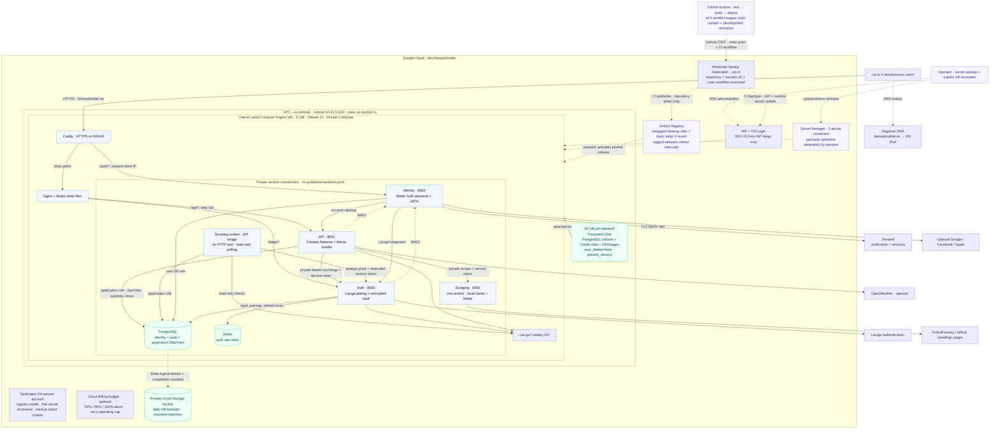

# Google Cloud architecture diagram

The current configured topology is shown below; the
[Mermaid source](google-cloud-architecture.mmd) is the editable service graph.
The older [SVG](google-cloud-architecture.svg) and [PNG](google-cloud-architecture.png)
exports date from 27 October and omit the scouting worker, application database
and automatic development activation. They are historical visual references.

## Scope

Updated on 5 November 2026 from `infra/gcp/main.tf`, `github-actions.tf`,
`variables.tf`, the selected local deployment settings, the production Compose
template, `docker/Caddyfile`, and `.github/workflows/ci.yml`. Project
`dev-fantasybuilder`, region `us-central1`, zone `us-central1-a`, and machine
type `e2-small` match those settings. The address `35.209.215.112` is the
Terraform output reported by the operator; it is not hard-coded in Terraform.
If the reserved address is replaced, update both DNS and the diagram.

The topology describes configured resources and release paths. Infrastructure
reconciliation, image publishing, secret uploads, and successful host bootstrap
have been reported in the deployment conversation. Application activation was
still being troubleshot when the diagram was created. No live cloud inspection
or application health check was performed to produce this diagram.

## Components and boundaries

| Component | Deployment responsibility |
| --- | --- |
| Existing DNS provider | Root-domain A record points to the reserved Standard Tier IPv4 address. DNS is managed outside this Terraform module. |
| VPC, subnet, firewall | Dedicated `10.42.0.0/24` subnet. Public ingress allows TCP 80/443; SSH allows TCP 22 only from the IAP range `35.235.240.0/20`. |
| Compute Engine | One Shielded Debian 12 `e2-small` VM with 2 GiB RAM hosts all containers. |
| Caddy and frontend | Caddy terminates TLS and routes `/auth/*` to Identity. Other paths go to Nginx, which serves React and proxies `/laliga/*` and `/api/*`. |
| Backend containers | Identity, Auth, API, and Scraping use private ports. API calls Auth and Scraping with service tokens; Auth and API fetch Identity JWKS. Identity also calls Auth for the LaLiga integration. |
| PostgreSQL and Redis | Self-hosted containers on the same VM. PostgreSQL has separate identity, vault and application databases/roles; Redis supports Auth rate limiting. These are not Cloud SQL or Memorystore resources. |
| Persistent Disk | Separate protected 30 GiB `pd-standard` boot-disk resource. It stores OS, images, PostgreSQL data, and Caddy data. VM attachment has `auto_delete=false`; Terraform disk lifecycle has `prevent_destroy`. |
| Scouting worker | Separate process from the API image, no HTTP port. Uses the application database and a dedicated Auth delegation token for read-only polling; shares the VM resource budget. |
| Artifact Registry | Stores the five application images. CI publishes; the VM pulls immutable digests during explicit releases. Old untagged images are cleaned up, with three recent versions protected; tagged releases require deliberate retirement. |
| Secret Manager | Five dotenv payloads, uploaded outside Terraform. The host stages them for each explicit release; reboots use the committed local snapshot. |
| Cloud Storage | Private regional backup bucket. A VM systemd timer uploads three database dumps (identity, auth and application scouting) and then a completion manifest. Default lifecycle deletion is after 14 days, with a further 7-day soft-delete window. |
| IAP and OS Login | Operator SSH administration without opening SSH to the public internet. Operator IAM is configurable. |
| IAM and federation | Separate VM reader/uploader and CI image-writer identities. Optional GitHub federation is restricted to the configured repository, numeric repository ID, main push event, and CI workflow. No service-account key files are provisioned. |
| Cloud Billing budget | Optional project budget with 50%, 90%, and 100% alerts. It is an alerting resource, not a spending cap. |

All containers use the private Compose network; services requiring external
access also join the egress-capable network. The diagram consolidates outbound
provider connections into one bus for readability. That bus is not a separate
Cloud NAT, gateway, or load-balancer resource. Host metadata credentials are
protected from container HTTP access by the installed Docker metadata guard.

## Release flow

1. GitHub Actions runs `test` then `build` for branch pushes and pull requests.
2. On a main push, `deploy` uses keyless federation to publish the exact five
   checked images. It produces `release-images.env` with pinned digests.
3. The operator configures the five Secret Manager payloads for the initial
   installation. Subsequent main releases update only the runtime image entries.
4. The serialized `activate-development` job uses a separate federated identity
   to preserve runtime settings, update the five image references, and run
   `fantasybuilder-deploy` on the VM through IAP. Superseded main runs are skipped.
5. The host stages secrets, validates Compose, pulls images, runs migrations, and
   waits for health checks before committing the configuration snapshot.

Automatic activation requires the deployment IAM configuration and GitHub Actions
variables from Terraform, plus an already bootstrapped host and configured
secrets. The job checks HTTPS after the helper's container health checks. Manual
activation remains available for recovery. All application and data services share one host;
this design has no automatic failover or zero-downtime deployment guarantee.
See the [deployment guide](../../infra/gcp/README.md) for activation and recovery.

## Icon sources

Google Cloud component icons come from the
[official Google Cloud icon library](https://cloud.google.com/icons), using its
core product and legacy console collections. Compute Engine and Cloud Storage
use the core collection; the remaining Google components use the legacy
collection where the core download has no corresponding product icon.
Application containers and external services use labeled boxes to keep their
ownership distinct from Google-managed products.
