# Frontend

React app in `frontend/` (Vite, Bun). It is the browser entry point for
LaLiga Fantasy Builder: sign-in, league selection, lineup editing, player
catalog and profiles, an interactive market board, and a Teams tab with one dossier
per real LaLiga club. It never calls LaLiga
directly and keeps the internal JWT in memory only.

- System map: [Architecture](architecture.md)
- HTTP routes the UI calls: [API overview](api/README.md)

## Spanish and English

The header's Options button opens the league/account panel on mobile and desktop.
The panel is grouped under captions instead of separate boxes: **Preferences**
(language and theme), **League** (selector), and **Account** (a Profile row with
avatar and chevron, then Log out/Log in), with hairline dividers between groups.
Each main navigation tab (Lineup, Market, Players, Teams) carries a decorative
`NavIcon` from `features/shell/icons.tsx` that follows `currentColor`; on a phone
it stacks above the label in the bottom bar.
The panel contains the 44 × 44px globe-only language selector beside the theme
control; both stay hidden when Options is collapsed. The language selector’s
accessible name and hover title follow the current language (Idioma/Language). The popup lists Español and English with the selected
option marked; keyboard selection restores focus to the globe. The controls
share the existing league/account panel without adding a second header row.
The explicit choice is saved under
`lfb-language`; otherwise a supported browser language is used, then English.
Switching updates labels without recreating feature providers or clearing drafts.

Application copy and structured Weather/LALIGA labels use bundled i18next
catalogs. Literal source messages remain stable keys; English display copy may
correct their wording without renaming callers. Equivalent entries that differ
only by surrounding whitespace use explicit catalog entries when spacing is needed.
`t(key, parameters?)` translates exact string keys; `useTranslation()` subscribes
components to language changes and returns `t`. Composed messages pass numeric
parameters explicitly, including translated application labels. Club, player and
manager identities remain verbatim. Shared primitives render their supplied
children and labels; each producer owns its application copy. Notifications retain
message keys and translate while rendering, including screen-reader announcements. Spanish copy uses
football/Fantasy terms such as plantilla, jornada, puja, titularidad and cláusula
de rescisión; bids and seller offers remain distinct. OpenWeather forecasts use
«pronóstico», including upcoming-match headings and unavailable states.
Dates and numbers use the selected locale; currency remains EUR and fixture
times remain Europe/Madrid. Whole-euro fields accept validated English or
Spanish thousands grouping, preserving edits through language changes.

Value and form tooltips grow to fit their content and wrap within the viewport
on narrow screens. Their translated lines stay inside the tooltip border.

Radar profile and metric IDs select bundled labels and definitions before chart
wrapping. Imported cohort descriptions without a bundled translation are marked
as original-source labels in Spanish. Calendar chrome, chart series, countdown
units, competition categories, partial-data errors, and accessible names also
follow the selected language. Partial-data messages use stable error codes; raw
provider details are not translation keys.

Known FutbolFantasy wording is translated from closed, tested maps
(`teamInjuryLabels.ts`, `teamNewsLabels.ts`): recovery phases, diagnoses, return
notes, and the generated changelog sentences. Only wording outside those maps (other
diagnoses and return notes, article headlines) requests machine translation. Spanish shows the original. English
uses GTranslate Free in a separate opaque sandbox document for each visible
text block; no application credentials or whole API responses are passed in.
Results are ephemeral presentation state. Show original and Retry translation
remain available; blocked or failed translation leaves Spanish text visible.
The browser must reach `cdn.gtranslate.net` and the vendor's translation service
(currently `translate-pa.googleapis.com`). This public prose is processed by a
third party. No translated content is added to backend/query storage, and the
scraper continues its existing cache/robots/rate-limit behavior.

News links open the publisher's original article. The current API supplies
headlines, not full article bodies. Optional generated builder explanations
retain their original English text under a separate disclosure. GTranslate
Free is intended here for this noncommercial app and has no translated SEO or
manual translation editing. See the [implementation record](frontend-localization-plan.md)
for scope and validation. Run the opt-in real-service smoke check with:

```bash
cd frontend
LFB_LIVE_TRANSLATION=1 bun run test:browser -- localization.spec.ts -g 'live free'
```

## Visual system and screenshots

The app uses Anton display headings, LALIGA Text body/actions, neutral square
surfaces, thin borders and coral primary actions. All buttons and button-styled
links have rectangular corners, enforced globally across pages and portaled
overlays. The header's **Dark/Light** control switches the whole document,
including portaled overlays and charts.
At widths up to 1000px, the main **Lineup / Market / Players / Teams** navigation is
fixed to the bottom of the viewport. It accounts for device safe areas, keeps
the active destination visible, and reserves space below the footer so content
is not covered. Branding and account options stay in the top header; desktop
navigation remains in the header.
Links never use text underlines, including on hover, focus, and visited states;
keyboard focus indicators remain visible.
Market **Sell options** and catalog **Owned by** group each manager's avatar
with their readable name and existing squad link. Missing or failed photos use
a person icon. Names wrap within the cell; free agents and LaLiga listings keep
their distinct labels; LaLiga sellers also show the LaLiga logo. Photos reuse
the available listing and roster data.
Light is the default; an explicit preference is saved under `lfb-theme`.
LALIGA Text loads from the supplied WOFF2 face with a WOFF fallback. The shared
`--fb-font-body` token controls body text, forms, buttons, tooltips, and chart
labels. `--fb-font-size-body` scales the base size from 14px to 16px with viewport
width, while component type scales retain their existing priorities. These supplied files are static Regular faces; bold and italic emphasis
are synthesized by the browser. Width adaptation comes from responsive layout,
wrapping, and the existing type scale, rather than variable-font width axes.
The app uses Base UI for dialogs, selection, menus, tooltips, collapsibles and
toasts, with local CSS and native buttons/fields where appropriate.
The lineup sidebar uses local shadcn Base UI Card, ScrollArea, Table, and Badge
components, adapted to these same tokens and plain CSS.
Fixture and standings widgets share a fixed type scale in both themes and at
phone and desktop widths: 20px titles, 14px content (including team names and
scores), and 12px metadata, table headings, and status badges. The
`--fb-widget-font-*` tokens keep equivalent content consistent across panels.
These widgets also use normal letter spacing and a shared 1.5 line height,
including headings, table labels, buttons, and badges.

Button guidelines apply throughout the application, including portaled dialogs:

- Command buttons have at least a 44 × 44 CSS-pixel target, visible keyboard
  focus, and rectangular corners. Radio/checkbox/switch primitives use their
  enclosing labels as the target. Table filters include the heading in the
  clickable area; dense performance controls retain full-size targets.
- Primary actions use coral with black text; secondary and cancellation actions
  use neutral surfaces or outlines. Dialog footers preserve these variants.
  Selected filters and pagination also use an underline, so color is not the
  only indication of selection.
- Disabled actions retain their appearance on hover. The shared `Button`
  suppresses activation when `aria-disabled` while remaining focusable for
  explanations. Pending mutations disable repeat submission, show a specific
  progress label, and expose `aria-busy`.
- Confirmation buttons name the effect: **Place bid**, **Send offer**,
  **Pay release clause**, **Withdraw player**, or the relevant squad action.
  Favorite toggles keep a stable accessible name and expose `aria-pressed`.

These conventions apply the skill's Fitts's Law and action-feedback guidance,
with [WAI button semantics](https://www.w3.org/WAI/ARIA/apg/patterns/button/).
They are implementation guidelines, not a claim of a full accessibility audit
or testing with representative users.

Shared shadcn-style field compositions keep the persistent label, constraints,
control, and correction together. Descriptions and errors are connected to their
inputs with stable IDs and `aria-describedby`; invalid amounts and date ranges
also expose `aria-invalid`. Bid limits stay visible next to the amount rather
than requiring people to remember them from another panel.

Dialogs can provide a concise accessible description and deliberate initial
focus. Bid dialogs focus the amount; clause payment and withdrawal start on
**Cancel**. A pending request marks the dialog busy and prevents Escape, backdrop,
or close-button dismissal until a result is available. Closing an idle dialog
restores focus to its originating control. Date-range editing still uses an
explicit Apply/Cancel workflow.

Automated browser checks use fictional, deterministic account data. The sixteen
product captures below come from a signed-in browser session with real league and
player data. Screenshot assets live under [`docs/images/screenshots/`](images/screenshots/).
Keep captions and screenshots in the same change.

### Product captures

Captured on 9 November 2026 (Europe/Madrid) from the running local React app.
Each image shows the actual browser-rendered interface and live API data at capture
time, including the account's league, lineup, market, player profiles and the
Athletic Club dossier on Teams. Values, standings, availability, market listings and
published radar or profile data may change. The browser chrome was cropped away and
the application viewport was set to 1512 × 782 pixels for documentation. The
[project README](../README.md#screenshots) contains the same gallery.

#### Light theme

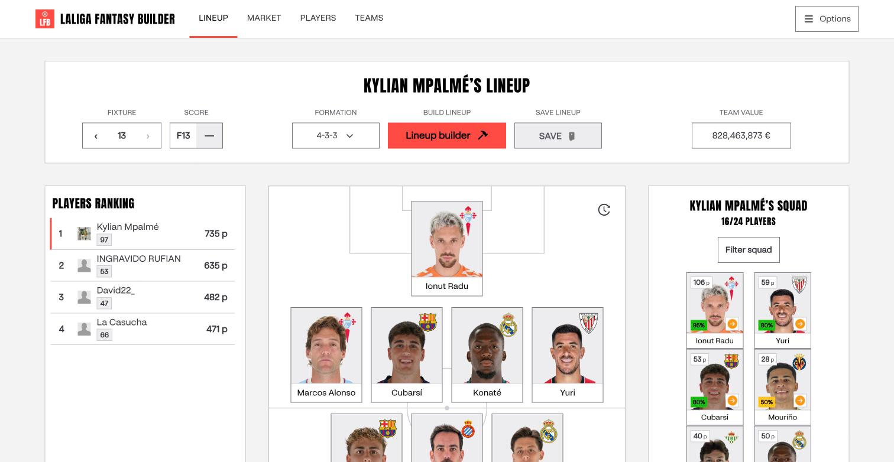

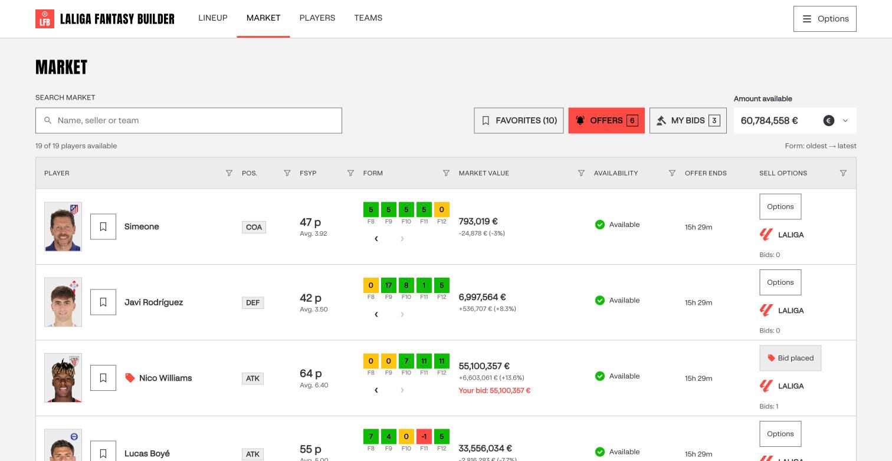

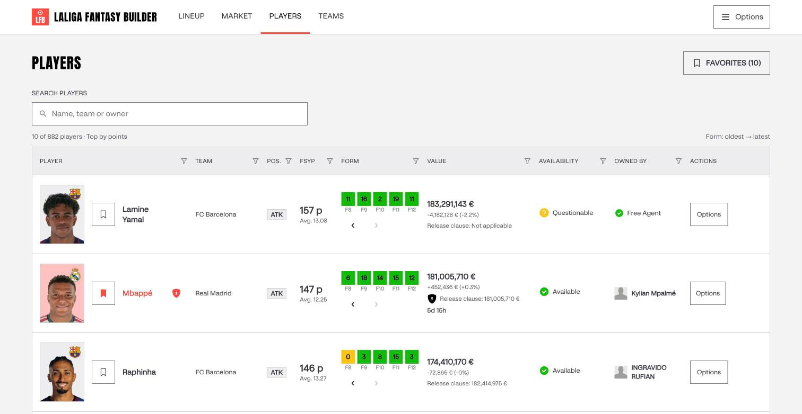

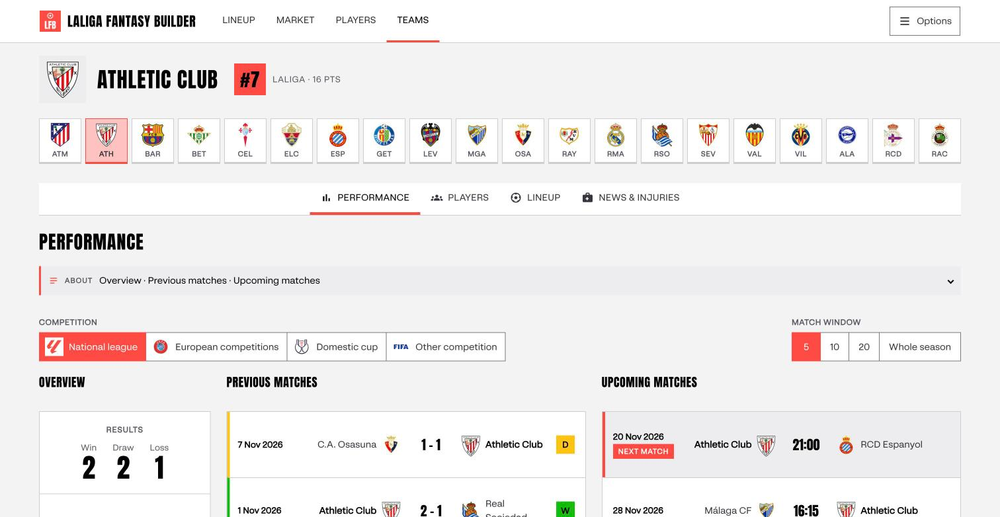

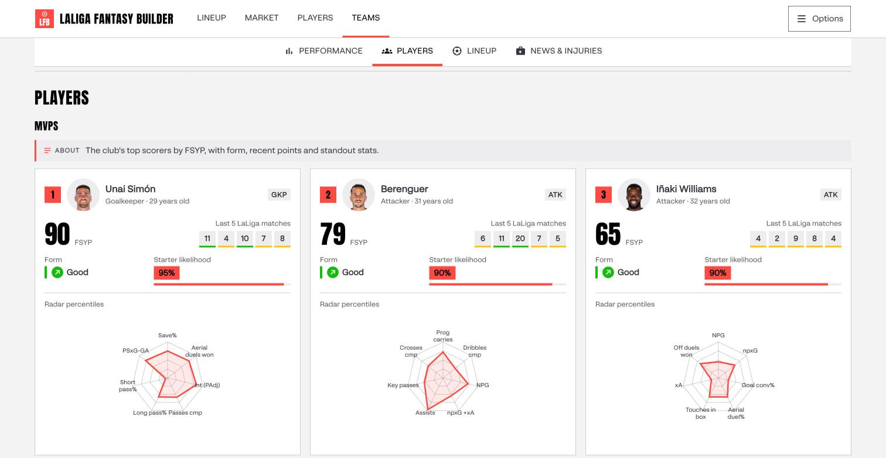

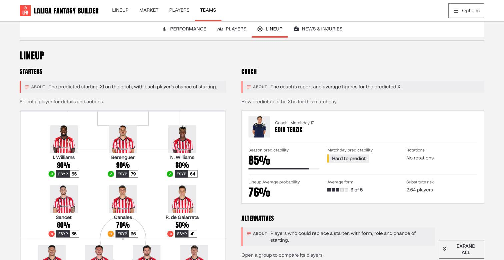

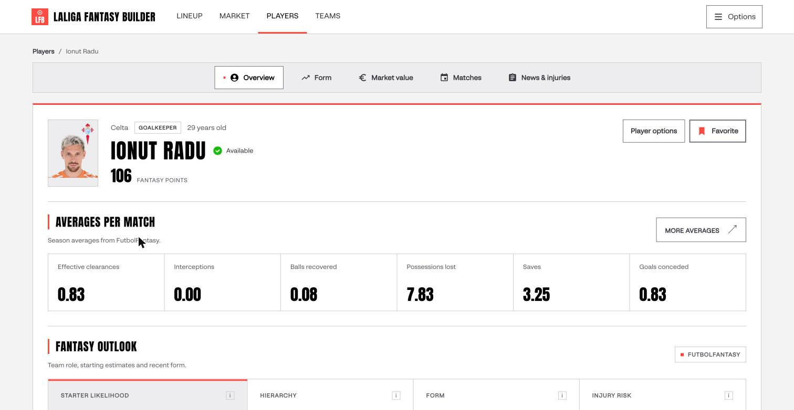

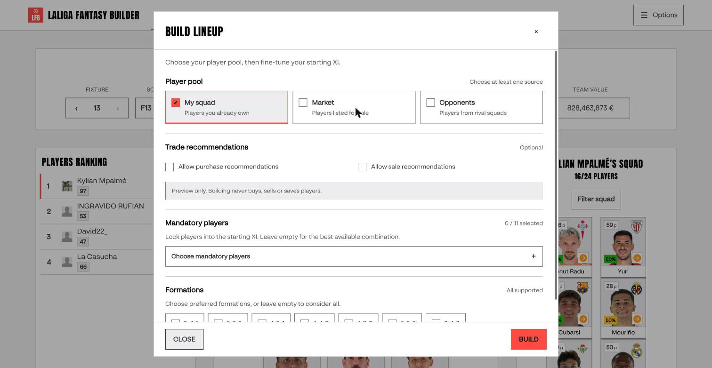

#### Dark theme

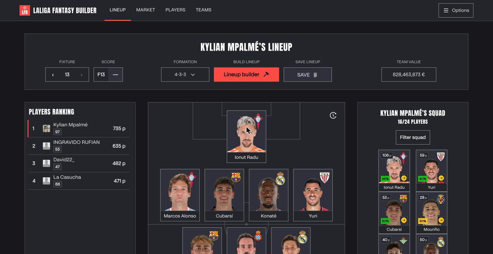

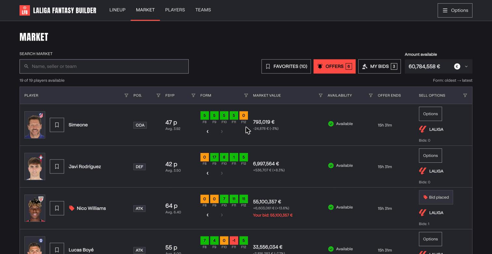

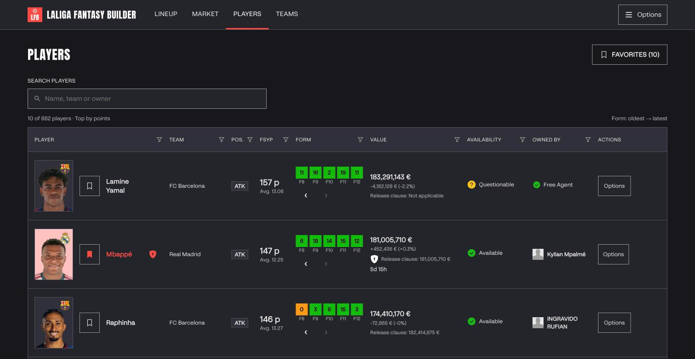

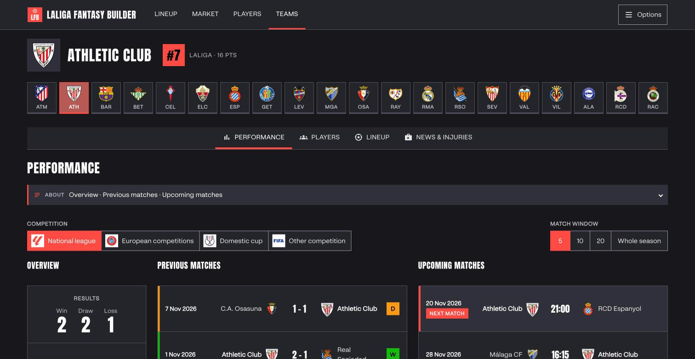

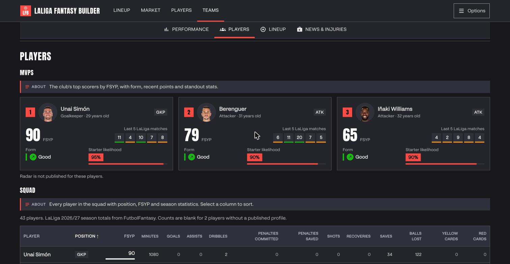

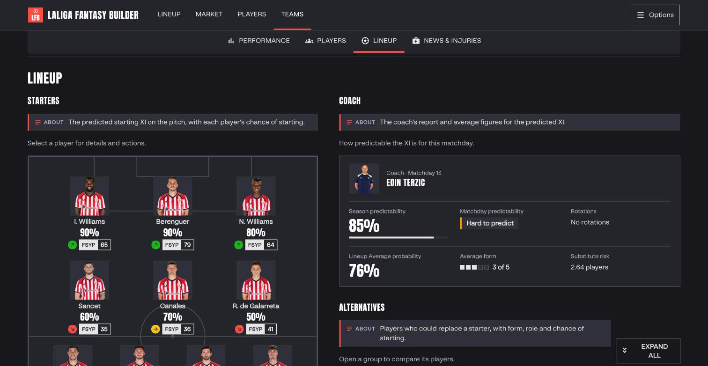

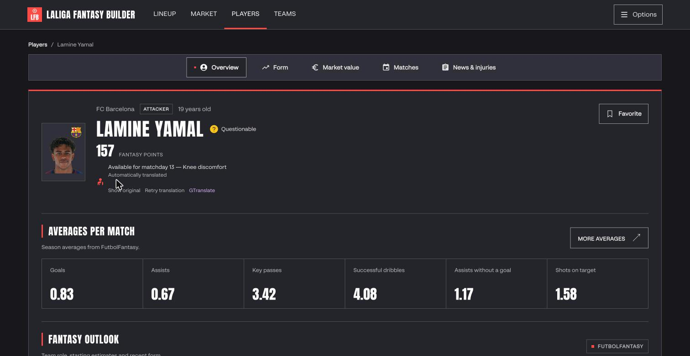

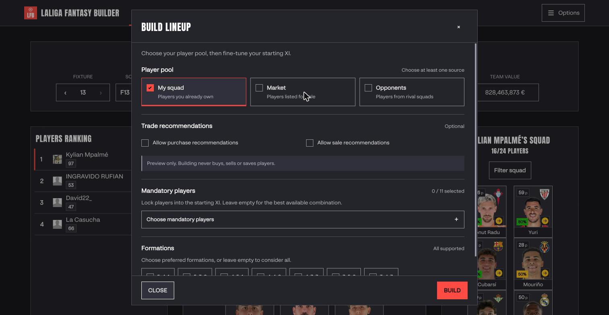

#### Refreshing screenshots

Open a signed-in local application session, select the intended league, and visit
`/`, `/market`, `/players`, one player's profile, and a club on Teams (`/teams/{clubId}`
for the Performance view, then `?section=players` and `?section=lineup`). Capture both
themes (switch with the theme control in Options) and the builder setup dialog directly
from the browser. The first read of a club scrapes every profile and can take about half
a minute, so wait until the season statistics, MVP form and radar have loaded before
capturing. Review the sixteen resulting images together before updating captions.
The builder setup view is read-only; no build, bid, trade, or lineup save is needed.

## Running locally

Same-origin proxying matches production Nginx:

- `uv run poe dev` from the repo root (auth, API, scraping, and Vite), or
- `cd frontend && bun run dev:all` when backends are already up.

App URL: http://localhost:3000. `/auth`, `/laliga`, and `/api` proxy to auth
and the API.

## Routes

| Path | Screen | Primary API domains |
|------|--------|---------------------|
| `/` | Lineup — fixture matches/weather, formation, pitch, squad, manager ranking, club standings | [Leagues](api/leagues/README.md), [Teams](api/teams/README.md), [Calendar](api/calendar/README.md), [Standings](api/standings/README.md) |
| `/market` | Market — listings, bids, release clauses | [Market](api/market/README.md), [Buyout](api/buyout/README.md), [Players](api/players/README.md), [Calendar](api/calendar/README.md) |
| `/players` | Players — catalog, filters, top-10 leaderboard | [Players](api/players/README.md), [Calendar](api/calendar/README.md) |
| `/players/:playerId` | Player detail — stats aggregate | [Players](api/players/README.md) (`GET /players/{id}/stats/detail`) |
| `/teams` | Teams — opens the first current club for the selected language | [Clubs](api/clubs/README.md) |
| `/teams/:clubId` | One club dossier: players, results, predicted lineup, news and injuries | [Clubs](api/clubs/README.md) |

The shell header switches routes. The league dropdown applies to lineup, market, and players.
Market, Players, Teams and player details load on demand. Hovering, focusing or first touching
a header tab (`useRoutePrefetch`) warms the section's code chunk and its first read-only
requests, using the same query options and `staleTime` as the screens so a prefetch never
refetches data a screen would still treat as fresh. Links to a player's details warm only the
code (`preloadHandlers`); both share `warmOnIntent` in `app/routeModules.ts`.

The alerts bell and the **Favorites** button open the scouting dialog through the `?scouting=`
URL parameter (`favorites` or `alerts`, with `scoutingQuery` and `scoutingFilter`). The dialog is
mounted once in the header for signed-in users and returns focus to the Favorites button when it
closes. A signed-out visit drops these parameters from the URL so a shared link does not open the
dialog after the next login.
Teams reads the current club directory and one dossier; it does not use the manager-squad API.

### Teams screen

`/teams` opens the first current club in the selected language. `/teams/:clubId`
keeps the club. The page heading is that club, with its crest and, when the LaLiga
standings load, its league position and points. The crest
strip chooses another club. Each club is a tile with its crest and the three-letter
short name under it, so clubs stay recognisable by two cues; the current club's tile is
tinted and outlined, and the strip scrolls it into view on narrow screens.
The query keeps `section`, `competition`, and `window` when they differ from
Performance, LaLiga, and five matches. Refresh restores that URL. A signed-out
visit uses the same sign-in gate as Market and Players.
While the club directory or the dossier loads, a `PulseRing` announces "Loading the club
dossier." and each section that has not arrived is a `TeamSectionSkeleton`: the real
heading and id (so deep links and the section bar still land) over skeleton blocks shaped
like the finished content, marked `aria-busy`. The club strip shows skeleton tiles until the
directory arrives. A section left empty after the load stays a plain anchor. Season
statistics that are still loading show a small `PulseRing` above the squad table.
The club strip and the Performance, Players, Lineup, and News & Injuries links (each with a
decorative icon, in that order and in the same order down the page) stay available from the
keyboard. That bar is named **Club sections**, separate
from the header's Sections navigation. On a phone the four header destinations move to
the bottom bar and keep their labels inside the safe area.

The Club sections bar (the shared `.fb-section-tabs` style, also used by player details) is sticky and follows the section being read as the page
scrolls; selecting a link, or opening a `?section=` URL, jumps to that section and
keeps the jump in place while images and radar chips finish loading, until the
reader scrolls. Sections are separated by a rule and share one heading style.

On a wide screen the three MVP cards share a row, the competition filter sits
beside the match window, previous matches beside upcoming ones, and the coach
report beside the XI summary. Predicted starters stand on the same pitch markings
as Lineup, in the published position lines, with the bench beside the pitch. The
squad table stays full width once event columns are published; with only FSYP it
is capped so position and points stay beside the name. A phone stacks each pair.
News & Injuries puts the injured players beside the news feed; a phone stacks them, injuries first.
On a phone the four section links become equal-width tabs with the icon above the label.
Performance shows the match window at the right end of the filter row on wide screens, and on
a narrow screen the competition buttons keep only their logo (the name stays as the accessible
name and tooltip).

Every widget opens with an **About** line: one visible sentence under its heading that says
what the widget is, not what it currently shows. The fixed, translated texts live in
`teamSummaries.ts` (`widgetDescription`) and are shown by `TeamSummary` for Overview, Previous
and Upcoming matches, MVPs, Squad, Hierarchy levels, Starters, Coach, Alternatives, Injured
players, and News. They carry no numbers, so they stay true whatever the data says. The widget's
own list, table, or group points back to its description with `aria-describedby`, so a screen
reader announces it again when that element is entered. In Performance the three lines (Overview,
Previous matches, Upcoming matches) share one **About** block under the section title (`TeamAbout`): a single line naming the
widgets that opens to show each description, instead of repeating inside every card.

The squad table folds players with a published zero in the Minutes column, or a published zero
FSYP, behind a full-width "Show players without minutes" toggle (`splitIdle`); a blank is not a
zero, and when every row would be folded they all stay visible. The Hierarchy levels dialog leaves
the same players out (and any level that only held them) until its own toggle is used.

Alternatives show each substitute's squad role (hierarchy) beside form and points when the
player profile publishes one; the profile is read when its position group is opened, so a
substitute without a matching profile shows no badge. Below the squad table, **Hierarchy levels**
opens a dialog listing every squad player under their role, most important first (God, Key
player, Important, Rotation, Impact substitute, Other, Reserve, then Unknown and Unavailable),
best scorers first inside each role, with photo, position, and points. A link to
`/teams/{clubId}?section=players#team-hierarchy` (the Hierarchy block on a player's detail screen)
lands on this block with the dialog already open. The roles come from one
player-profile read per player, so nothing is requested until the dialog is first opened; while
they load, the dialog shows `Skeleton` placeholders shaped like the list. Once read, the block
also shows a tally chip per level.

Players lists the top three footballers by published season points as ranked
cards: the player photo (from the shared players catalog, with a person icon
fallback), the position name and age (age from the profile birth date, omitted
when not published), a position badge, FSYP with the Fantasy points of the last
five LaLiga matches on its right (oldest first, with a colored base for negative, mid,
and 10-plus scores, loaded per player), form with its icon and a colored stripe
(red, amber, or green by rating), starter likelihood as a percentage with a bar,
and the compact percentile radar chart that the player detail page also uses
(`PlayerRadarChart`). Starter likelihood of 90% or more turns the percentage chip
and bar red, with a hidden text cue. The exact radar percentiles stay available
to screen readers in a hidden table. A player without a radar says so. The squad table leads with player, a position
badge, and FSYP with a bar scaled to the squad's top score, then the twelve event
columns (set one size smaller so player, position, and FSYP lead; each player name links to
the player detail page and Back returns to the club): Minutes, Goals, Assists, Dribbles, Penalties committed, Penalties saved,
Shots, Recoveries, Saves, Balls lost, Yellow cards, and Red cards. These are LaLiga
season totals from `GET /api/clubs/{id}/roster-stats`, requested after the dossier
because the first read of a club scrapes every profile (about half a minute); the
table shows FSYP at once, a status line while the counts load, and a Retry on
failure. A footballer without a published profile, or a count the page omits, stays a
dash and is never summed as zero; the caption names how many players are blank. Zeros are muted so scorers stand out; a blank stays a dash. Only the
player column is pinned, so event columns remain reachable on a phone. Sort headers
are buttons. Totals skip unpublished counts. A short window and a missing matchweek
list are named in the caption.

Performance labels its two segmented controls, **Competition** and **Match window**.
LaLiga is the default competition; European, Domestic, Friendlies, and All use the
same control as the record. The window starts at five previous and five next
matches and widens to 10, 20, or the whole season. One panel shows wins, draws and
losses, the results as W/D/L chips from oldest to newest, the home and away split,
and goals, all following the finished matches in that window. Matches are compact
rows: date, the two clubs with crests (the viewed club in bold), the score or the
kickoff time, and an outcome chip with a colored rail. The soonest scheduled
kickoff inside the filter is labeled **Next match**. A kickoff that arrives as a
date at midnight UTC is a date without a published time, so the row shows **vs**
instead of an invented hour. The competition name appears only outside LaLiga. A
score beyond 90 minutes shows the regulation score and the published final score.
An empty filter names itself and offers all competitions. A failed cup or European
read stays visible while LaLiga matches remain usable.

Lineup opens with one coach card: season predictability leads, then the matchday
predictability badge and the rotation note, then the XI averages (probability, form on a
1 to 5 scale, substitute risk). Known Spanish wording (predictability, rotations, "2.64
jugs") is translated locally; only unknown free text uses the translation widget.
Starters stand on a larger pitch (up to 620px) whose photos, type and margins scale with
its own width (container units), grouped by the published position line from attack to
goalkeeper. Each token shows the probability, the form icon, and an FSYP tag (a squared
two-tone label, so it reads apart from the round form icon). Selecting a token opens a
dialog with probability, form, FSYP, a Market options block (every bid, direct offer, release
clause, modify or cancel option the listing offers, as visible buttons with the reason when one
is off; shown only when the league has a listing for that player), Player details, the bookmark,
Field player, the last five LaLiga points, a collapsible per-match stat list (newest first, with
the Fantasy points each stat earned) and the percentile radar. Starting a bid or clause closes
the dialog first. Alternatives sit in a narrower column as one collapsible group per line (goalkeeper to
attack), each header showing the translated line, a count and, when collapsed, the two
likeliest names; the line holding the likeliest alternative starts open and Expand all
opens the rest. Rows show form, FSYP, last five points, a probability bar (red from 90%)
and a quiet bookmark toggle. Every resolved name links to the player page and Back returns to this club. Published names
("I. Williams") are matched first inside the club squad (initial plus surname), then in the
catalog; an unmatched name stays plain text marked "Details unavailable". Form loads for the XI and for open alternative lines; last-five points follow the same ids. Market actions use the
existing menu and dialogs only when the selected league has a listing, bid, clause, or
sale. **Field player** appears only for a player that league owns. It opens Lineup and
focuses that squad card; it does not place the player or save the lineup.
An unresolved scraped name stays visible and says that Fantasy actions are
unavailable.

**News & Injuries** (`section=news`) has two blocks with a heading and a one-line subtitle each.

Injured players are cards ordered by squad role (the player profile's hierarchy, the same
value and icon as the player details page), then FSYP. Each card shows the photo, name
(linked to the player when the name matches the club squad), FSYP, hierarchy, injury type,
recovery phase, expected return, and start date with elapsed days, plus the medical-report
link when the source publishes one. Names are matched against the club squad
(`matchRosterPlayer`); an unmatched player keeps the card with dashes for FSYP and
hierarchy. The phase badge is neutral because severity is not published. An unpublished
injury block stays distinct from a published empty list.

News is the club's `ultimos-cambios` feed: about the last week of events, grouped by Madrid
calendar day, each with a kind tag (injury update, lineup, squad list, international duty).
It shows five events and offers 10, 20, and All (steps that would equal All are hidden, and the
control disappears for five or fewer), with a live line such as "Showing 5 of 37 events,
covering 7 days." The source publishes no season history, so All is the whole feed. Only
events that open an article or a match show a link (marked as opening in a new tab);
events that point back to the club page do not. A failed news or injury segment names
itself and can be retried without clearing the sections that loaded.

### Fixture matches and stadium weather

The lineup page ends with a full-width shadcn Card and horizontal ScrollArea,
below the lineup, squad, and standings.
It displays the current competition round from first play through the final
result, including gaps between matches, then changes to the next fixture's
pairings and kickoff dates/times. Ten distinct finished pairings are required
to establish completion. Until the next response is ready, the finished round
remains clearly labeled, retries automatically, and offers retry after a failure. At season end it says **Season
complete**. Historical lineup navigation and manager selection do not change
this competition panel or discard an unsaved draft. The panel has its own previous/next
fixture navigation, bounded to weeks 1–38. Browsing keeps the chosen fixture visible.
Matches are grouped by kickoff day: each day is an item of the list with its own
heading and a nested list of that day's matches. The horizontal scrollbar and previous/next fixture pager are the only navigation
controls. The pager is centered at phone widths. There is no manual refresh button.

Matches include club names/crests, Madrid-local dates and times, and reported
scores; scheduled score placeholders stay blank. The heading states how long
remains until the next kickoff still ahead in the matches shown. The countdown
appears once at panel level so match cards stay focused on teams, score, and
forecast. Finished rounds and matches without a confirmed kickoff do not show
a countdown. Unrecognized provider match
statuses say **Status unconfirmed**, with any reported score, instead of an
invented live/final state. Incomplete round data cannot trigger advancement.
Automatic updates preserve scroll and focus; native horizontal scrolling, arrow keys,
and Home/End make every match reachable. Score-change
announcements are concise rather than repeating all matches on every poll.

Current metadata and fixture/score queries are shared with the lineup board and
refresh every 30 seconds while visible. The separate optional
`GET /api/calendar/weeks/{week}/weather` query refreshes every 30 minutes, with
source and original retrieval time shown. Hidden tabs do not poll; stale data
can refresh on focus/reconnect. Weather keys include fixture identities,
kickoffs, and venue overrides to invalidate rescheduled predictions.

Each match has a forecast summary that expands and collapses by click, Enter, or
Space. Details start collapsed and expand to their full height without internal
scrolling. Temperature and condition stay visible in the summary.
Weather shows condition/icon, °C, rain probability, and km/h when the server's
existing OpenWeather key is configured. Beyond the five-day provider window it
says **Forecast closer to kickoff**. Missing/failed weather never blocks games,
scores, or lineup editing. A forecast already received before kickoff may
remain during play as **Saved kickoff forecast**, with its original timestamp;
it is not observed current weather. Finished matches omit weather.

The [product gallery above](#product-captures) includes the fixture panel.
See the [calendar API guide](api/calendar/README.md) for provider behavior.

### Player detail widgets

The player detail screen loads recent and upcoming matches, profile data, and
weather from `GET /api/players/{id}/stats/detail`. Its match section shows up to
five cards in each direction, with a central score and labeled outcomes. Small
status rails distinguish results. Upcoming cards show a neutral weather icon and
available temperature, humidity, and wind values; unavailable forecasts leave
the fixture visible with a reason. A **View match timer** control shows the
countdown to a confirmed kickoff.

The **Form – fixture stats** section offers Last 5, Last 10, Last 20, Last 40,
Last 60, and **Show match statistics** views. A chronological bar chart puts
Fantasy points on a shared scale with an average reference line, including
negative scores and explicit zeroes. Total, average, and best scores summarize
the fixtures actually shown. Select a fixture to see its points, minutes, and
expandable event statistics, including DAZN points. The latest fixture is selected
initially; native radio controls support arrow keys, and the chart scrolls
horizontally for longer histories. The last five scores fit together on phones.
Home and away crests identify each fixture and the selected match; unavailable
images fall back to club initials, while full fixture names remain accessible.
Scores and the selected-match title lead the type hierarchy, with smaller club
labels, dates, and helper copy. Averages exclude missing
scores and label that scope. Missing points produce a labeled subtotal or
**Unavailable**, preserving the distinction from a genuine zero. The header's
**Fantasy outlook** leads with the starting estimate in large type and a
proportional meter, followed by the squad hierarchy, form, and injury risk.
One panel groups the four signals with thin dividers, neutral icon tiles and
compact labels; two columns on tablets and phones become one column on the
narrowest screens, keeping long labels readable.
The FutbolFantasy source is separate from the data. Explanations remain
available on hover and keyboard focus. Missing estimates show **Unavailable**
without a meter, while a reported zero remains **0%**.
**News & injuries** gives the news feed more space beside a compact injury
sidebar. The newest article has a larger headline; all headlines remain fully
readable, with source, publication date, and an external-link cue. Article links
announce that they open a new tab, while missing/invalid URLs remain plain text.
Injury records form a timeline with distinct current, ended, and unreported-end
labels, readable dates, and reported durations. Explicitly current records come
first, followed by the remaining records from newest to oldest; ongoing records
never present a future end date as a completed recovery. Both lists retain five
records per page with independent sliding three-number navigation and result
counts. Panels use their natural height and stack on phones and tablets.

The player header groups a compact portrait, club and position, player name,
availability and a separate Fantasy-points reading. Labeled player options and
favorite actions stay beside the identity on desktop and below it on phones.
Six equal metric cells occupy a full-width row below the identity, adapting to
three columns on tablets and two on phones. The **More averages** action sits
beside the section heading. The cells highlight position-specific averages; all
statistics open in a **More averages** performance dialog, keeping the profile
header compact. FutbolFantasy season averages take priority.
When a supported scraped metric is missing, the UI averages that metric across
played `lastStats` matchweeks from the LaLiga Fantasy catalog and identifies
that source and sample size. Form arrow classes map to **Bad**, **Mid**,
**Good**, and **Very good** labels; numeric form and starter probability are
shown when the source publishes them. A partial API failure is reported by
segment while successful groups remain visible, with **Retry player data** for
recovery. Failed match segments are distinguished from empty match lists.

The performance dialog groups event counts into Shooting, Chance creation,
Ball use, Defending, Discipline, and Goalkeeping. Each metric pairs its exact
mean with a definition, `/ match` unit, and source/sample label (shared in the
heading when a group uses the same source). Missing metrics
have their own disclosure and never become zero. The mean explanation identifies
these as counts per appearance, without per-90 normalization or a next-match
prediction. Shot and crossing breakdowns show approximate subset shares only
when both inputs come from the same FutbolFantasy season; mixed-source fallback
means, missing inputs, zero denominators, and inconsistent counts produce no share.
Other shot attempts include blocked attempts, so the remainder is not labeled
off-target. There are no invented player rankings or quality thresholds.

Definitions were researched on 22 October 2026 against
[Opta's event guide](https://www.statsperform.com/opta-event-definitions/) and
[LaLiga Fantasy's own rules](https://laligafantasy.zendesk.com/hc/es/articles/115002390453--C%C3%B3mo-se-calculan-los-puntos-de-mi-equipo).
The [mean definition](https://www.itl.nist.gov/div898/handbook/eda/section3/eda351.htm)
is consistent with the existing `averages_from_season` service and frontend fallback
calculation. Provider classifications are not assumed identical: the existing BR
mapping uses season `ballSteals` and fallback `ball_recovery`, while LaLiga's
assists without a goal remain separate from key passes. Source definitions and
calculation details remain available inside the dialog. No API contracts changed.

Section shortcuts link directly to keyboard-focusable headings for Overview,
Form, Market value, Matches, and News & injuries. They use the shared
`.fb-section-tabs` bar from the design system, the same one as the Teams club
sections: a sticky bar beneath the app header whose current tab has a coral
underline and `aria-current="location"`. On phones the tabs become equal-width
cells with the icon above the label; on screens 500px tall or less (landscape
phones) the bar scrolls with the page.
The current section updates when scrolling, using links, or navigating history.
If the bar overflows, the active link scrolls into view without moving page focus. Links retain native heading focus and URL hashes.
Phone profiles place the portrait beside the player's identity. This grouping
applies [proximity](https://lawsofux.com/law-of-proximity/) and
[chunking](https://lawsofux.com/chunking/) to the existing data and design system.

An unknown player ID (HTTP 404) or an invalid player link shows a focused
**Player not found** heading and **Browse players** action, with no profile,
bookmark, statistics, or section shortcuts. Temporary first-load failures have
a separate retryable state. A failed update retains previous results unless
the server confirms the player no longer exists.

Market value labels the current price, change, and actual date range returned by
the server. Previous results remain visible and explicitly labeled during a
period update or after a failed update; Retry uses the selected period. A
collapsed **View daily market values** table provides exact dates/prices alongside
the chart. Axis precision adapts to the price range, and an empty history keeps
the known current price visible. `e2e/player-detail-ux.spec.ts` checks keyboard
navigation, disclosures, missing points, period updates, and recovery using
fictional data in phone/dark and desktop/light layouts.

Player photos use available API media with fallback images from market listings
and the selected roster. Team crests resolve from fixture/catalog media and fit
inside fixed match-card tiles. Failed portrait and crest requests use safe
fallbacks. Custom value periods open a dialog with a keyboard-accessible
calendar, From/To fields and a Last days shortcut. Only **Apply range** updates
the query; Cancel leaves the current chart period intact.

### Lineup player actions

Squad cards show a small current-form icon above the name, using the same
Poor/Average/Good/Very good symbols as player profiles (Very poor uses the poor
symbol with its own accessible label). Hovering or focusing the card explains
the rating and its FutbolFantasy source. This is current form even while viewing
an older fixture. Season total Fantasy points occupy the photo's upper-left
corner; the pitch retains fixture points. Starter probability appears above the
name on the left, with form on the right. The tooltip includes the probability's
matchweek when supplied. Starter badges use the profile icon colors: red below
50%, yellow from 50% to below 75%, and green from 75%. Missing values show a
neutral dash; reported zeroes stay zero.
On your own squad, a player listed for sale shows a red € mark under the season
points, in the same colour as the market options. It appears only on squad cards
(not the pitch) and adds "On the market" to the card's name and tooltip.
**Filter squad** opens a dialog for position, season Fantasy points, club, start
probability, form, and availability. Every selected condition applies together.
The layout follows the screen. Phones (up to 700px) get a bottom sheet of
expandable rows with a current-value summary; position opens first, club comes
last, positions fit one segmented row of short labels (POR, DEF, MED, DEL, ENT;
the full name is the accessible name and shows in the row summary), and
**Show N players** spans the full width above Clear and Cancel. From
701px every group is an open section with its value in the heading (highlighted
once the group has a selection, whatever the language): two columns on iPad portrait with clubs across the bottom, and
three columns from 1000px (iPad landscape, Mac) where the club list scrolls in its
own column so the whole panel fits without scrolling. Position and availability use toggle groups. Form is grouped
into Poor, Average, and Good, with equal buttons inside each band. Availability
is three equal rows for Available, Questionable, and Unavailable. Club
choices are checkboxes with their crest and name. FSYP is a two-thumb slider
bounded by the squad's lowest and highest points. Start probability is a minimum:
a slider in 5% steps keeps players at or above the value and
reports how many squad players qualify.
**Show N players** previews the match count and updates the squad; **Cancel** and
Escape leave it unchanged.
**Clear filters** is available in the dialog and beside the button once a filter
is active. Applied groups also show as chips under the button (for example
"Position Goalkeeper, Defense"); each chip's × removes just that group. An empty result explains that nothing matched and offers clear.
Missing values stay visible while squad details are still loading, then drop out
of an active filter. Changing team clears the filters.
All squad profiles load in parallel and are cached for five minutes. A skeleton
reserves the cards' space until the catalog and all profiles settle, then reveals
the complete squad with a short fade and slide on its first appearance for a
team. Pagination, filters, and swaps do not replay that animation. Reduced motion
skips the transition. Failed profiles settle to unavailable values, and cached
background updates keep the cards and focus in place. Coaches show total points but have
no outlook badges or profile request.

Pitch cards show fixture points in the upper-left corner, opposite the
club crest; squad cards show season totals in that corner. On a matchweek that
has started or already finished, a pitch player who scored is shown on a purple
background. A goalkeeper who played and did not concede is shown the same way.
The accessible name and tooltip say how many goals were scored, or that the
goalkeeper conceded none. A played score also explains the events that changed
it. Each event keeps the same three places: name, count, and signed points.
Points are bold and end in `p`, so they stay distinct from the count. A non-zero
DAZN value from that matchweek's fixture statistics, the same 1–4 figure as
the player details page, is listed in the count column and as the points.
Marca is not part of the Fantasy score and is omitted. Hover
stays closed when a card has nothing further to explain. Squad, market, and
player cards stay neutral.
Clicking a populated card opens a player menu. The actions stay the same size
and are grouped: **Market** (sell or view offers), **Details** (open the profile;
coaches have no details route), and **Lineup** (swap). Market actions retain the
existing ownership, listing, balance and availability rules.

When your editable lineup still has an empty slot, that slot and the squad players
who can fill its position use a red background with black text. Players already
in the lineup stay on the neutral background. Opponent and past lineups are not
marked.

**Swap player** is available only for footballers in your editable lineup.
Choosing it on a pitch player opens the squad replacement picker. Choosing it on
a bench player asks you to select a pitch player in the same position. During
replacement selection, card clicks choose players directly. Changes remain a
local draft until you save the lineup; past and opponent lineups cannot be edited.

### Players screen

The Players table includes player photo, name, team, FSYP, form, market value,
owner, availability, position, and context-sensitive actions. Search and
column filters include a team list. Names are bold; known shields or future clause
locks make linked and plain coach names red, with keyboard-accessible protection
help. Lock expiry updates without a reload. Primary FSYP scores are bold at 16px;
the season average and score tooltip remain secondary. Form shows five matchweeks
in 26px squares, ordered oldest to newest, with earlier/later navigation.
Form filtering and score averages use the last three played matches, including
current-week matches once they start. Form badges also display scheduled current-week
matches as zero with a warning; these placeholders are excluded from averages.
The Players score tooltip appears only over the FSYP cell (or on keyboard focus). Row actions expose market options
when available, plus explicit player-name/details links. Favorite selection
changes only the bookmark icon; its surface stays neutral. Rich rows have thin
dividers without entrance motion. Filters edit a draft in a desktop side panel
or mobile bottom panel; Apply writes the existing URL state, while Cancel or
Escape discards edits. Catalog pagination uses a sliding three-number window.

Above **1280px**, the catalog shows every comparison column side by side. From
**1001px to 1280px** (tablet landscape), Team sits under the player name and Owned
by under Availability, so the table fits without horizontal scrolling. At
**1000px or less**, labeled player cards retain points, form, market value, clause,
availability, ownership, and actions, two per row above 700px and one per row
below. Column filters wrap onto as many lines as needed instead of scrolling. Loading placeholders follow the row layout.

Market value also groups **Your bid** (red, only for a current bid) and **Release
clause**, including its shield and lock countdown. Phone cards keep these facts
in the value section. Only listed players have a bid count in Actions: known zero stays zero; missing or invalid counts show Unavailable.
Owned, unlisted players retain their roster clause; free agents show Not applicable,
while unknown clause/ownership data shows Unavailable. Known roster fields take
precedence over listings; missing fields may use a listing only when owner and
squad-entry identities match. Roster metadata does not depend on a manager name.
Existing league roster queries supply this data without requests per catalog row.

Players reuses the market's pending-bid reconciliation and square portaled bid
dialogs. Bid amounts and counts reconcile on create, modify, cancel and failed
mutations. League changes reset row/dialog state. Favorites, URL filters, pagination,
own-squad sale actions and player-specific Offers remain available; balance
projections and My bids stay on Market.

`e2e/players-market.spec.ts` covers these behaviors with synthetic league rosters,
including both themes at 375/800/1024/1440px and a 720px layout equivalent to 200%
zoom. Roster ownership and listing reconciliation have focused unit coverage in
`features/players/model/playerMarketDetails.test.ts`.

## Authentication

Better Auth's React client owns session state and calls `GET /auth/token`.
The app keeps the JWT in memory and sends `Authorization: Bearer …` on `/api`
and `/laliga` requests. Sign-in, registration, one-time email verification,
recovery and account settings have separate routes. The `/account` page groups the
external LaLiga account link, username/email/password changes, linked providers,
and confirmed account deletion. Email changes wait for a code delivered to the
new address; deletion removes the sealed LaLiga connection first and clears local
private data on success. `needs_reauth` prompts the user to link LaLiga again. See
[Authentication](authentication/authentication.md).

Sign-in and registration show equally sized buttons only for configured direct
Google, Facebook and Apple providers, with locally served artwork. A divider
separates them from the password
form; password visibility, adjacent recovery, preserved input on failure and
provider-specific pending labels support correction without restarting the flow.
The screen uses the shared square controls, coral primary action and both themes.

Social callbacks and successful credential sign-in continue to `/connect-laliga`.
That route waits for a verified application session/JWT, checks the connection,
and returns connected users to the lineup. It reads owner-scoped
`/laliga/link-options`: each enabled method remains available for the user to
choose. The helper shows macOS instructions and a manual **Check connection**
action; a registered browser callback starts only after **Continue to LaLiga**
is selected, and manual pairing starts only after its own button is selected.
A failed capability lookup stays distinct from unavailable configuration. Provider
tokens are not passed to the web app. Direct social providers need their own
configured credentials; LaLiga SSO remains unavailable pending an approved
web client and callback.

## Shared building blocks

The application navigation stays at the top of the viewport when scrolling.
Market and Players titles stick immediately beneath it, using the measured header
height to follow responsive wrapping and auth notices. Menus and dialogs remain
above the sticky layers. Keyboard/anchor scrolling reserves space for both headers.

| Area | Location |
|------|----------|
| API paths and JSON helpers | `frontend/src/api/client.ts`, `format.ts`, `mappers.ts` |
| TanStack Query hooks | `frontend/src/api/queries.ts` |
| Dialogs and money display | `frontend/src/components/ui/Dialog.tsx`, `frontend/src/components/ValueBox.tsx` |
| Tooltip, pagination, notifications and controls | `frontend/src/components/ui/` |
| Theme roles and typography | `frontend/src/styles/design-system.css`, `fonts.css`, `theme.ts` |
| Live clock for countdowns | `frontend/src/hooks/useNow.ts` |

## Lineup screen

The user's current-fixture pitch provides two loading actions. **Load last saved
lineup** discards local edits and restores `GET /teams/{team_id}/lineup`.
**Load original lineup for FX** loads the fixture snapshot from
`GET /teams/{team_id}/lineup/week/{week}`, including its formation and captain.
The scoring action is enabled after the fixture starts and a snapshot is available;
an unavailable snapshot is never replaced by the latest saved lineup. Loading either
lineup changes the local draft only. Loading a different scoring snapshot enables
Save, which must be used explicitly to replace the saved lineup.

Code: `frontend/src/features/lineup/`.

- **Lineup builder** requests up to seven recommendations total. The filters
  **Only current squad** and **Squad with external players** narrow that same list.
  Switching filters preserves original ranks and does not rebuild or execute trades.
  Acquisition lineups must score strictly higher than the strongest feasible
  current-squad lineup; fewer than seven total may qualify. If the current squad cannot
  form a valid XI, acquisitions can still complete one.
- Each result card shows its funding status: **Ends in debt** (within the 20% limit)
  or **Needs more sales** with the shortfall. Sale steps offer **Accept offer (€X)**,
  which re-reads the offer and accepts it only if still pending at that amount or
  higher, and **Sell now (€X)**, which warns that an immediate sale pays half the
  market value and cannot be undone. Listing suggestions open **List for sale**
  with the suggested price, still editable. Each is one confirmation; nothing is
  confirmed automatically. After a write the squad, cash and offers refresh, and
  **Use as draft** is re-evaluated locally: every starter owned and, when the build
  required a non-negative balance, refreshed cash minus pending bids ≥ 0.
  Acquiring a starter still marks the result stale.
- **Acquire** opens the existing bid dialog prefilled with the suggested bid (or the
  market value for a direct offer to an opponent); the amount stays editable.
- **Players Ranking** lists the user and opponents. The season total stays the
  only figure on the right, with its `p` suffix. Each manager’s matchweek score
  sits under the name as the score alone. Hovering that score names the fixture,
  for example Fixture 11. That score follows the open matchweek once its first
  match has started, and keeps that matchweek after it finishes until the next
  matchweek’s first match starts. Before that kickoff it shows the previous
  matchweek. `0` is a reported score; `—` means that manager has no score. The
  chip shows `…` while the week standing loads, and live scores refresh while a
  match in that week is still unfinished. If that request fails, the ranking
  stays selectable and the card says the fixture scores are unavailable; a failed
  refresh keeps the last scores. Before matchweek 1 starts, the chip is absent.
  **LALIGA standings** occupies a full-width section below the lineup, squad,
  ranking, and fixture schedule. Both standings cards have bounded scrollable
  bodies and fixed headings; long manager and club names stay on one line.
- The LALIGA table includes rank, team, points, wins, draws, losses, goals for,
  goals against, signed goal difference, and last-five results. Horizontal
  scrolling reveals every statistic while rank/team and the table header stay
  visible. W/D/L badges run oldest to newest; click, tap, or activate a badge by
  keyboard for opponent, venue, score, and date. Club rows do not select managers.
- The widget uses `GET /api/competitions/1/standings?mode=completed` through
  `useCompetitionStandingsQuery`, resolving the current season on the server.
  Its in-memory query is fresh for one hour and retained for one hour after
  unmounting; logout/session expiration clears the user-scoped cache. The
  refresh button can request data earlier. Source-update and retrieval times
  are labeled separately. Provider failures offer retry inside the widget,
  preserve any previous table, and do not block the lineup. See the
  [standings API guide](api/standings/README.md).
  The default `laliga-fixtures` source computes scores and form from completed
  public fixtures and verifies the table against the private official scraper.
  The optional API-Football source's `standings_plan_unavailable` response explains that the provider does
  not cover this season; the server's configured provider key needs season
  access before retry can succeed.
- Loads leagues, remembers selection, and supports `/?team={teamId}` to open
  another manager’s squad when that team appears in standings.
- Matchweek navigation, formation picker, lineup save (`PUT /teams/{team_id}/lineup`,
  full replace — [Teams API](api/teams/README.md)), standings, pitch, and
  paginated squad panel.
- Shared player tiles and score badges are reused on the market table.
- On your own squad, hover a player for **Click for player options**, then click the
  card. **Bring to market** lists the player (`POST /api/market/leagues/{id}/listings`)
  for a whole-euro offer from the current market value through 999.999.999 €.
  When that player is already listed, **Bring to market** is replaced by **Cancel bid**
  (`DELETE /api/market/leagues/{id}/{marketId}`) and **Modify bid** (withdraw, then list
  again at the new amount). **Send immediately to market**
  (`POST /api/market/leagues/{id}/immediate-sales`) sells at half the market value;
  Fantasy credits the balance and the player leaves the squad. These actions are hidden
  while you are replacing a pitch player, and on another manager’s squad.

## Market screen

Code: `frontend/src/features/market/` (`model/`, `cells/`, `actions/`,
`MarketPage.tsx`, `useMarketBoard.ts`). Row helpers are re-exported from
`marketRows.ts`.

### Toolbar

- **Amount available** groups the reported balance from
  `GET /api/teams/{team_id}/money` (league object fallback) with a chevron that opens
  the two projection rows in a popover. The closed balance control has the same
  height as Offers and My bids, aligned to the toolbar's right edge; search stays
  on the left. The estimate explanation is available from the popover's information
  button on hover or keyboard focus. Escape or clicking outside closes the details.
- **Projected spending** sums distinct active bids across the selected league,
  including supplemental `userBids` whose players are absent from the table. Filters
  never change commitments. The assumption is that **all active bids succeed**.
- **Estimated available** is the conservative `reported balance - projected spending`.
  Gross versus net reservation accounting remains unverified; this can understate
  available cash if Fantasy already reserves bids. Sales, offers and the 20% squad
  borrowing allowance are excluded. Missing balance, missing/conflicting amounts or
  unclassifiable bids show unavailable/incomplete projections. Negative projected
  cash has its own explanation, separate from the reported-balance warning.
- **My bids** beside Offers shows the active count and opens a side/bottom sheet.
  It lists player, amount, seller, time remaining/status and eligible Modify/Cancel
  actions, sorted by nearest known expiry with unknown expiries last. Missing display
  metadata uses explicit fallback labels without discarding a known commitment.
  Only confirmed pending bids with authoritative bid/listing identifiers can be
  modified/cancelled; synthetic local bids and invalid expirations cannot send writes.
  The sheet closes fully before opening Modify, and dismissal restores focus to its
  trigger. Cancel moves focus off the removed row. League changes reset sheets,
  dialogs and filters. Refresh uses the existing market and money queries; cached
  rows remain visible and marked stale on failed background reads. First-load,
  incomplete-data and empty states are distinct.
- Negative balance shows a warning icon and red amount. Its balance-details
  popover explains that cash must be positive before the next matchday to score.
- **Offers** beside the market balance opens a modal side panel (bottom panel on mobile),
  following the shadcn Sheet pattern on the existing Base UI dialog. Its translucent
  backdrop leaves the market visible. The supplied notification icons adapt to the
  theme and pending count. Offers load asynchronously when the market screen appears;
  they never block the market table. The entire notification button turns red as soon
  as a pending offer arrives, even while other offer reads are still loading, and
  returns to its normal appearance when none remain. Close, Escape and backdrop dismissal restore focus to
  the trigger; dismissal is blocked while an offer response is being sent.
- Your own players have **View offers for this player** in their Options menus
  on the lineup, Players, and market screens. It opens the panel filtered to that
  player's incoming offers; the market toolbar notification count covers the full squad.
- The panel reads `/api/market/leagues/{id}/player-teams/{playerTeamId}/offers`
  for the caller's squad, independently of market filters and listings. Reads are
  cached for 30 seconds, refreshed on opening and manually, and polled every minute
  while open. Partial failures preserve available offers and mark the count incomplete.
  `isFromMarket: true` identifies LaLiga offers. Missing sender data without that
  flag is not assumed to mean LaLiga. Bids remain visible but cannot
  be answered through offer endpoints.
- Pending offers with valid identifiers and whole-euro amounts can be rejected or
  accepted. Acceptance confirms the player, sender and exact amount before sending
  `offerMoney`; expired offers are excluded. Changed amounts and unknown statuses
  block confirmation. Writes are never automatically retried. Confirmed responses
  update the count and refresh market, offers, squad, lineup, balance and leagues;
  unusable success responses refresh reads so the user can check the outcome.
- Each offer displays a clock and time remaining, refreshed every minute, alongside
  its exact expiry date. The clock turns red at one hour or less. Expiries below
  one minute show `<1m`; absent or invalid dates show an unavailable indicator.
- **Search and filters** (`marketFilters.ts`, column header filter icons): toolbar
  `query` matches player, seller and team; column editors use separate `player`
  and `seller` strings (AND with `query`). Each filterable table column has a funnel
  icon that opens min/max or text controls (market value 1.000–1.000.000 €,
  whole-number points/form). **Clear filters** in the toolbar resets everything;
  **Clear column filter** resets only that column. Filter state stays on the page
  across refetches; values use `useDeferredValue`. Column filters open a
  responsive side/bottom dialog with local draft values. **Apply filters**
  commits the draft; Cancel, Escape and backdrop dismissal discard it.
  **Clear column filter** clears that field in the draft; Apply confirms it.
  Market and Players share the same flat rich-row presentation.

### Data loading (`useMarketBoard`)

| # | Request | Purpose |
|---|---------|---------|
| 1 | `GET /api/market/leagues/{league_id}` | Listings and `userBids` ([Market snapshot](api/market/README.md)) |
| 2 | `GET /api/players` | Catalog (names, photos, positions) |
| 3 | `GET /api/calendar/current` | Current and previous matchweek for form |
| 4 | `GET /api/players/{id}/market-value` | Per listed master id (trend + tooltips) |
| 5 | `GET /api/calendar/weeks/{week}/stats` | Played history plus current matchweek scores for form badges |
| 6 | `GET /api/teams/{team_id}` | Caller squad size and squad value (eligibility) |
| 7 | `GET /api/teams/{team_id}` (seller teams) | Opponent rosters when buyout lock times are missing on listings |

After bid mutations, the client refetches market, money, and squad data. A
short-lived **pending-bid overlay** reapplies local bid/cancel state on top of
stale snapshots until Fantasy confirms the change (`model/pendingBids.ts`).
The same normalized collection (`model/activeBids.ts`) drives table bid state,
My bids, spending and squad-cap checks. Distinct real ids deduplicate listing and
envelope copies; local ids reconcile by listing identity. Terminal/expired bids
are excluded; unknown statuses remain visible and prevent a complete projection.
Known `numberOfBids` changes once on create/cancel and stays unchanged on modify;
unknown counts remain unknown. Failed cancellations discard the overlay and
reconcile with server data. Direct offers do not create synthetic market bids.
Projections stay marked refreshing while either read or a pending confirmation is
outstanding; follow-up reads refresh both market and money without adjusting cash
locally.

Reservation evidence reviewed on 2026-10-18: the captured market fixture
(`backend/api/tests/fixtures/market_captured_snapshot.json`) contains one pending
listing bid for €12,500,000, but has no corresponding money read or league-summary
cash. `assets/fantasy_market-json-tree.json` records pending-bid fields;
`assets/fantasy_leagues-json-tree.json` and `assets/leagues_info_structure.json`
describe money fields without paired amounts/timestamps. They cannot establish
whether reported cash already includes reservations. No transaction was created
to obtain evidence, and `teamInvestment` is not treated as pending spending.
Future verified gross accounting uses `B - P`; verified net accounting uses `B`.

### Table columns

| Column | Notes |
|--------|--------|
| Player | Photo and bold name/link; the club crest on the photo links to that club on Teams; bid icon and amount tooltip when you have a bid. Shielded or future clause-locked names are red and bold, with textual protection help; expired locks revert unless shielding remains |
| Position | Abbrev badge (`GKP`, `DEF`, `MDF`, `ATK`, `COA`); hover shows full role name. Clicking it filters Market (and Players, via `?pos=`) to that position; clicking it again while it is the only position filter shows all |
| FSYP | Bold 16px primary points plus secondary season average; hover panel: total, season average, form (last 3) |
| Form | Five matchweeks at a time, oldest→newest, in compact 26px score squares; current pending fixtures show 0 with a warning and are excluded from averages; ‹ earlier, › later (full season) |
| Market value | Price, 5-day change, your active bid amount when present, then release clause with protection and lock countdown; hover on the price: last, highest, lowest, 5d/14d ago with % vs current |
| Availability | SVG icons + hover text for next matchday readiness |
| Seal end | Countdown with a coral status rail when under one hour remains. In the final minute the rail is replaced by the warning icon and the time shows `<1m` |
| Sell options | Seller link (`/?team=…`) or `LALIGA`; **Options** / **Bidded** action menu. On your own listings the menu offers **Withdraw from market** (confirmation modal, `DELETE /api/market/leagues/{id}/{marketId}`) and a disabled **Immediate sell** entry until a documented Fantasy route exists |

The player name occupies a single compact grid track beside the photo, wrapping
long names. Table headers and loading placeholders use the same column layout.

The seller/options cell displays the listing's bid count. An omitted count is
**Bids: 0**. A null or invalid count stays **Bids: Unavailable**.
`numberOfOffers` is never added.
Below the market value, **Release clause** shows the known positive euro value even while protected,
Not applicable for a LaLiga listing without a clause, and Unavailable for other
unknown values. The shield beside it follows the theme foreground (white in dark
mode); the separate red protection icon stays red. The clause lock countdown stays
with the clause value. Seller navigation remains in Sell options. Market value
and clause details stay visible at every width; nothing scrolls sideways. Bid/direct-offer
dialog actions, close and counter buttons have square corners, including disabled
controls. Market and Players share typography, protection and score styling while
keeping their own responsive column layouts.

### Actions (user-confirmed only)

Each row’s menu depends on listing type and your bid state. Dialogs use grouped
euro amounts (es-ES). CLIs and browser-session flows stay read-only.

| Action | When | API |
|--------|------|-----|
| **Hire** | LaLiga listing, no active bid | `POST …/bids` |
| **Purchase bid** | Opponent listing | `POST …/bids` or `POST …/direct-offers` when `directOffer` |
| **Modify bid** / **Cancel bid** | You already bid | `PUT` / `DELETE …/bids/{bid_id}` |
| **Pay release clause** | Opponent, clause unlocked, balance OK | [Buyout pay](api/buyout/README.md) |

**Eligibility (client-side before dialogs):**

- Squad cap: fewer than 24 players and `players + active bids < 24` for new bids.
- Bids: amount ≥ market value and ≤ cash + 20% of squad market value,
  regardless of whether the starting cash is positive, zero or negative.
  The exact limit is allowed. Modifying a bid restores that bid's reserved amount
  before calculating the limit. Unknown squad valuation grants no debt allowance.
- Coaches (`positionId` 5): **Hire** disabled; menu shows the premium-only explanation
  (`marketMessages.ts`).

**Explanations on disabled menu items:**

- Locked release clause: cannot activate yet + countdown until unlock (from
  listing or seller roster `buyoutClauseLockedEndTime`).
- Coach hire: LaLiga Fantasy premium subscribers only.

**Bidded UX:** neutral **Bidded** trigger with bid icon, **Modify bid** and
**Cancel bid** actions; bid amount tooltips on name and button.

**Errors:** upstream bid `400` / `fantasy_error` maps to a refresh-and-retry
message when listing state changed (`marketActionErrors.ts`).

User-facing copy constants: `marketMessages.ts`, `marketActionErrors.ts`,
`bidTooltip.ts`.

### Tests

`frontend/src/features/market/**/*.test.ts` and `*.test.tsx`, plus
`api/format.test.ts` and `client.test.ts` for shared helpers.
`e2e/market-bids.spec.ts` covers fixture-only commitments/mutations, stale reads,
league isolation, focus, both themes at 375/800/1024/1440px and a 720px layout
equivalent to a 1440px display at 200% zoom, plus a Players regression check.

Current-matchweek scores are loaded for both your lineup and opponents' lineups,
including pitch and squad badges. The current calendar score takes precedence over
cached player history. Current-week stats refresh every 30 seconds while the screen
is open. Before a match is played, its displayed zero is a placeholder, not a played
result for form averages.

## Validation

From `frontend/`:

```bash
bun run lint
bun run test
bun run build
bunx playwright install chromium
bun run test:browser
```

Browser tests run an isolated Vite server on port 3100. They intercept auth/API
requests with fictional fixtures and block external requests; no live bids,
sales or clause payments are performed. The suite covers both themes at
375/800/1024/1440px, the catalog's 800/801px boundary, access gates, supporting
routes, filter focus/cancellation, calendar apply/cancel, and confirmed-response
notification timing. Screenshot artifacts go to `frontend/test-results/` by
default; `PLAYWRIGHT_OUTPUT_DIR` can override the location.

Club and competition badges use the shared candidate loader with published API,
catalog/scraped, and verified local football-logos.cc fallbacks. Source manifests,
refresh instructions and attribution are documented in
[badge sources](frontend-club-crest-sources.md).

Builder setup groups player sources into selectable tiles and splits trade options
by domain, and keeps Build/Close outside the scrolling content. **Purchases** holds
its switch, trading-only purchases and the bid amount (market value or maximum
profitable bid as two described choices, plus a minimum return in percent).
**Sales** holds its switch and immediate sales, which are highlighted because they
lose half the market value. **Balance** is its own section with **Non-negative balance
at kickoff**, a constraint on the outcome that is only reachable through sales, so it
is disabled with a hint while sales are not allowed. A minimum return below which a
maximum profitable bid is skipped excludes that player instead of bidding the market value.
Each group's dependent options stay visible but disabled, with a hint, while its
switch is off. Purchase and sale recommendations start checked; every dependent
option starts off. Mandatory player search expands on demand, with a persistent
selection count; formations remain visible as individual checkboxes. Every
disclosure in the builder uses the same ▸/▾ marker, and each candidate shows its
score, projected cash, squad size, squad value and pending bid slots as a metric row.
Empty source selection explains
why Build is unavailable. These controls retain their configuration while users
explore options and generated previews.

LaLiga standings sit below the lineup, squad, manager rankings and fixture
schedule as a full-width section. Desktop can show all table columns together;
mobile retains horizontal scrolling with pinned team identities. The bounded
vertical table area keeps its heading, refresh action and column headers nearby.

The market uses comparison rows with a 144px minimum height on desktop and
labeled player cards at 1000px and below (two per row above 700px). From 1001px to 1100px
Availability sits above Offer ends in one column. Cards keep points, form history, market value, availability,
expiry and seller actions visible; column filters wrap instead of scrolling. The result count reflects the active filters. Season averages
are labeled explicitly, and LaLiga listings omit the inapplicable release-clause
line. Transaction dialogs and confirmations retain their existing behavior.

Players and Market share `ComparisonList.css` for typography, portrait sizing,
form controls and comparison-row styling. Footballer portraits are 84 × 112px
and manager avatars are 24px, matching the LaLiga seller symbol. Players keeps
club, ownership and favorite actions alongside the shared facts. At phone widths, both screens use
labeled cards; Players shows value and clause details together in the value
section, without duplicating them under Actions. Ownership has its own full-width
line on phones to keep larger avatars and long manager names together. Tablet
retains all catalog columns through horizontal scrolling. Filtered counts and pagination distinguish
the visible page from the full matching set.

## Player performance radar

Player profiles include an optional **Performance profile** subsection in Overview.
It loads a separate authenticated query on arrival, with identity/season/profile/dataset
compatibility independent of the existing detail aggregate. Player panels are
pinned to 2026/27 and have no season selector; same-selection refreshes can
retain saved content and display failures. Comparison choices are server-validated
known compatible snapshots, with a maximum of two outlines.

The shared Recharts view renders the seven fixed role axes on a 0–100 scale,
accompanied by an accessible table and source/population details. Minutes are raw
sample context. Missing spokes retain their table row and hide the polygon;
zero is valid. Source failure does not block the rest of the player profile.

The six supplied role examples live in `frontend/test/fixtures/player-radars.json`
for shared Python/frontend contract tests and mocked browser tests of real player
pages. These synthetic test records are never bundled as a product preview or
assigned to live Fantasy profiles. Their populations remain unverified.

To regenerate/check the exact 42 supplied percentiles from the repository root:

```bash
PYTHONPATH=backend/api/src backend/api/.venv/bin/python scripts/generate-radar-examples.py
PYTHONPATH=backend/api/src backend/api/.venv/bin/python scripts/generate-radar-examples.py --check
```

Frontend Zod validation checks season, profile/position, fixed metric order,
percentile bounds, missing-value status and comparison consistency. Python and
frontend retain a contract test over all six profile definitions. The production
component does not scrape or calculate population percentiles in the browser.

### Published performance radars

The player performance radar sits below Fantasy outlook as a full-width subsection
of Overview, sharing its panel and navigation selection. It reads independently
when it enters the viewport or receives focus. It also remains reachable when the detail
aggregate is loading or temporarily fails; confirmed missing players and coaches
retain their own appropriate flow. Player/account changes reset selections.
The reviewed default role is selected; multiple published roles remain selectable. Within
Overview the main header owns the player's name, club, Fantasy position and age
when a birth date is available. Age uses the current date in Europe/Madrid. The
embedded radar shows the performance role, league and sample minutes; it
omits a single-player legend and keeps its table caption available to assistive
technology. Standalone previews and independent fallback radars retain identity.

The performance toolbar places optional role and refresh alongside the
section title on desktop, stacking on mobile. A quiet chart surface balances the
metric table; population status stays visible in a compact information label.
Source and methodology groups provenance, dates and a reading guide in a native
keyboard-accessible disclosure with three separated columns on desktop and
stacked groups on mobile. Provider methods use product labels rather than
recipe IDs. Retrieval and provider-update dates are distinct; an unknown update
is explicitly marked as not provided. Population uncertainty remains visible
beside the graph, and raw values are never inferred from percentiles.

When the API confirms no published radar for the selection, the entire subsection
is omitted, including its heading, controls and absence message. Partial profiles
with available data remain visible. Errors retry the local API only. Available data
stays visible on refresh failure. The data date and retrieval date appear in
Source and methodology. No overall score or invented values are derived from the polygon.

Comparison search is limited to compatible published candidates, with name,
club and role. Native input/buttons support keyboard and touch, show empty search
results and retain input during refresh. An overlay uses its primary from the
same pinned server response. Changing role clears comparison explicitly;
removing a comparison returns focus to its disclosure. Exact values remain in
the table; missing axes hide the polygon, and a real zero remains visible.

Validation of this flow uses synthetic browser fixtures: section navigation and
keyboard selection, same-release overlays, failed background updates, default
roles, explicit absence, coaches, missing metrics and independent detail failure.
Phone/desktop and light/dark screenshots are inspected. Reflow is checked at
320 CSS pixels with 200% text sizing; this is not a certification of accessibility
or a study with representative users.

## Favorites and scouting

`ScoutingProvider` shares server-backed bookmarks across Market, Players and player
detail, keyed by user and league. The shared toolbar sheet has Favorites and Alerts
views, basic player cards, per-league preferences and a persistent unread inbox.
Cards group comparable metrics and league availability separately. The latest five
form scores run oldest to newest. Alert settings start collapsed with their saved
market/clause and lead-time summary visible; keyboard and touch can expand them.
Advance warning is shown only when clause alerts are enabled. Failed saves keep the
confirmed values and show an inline correction message. The sheet keeps a neutral
Close action and a separate Player details action on each card.
Grouping uses [proximity](https://lawsofux.com/law-of-proximity/) to keep labels and
values together; disclosing alert controls keeps comparison data prominent, at the
cost of one extra action to edit preferences. These are heuristic choices, checked
with fixture-based browser flows and screenshots rather than user research.
Legacy device favorites import once after a successful server read, without enabling
alerts; local data remains until import succeeds. Return URLs preserve the open
sheet, query/filter and scroll; details accept only local Market/Players return paths.
Domain Zod contracts live in `api/scouting.ts`; all public properties use
camelCase. See [scouting](api/scouting/README.md) for monitoring semantics and operation.

Market toolbar destinations (Favorites, Offers and My bids) share one responsive
flex group with equal button heights, 18px icons and 8px gaps. Phone layouts place
icons above labels to fit three destinations while keeping touch targets at least
44px. Balance remains a separate full-width row on phones. The bids icon uses the
requested [Flaticon auction asset](https://www.flaticon.com/free-icon/auction_9367178),
credited in the footer and next to the bundled asset.

Notifications use 14px body text with wrapping, 44px close targets and a scrollable
stack above mobile navigation. Urgent errors remain until dismissed; success
messages expire. Base UI's urgent-announcement `aria-hidden` state does not disable
pointer interaction: only exiting notifications ignore pointer input. F6 enters
the notification region; Tab reaches Close, and Enter dismisses it. Browser checks
cover stacked errors with touch, mouse and keyboard in light/mobile and dark/desktop.
Saving or removing a favorite shows a localized success toast after the confirmed
write. Failed writes show only the error; failed alert activation keeps its existing
partial-success warning without adding a second success toast.

Favorites labels stay on one line; toolbar destinations wrap as complete controls.
On wider layouts, row bookmarks occupy a fixed 44px slot before player names
with matching spacing on each side (14px).
Offer and clause indicators occupy a single vertical column inside the name
field: notification above, clause below, each with a fixed 44px target. The
bookmark and name are vertically centered alongside that column. On the smallest
cards (up to 400px), the bookmark sits centered above the name beside the same
status column, leaving more readable space for long names.
A lone status icon is centered vertically within the column; two icons remain
stacked. Empty columns preserve alignment independently of name length. These controls sit alongside identity instead of beneath market actions, keeping
transaction columns compact. Favorited Market and Players portrait tiles use `#FFC2BF` in
both themes; comparison row backgrounds remain unchanged.

## Linked data

Wherever the UI names an entity it can resolve, the name is a link. The shared components
in `frontend/src/components/links/EntityLinks.tsx` render plain text when the id is missing
or the component is outside a router, so a name never becomes a dead link.

| Entity | Component | Destination |
|--------|-----------|-------------|
| Club (name or crest) | `ClubLink` | `/teams/{clubId}`; resolved from the Fantasy team id, crest URL or club name (`teamsClubId`, `teamsClubIdFromName` in `api/clubMedia.ts`); a crest URL shared by two clubs is ambiguous and resolves to none |
| Player name | `PlayerLink` | `/players/{id}`, with `state.returnTo` for the back link |
| Fantasy manager | `ManagerLink` | `/?team={teamId}` (Lineup) |
| Position, club squad | `playersFilterPath` | `/players?pos=…` / `/players?team=…` |

Linked today: club names on Players, player details (header and match cards), Lineup
fixtures and standings, and Scouting cards; player names on Market, Players, bids,
received offers, Teams (squad table, MVP cards, hierarchy, injuries); bid sellers and
Players owners (managers); the position on player details and the club's "Compare all
players" link on Teams.

Not linked on purpose: lineup builder results (the draft is not kept when leaving the page),
received-offer senders (the payload carries a bidder name, not a verified team id) and form
history fixtures (their rows are radio labels, so a nested link would be invalid).
