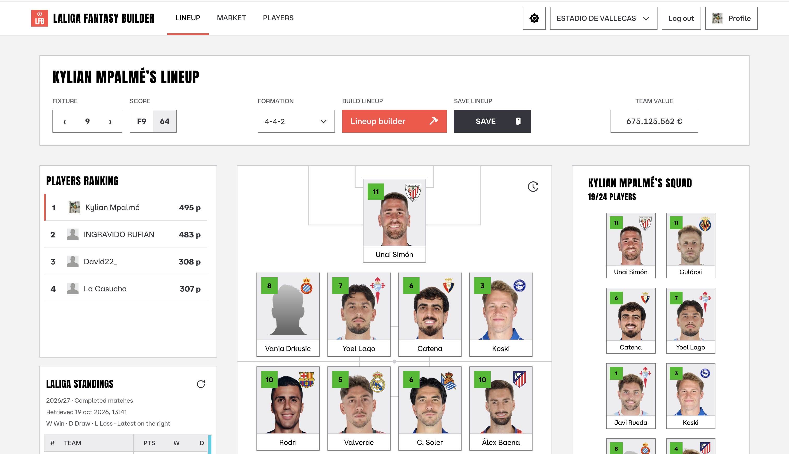
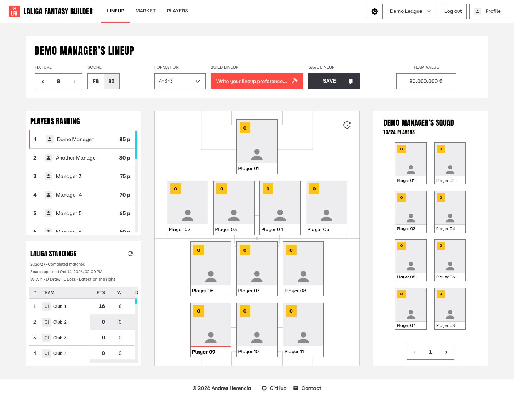
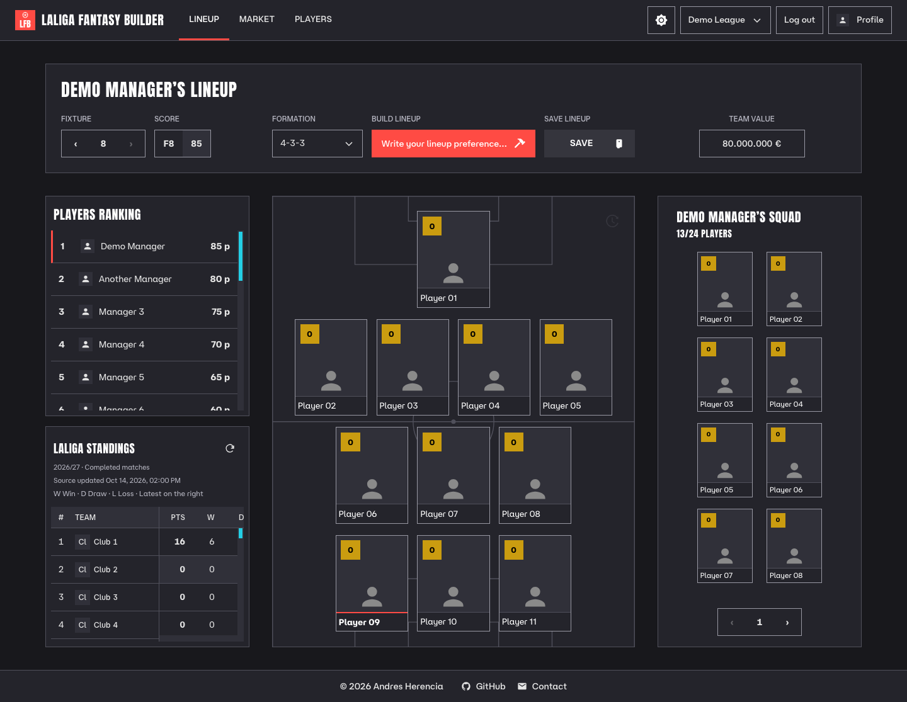

# Frontend

React app in `frontend/` (Vite, Bun). It is the browser entry point for
LaLiga Fantasy Builder: sign-in, league selection, lineup editing, player
catalog and profiles, and an interactive market board. It never calls LaLiga
directly and keeps the internal JWT in memory only.

- System map: [Architecture](architecture.md)
- HTTP routes the UI calls: [API overview](api/README.md)
- Completed visual migration: [Design-system migration record](frontend-design-system-migration-plan.md)

## Visual system and screenshots

The app uses Anton display headings, AT Aero body/actions, neutral square
surfaces, thin borders and coral primary actions. The header's **Dark/Light**
control switches the whole document, including portaled overlays and charts.
Light is the default; an explicit preference is saved under `lfb-theme`.
The app uses Base UI for dialogs, selection, menus, tooltips, collapsibles and
toasts, with local CSS and native buttons/fields where appropriate.
The lineup sidebar uses local shadcn Base UI Card, ScrollArea, Table, and Badge
components, adapted to these same tokens and plain CSS.

Automated browser checks use fictional deterministic data and fallback
portraits. The product captures below show the local account as it appeared at
capture time.

Screenshot assets live under [`docs/images/`](images/).

### Product captures

The following captures document the full local interface: lineup and builder,
market and catalog tables, and the player profile's averages, form, match,
market-value, Fantasy-data, and injury-history sections. Their values reflect
the account and data available at capture time. The same gallery is embedded in
the [project README](../README.md#screenshots).

#### Lineup



The following standings captures use deterministic fictional managers and the
shared synthetic twenty-club contract fixture:





[Mobile standings layout](images/screenshots/lineup-standings-mobile.png)


#### Market and player catalog


#### Player profile


## Running locally

Same-origin proxying matches production Nginx:

- `uv run poe dev` from the repo root (auth, API, scraping, and Vite), or
- `cd frontend && bun run dev:all` when backends are already up.

App URL: http://localhost:3000. `/auth`, `/laliga`, and `/api` proxy to auth
and the API.

## Routes

| Path | Screen | Primary API domains |
|------|--------|---------------------|
| `/` | Lineup — formation, pitch, squad, manager ranking, club standings | [Leagues](api/leagues/README.md), [Teams](api/teams/README.md), [Calendar](api/calendar/README.md), [Standings](api/standings/README.md) |
| `/market` | Market — listings, bids, release clauses | [Market](api/market/README.md), [Buyout](api/buyout/README.md), [Players](api/players/README.md), [Calendar](api/calendar/README.md) |
| `/players` | Players — catalog, filters, top-10 leaderboard | [Players](api/players/README.md), [Calendar](api/calendar/README.md) |
| `/players/:playerId` | Player detail — stats aggregate | [Players](api/players/README.md) (`GET /players/{id}/stats/detail`) |

The shell header switches routes. The league dropdown applies to lineup, market, and players.

### Player detail widgets

The player detail screen loads recent and upcoming matches, profile data, and
weather from `GET /api/players/{id}/stats/detail`. Its match section shows up to
five cards in each direction, with a central score and labeled outcomes. Small
status rails distinguish results. Upcoming cards show a neutral weather icon and
available temperature, humidity, and wind values; unavailable forecasts leave
the fixture visible with a reason. A **View match timer** control shows the
countdown to a confirmed kickoff.

The **Form** section shows LaLiga fixture cards with expandable per-match stats,
including DAZN points. The **Fantasy data** section groups profile indicators,
news links, and injury history into responsive columns. News titles show
**Read more** only when the title exceeds its two-line region. News and injury
history show five records per page with independent sliding three-number navigation.
Fantasy profile and injury-history columns have matching widths on desktop.

The player header separates club, FSYP, position, and availability. Six equal
metric cells highlight position-specific averages; the remaining
statistics open under **Details**. FutbolFantasy season averages take priority.
When a supported scraped metric is missing, the UI averages that metric across
played `lastStats` matchweeks from the LaLiga Fantasy catalog and identifies
that source and sample size. Form arrow classes map to **Bad**, **Mid**,
**Good**, and **Very good** labels; numeric form and starter probability are
shown when the source publishes them. A partial API failure is reported by
segment while successful groups remain visible.

Player photos use available API media with fallback images from market listings
and the selected roster. Team crests resolve from fixture/catalog media and fit
inside fixed match-card tiles. Failed portrait and crest requests use safe
fallbacks. Custom value periods open a dialog with a keyboard-accessible
calendar, From/To fields and a Last days shortcut. Only **Apply range** updates
the query; Cancel leaves the current chart period intact.

### Lineup player actions

Pitch and squad cards show fixture points in the upper-left corner, opposite the
club crest. Clicking a populated card opens a player menu with **Market options**
and **Player details** (coaches have no details route). Market actions retain the
existing ownership, listing, balance and availability rules.

**Swap player** is available only for footballers in your editable lineup.
Choosing it on a pitch player opens the squad replacement picker. Choosing it on
a bench player asks you to select a pitch player in the same position. During
replacement selection, card clicks choose players directly. Changes remain a
local draft until you save the lineup; past and opponent lineups cannot be edited.

### Players screen

The Players table includes player photo, name, team, FSYP, form, market value,
owner, availability, position, and context-sensitive actions. Search and
column filters include a team list. Form filtering and score averages use the last three played matches, including
current-week matches once they start. Form badges also display scheduled current-week
matches as zero with a warning; these placeholders are excluded from averages.
The Players score tooltip appears only over the FSYP cell (or on keyboard focus). Row actions expose market options
when available, plus explicit player-name/details links. Favorite selection
changes only the bookmark icon; its surface stays neutral. Rich rows have thin
dividers without entrance motion. Filters edit a draft in a desktop side panel
or mobile bottom panel; Apply writes the existing URL state, while Cancel or
Escape discards edits. Catalog pagination uses a sliding three-number window.

At viewport widths of **800px or less**, the table condenses to the player
photo, name, team, and actions, with those four column headings shown.
The Name and Team filters remain available; other data columns and their filters
are hidden at that breakpoint. The loading state uses a table-shaped skeleton.

## Authentication

After Keycloak login, the app exchanges the session for an internal JWT
(`POST /auth/token` with CSRF) and sends `Authorization: Bearer …` on `/api`
requests. `needs_reauth` prompts the user to link LaLiga again. See
[Authentication](authentication/authentication.md).

## Shared building blocks

| Area | Location |
|------|----------|
| API paths and JSON helpers | `frontend/src/api/client.ts`, `format.ts`, `mappers.ts` |
| TanStack Query hooks | `frontend/src/api/queries.ts` |
| Dialogs and money display | `frontend/src/components/ui/Dialog.tsx`, `frontend/src/components/ValueBox.tsx` |
| Tooltip, pagination, notifications and controls | `frontend/src/components/ui/` |
| Theme roles and typography | `frontend/src/styles/design-system.css`, `fonts.css`, `theme.ts` |
| Live clock for countdowns | `frontend/src/hooks/useNow.ts` |

## Lineup screen

The user's current-fixture pitch provides two loading actions. **Load last saved
lineup** discards local edits and restores `GET /teams/{team_id}/lineup`.
**Load original lineup for FX** loads the fixture snapshot from
`GET /teams/{team_id}/lineup/week/{week}`, including its formation and captain.
The scoring action is enabled after the fixture starts and a snapshot is available;
an unavailable snapshot is never replaced by the latest saved lineup. Loading either
lineup changes the local draft only. Loading a different scoring snapshot enables
Save, which must be used explicitly to replace the saved lineup.

Code: `frontend/src/features/lineup/`.

- **Players Ranking** lists the user and opponents; **LALIGA standings** sits
  immediately below it. Each card has an independently scrollable body and a
  fixed heading. On desktop they share the existing sidebar height; on stacked
  screens they follow the pitch and squad with bounded scrollable bodies.
- The LALIGA table includes rank, team, points, wins, draws, losses, goals for,
  goals against, signed goal difference, and last-five results. Horizontal
  scrolling reveals every statistic while rank/team and the table header stay
  visible. W/D/L badges run oldest to newest; click, tap, or activate a badge by
  keyboard for opponent, venue, score, and date. Club rows do not select managers.
- The widget uses `GET /api/competitions/1/standings?mode=completed` through
  `useCompetitionStandingsQuery`, resolving the current season on the server.
  Its in-memory query is fresh for one hour and retained for one hour after
  unmounting; logout/session expiration clears the user-scoped cache. The
  refresh button can request data earlier. Source-update and retrieval times
  are labeled separately. Provider failures offer retry inside the widget,
  preserve any previous table, and do not block the lineup. See the
  [standings implementation record](frontend-standings-implementation-plan.md).
  The default `laliga-fixtures` source computes scores and form from completed
  public fixtures and verifies the table against the private official scraper.
  The optional API-Football source's `standings_plan_unavailable` response explains that the provider does
  not cover this season; the server's configured provider key needs season
  access before retry can succeed.
- Loads leagues, remembers selection, and supports `/?team={teamId}` to open
  another manager’s squad when that team appears in standings.
- Matchweek navigation, formation picker, lineup save (`PUT /teams/{team_id}/lineup`,
  full replace — [Teams API](api/teams/README.md)), standings, pitch, and
  paginated squad panel.
- Shared player tiles and score badges are reused on the market table.
- On your own squad, hover a player for **Click for player options**, then click the
  card. **Bring to market** lists the player (`POST /api/market/leagues/{id}/listings`)
  for a whole-euro offer from the current market value through 999.999.999 €.
  When that player is already listed, **Bring to market** is replaced by **Cancel bid**
  (`DELETE /api/market/leagues/{id}/{marketId}`) and **Modify bid** (withdraw, then list
  again at the new amount). **Send immediately to market**
  (`POST /api/market/leagues/{id}/immediate-sales`) sells at half the market value;
  Fantasy credits the balance and the player leaves the squad. These actions are hidden
  while you are replacing a pitch player, and on another manager’s squad.

## Market screen

Code: `frontend/src/features/market/` (`model/`, `cells/`, `actions/`,
`MarketPage.tsx`, `useMarketBoard.ts`). Row helpers are re-exported from
`marketRows.ts`.

### Toolbar

- **Balance** from `GET /api/teams/{team_id}/money` (league object fallback).
- Negative balance shows a warning icon with a tooltip: balance must be positive
  before the next matchday to score.
- **Offers** beside the market balance opens a modal side panel (bottom panel on mobile),
  following the shadcn Sheet pattern on the existing Base UI dialog. Its translucent
  backdrop leaves the market visible. The supplied notification icons adapt to the
  theme and pending count. Offers load asynchronously when the market screen appears;
  they never block the market table. The entire notification button turns red as soon
  as a pending offer arrives, even while other offer reads are still loading, and
  returns to its normal appearance when none remain. Close, Escape and backdrop dismissal restore focus to
  the trigger; dismissal is blocked while an offer response is being sent.
- Your own players have **View offers for this player** in their Options menus
  on the lineup, Players, and market screens. It opens the panel filtered to that
  player's incoming offers; the market toolbar notification count covers the full squad.
- The panel reads `/api/market/leagues/{id}/player-teams/{playerTeamId}/offers`
  for the caller's squad, independently of market filters and listings. Reads are
  cached for 30 seconds, refreshed on opening and manually, and polled every minute
  while open. Partial failures preserve available offers and mark the count incomplete.
  `isFromMarket: true` identifies LaLiga offers. Missing sender data without that
  flag is not assumed to mean LaLiga. Bids remain visible but cannot
  be answered through offer endpoints.
- Pending offers with valid identifiers and whole-euro amounts can be rejected or
  accepted. Acceptance confirms the player, sender and exact amount before sending
  `offerMoney`; expired offers are excluded. Changed amounts and unknown statuses
  block confirmation. Writes are never automatically retried. Confirmed responses
  update the count and refresh market, offers, squad, lineup, balance and leagues;
  unusable success responses refresh reads so the user can check the outcome.
- Each offer displays a clock and time remaining, refreshed every minute, alongside
  its exact expiry date. The clock turns red at one hour or less. Expiries below
  one minute show `<1m`; absent or invalid dates show an unavailable indicator.
- **Search and filters** (`marketFilters.ts`, column header filter icons): toolbar
  `query` matches player, seller and team; column editors use separate `player`
  and `seller` strings (AND with `query`). Each filterable table column has a funnel
  icon that opens min/max or text controls (market value 1.000–1.000.000 €,
  whole-number points/form). **Clear filters** in the toolbar resets everything;
  **Clear column filter** resets only that column. Filter state stays on the page
  across refetches; values use `useDeferredValue`. Column filters open a
  responsive side/bottom dialog with local draft values. **Apply filters**
  commits the draft; Cancel, Escape and backdrop dismissal discard it.
  **Clear column filter** clears that field in the draft; Apply confirms it.
  Market and Players share the same flat rich-row presentation.

### Data loading (`useMarketBoard`)

| # | Request | Purpose |
|---|---------|---------|
| 1 | `GET /api/market/leagues/{league_id}` | Listings and `userBids` ([Market snapshot](api/market/README.md)) |
| 2 | `GET /api/players` | Catalog (names, photos, positions) |
| 3 | `GET /api/calendar/current` | Current and previous matchweek for form |
| 4 | `GET /api/players/{id}/market-value` | Per listed master id (trend + tooltips) |
| 5 | `GET /api/calendar/weeks/{week}/stats` | Played history plus current matchweek scores for form badges |
| 6 | `GET /api/teams/{team_id}` | Caller squad size and squad value (eligibility) |
| 7 | `GET /api/teams/{team_id}` (seller teams) | Opponent rosters when buyout lock times are missing on listings |

After bid mutations, the client refetches market, money, and squad data. A
short-lived **pending-bid overlay** reapplies local bid/cancel state on top of
stale snapshots until Fantasy confirms the change (`model/pendingBids.ts`).

### Table columns

| Column | Notes |
|--------|--------|
| Player | Photo and explicit name link; bid icon and amount tooltip when you have a bid |
| Position | Abbrev badge (`GKP`, `DEF`, `MDF`, `ATK`, `COA`); hover shows full role name |
| FSYP | Points plus season average; hover panel: total, season average, form (last 3) |
| Form | Three matchweeks at a time, oldest→newest; current pending fixtures show 0 with a warning and are excluded from averages; ‹ earlier, › later (full season) |
| Market value | Price on the first line, 5-day change on the next; hover: last, highest, lowest, 5d/14d ago with % vs current |
| Availability | SVG icons + hover text for next matchday readiness |
| Seal end | Countdown with a coral status rail when under one hour remains |
| Sell options | Seller link (`/?team=…`) or `LALIGA`; **Options** / **Bidded** action menu. On your own listings the menu offers **Withdraw from market** (confirmation modal, `DELETE /api/market/leagues/{id}/{marketId}`) and a disabled **Immediate sell** entry until a documented Fantasy route exists |

### Actions (user-confirmed only)

Each row’s menu depends on listing type and your bid state. Dialogs use grouped
euro amounts (es-ES). CLIs and browser-session flows stay read-only.

| Action | When | API |
|--------|------|-----|
| **Hire** | LaLiga listing, no active bid | `POST …/bids` |
| **Purchase bid** | Opponent listing | `POST …/bids` or `POST …/direct-offers` when `directOffer` |
| **Modify bid** / **Cancel bid** | You already bid | `PUT` / `DELETE …/bids/{bid_id}` |
| **Pay release clause** | Opponent, clause unlocked, balance OK | [Buyout pay](api/buyout/README.md) |

**Eligibility (client-side before dialogs):**

- Squad cap: fewer than 24 players and `players + active bids < 24` for new bids.
- Bids: amount ≥ market value and ≤ cash + 20% of squad market value,
  regardless of whether the starting cash is positive, zero or negative.
  The exact limit is allowed. Modifying a bid restores that bid's reserved amount
  before calculating the limit. Unknown squad valuation grants no debt allowance.
- Coaches (`positionId` 5): **Hire** disabled; menu shows the premium-only explanation
  (`marketMessages.ts`).

**Explanations on disabled menu items:**

- Locked release clause: cannot activate yet + countdown until unlock (from
  listing or seller roster `buyoutClauseLockedEndTime`).
- Coach hire: LaLiga Fantasy premium subscribers only.

**Bidded UX:** neutral **Bidded** trigger with bid icon, **Modify bid** and
**Cancel bid** actions; bid amount tooltips on name and button.

**Errors:** upstream bid `400` / `fantasy_error` maps to a refresh-and-retry
message when listing state changed (`marketActionErrors.ts`).

User-facing copy constants: `marketMessages.ts`, `marketActionErrors.ts`,
`bidTooltip.ts`.

### Tests

`frontend/src/features/market/**/*.test.ts`, plus `api/format.test.ts` and
`client.test.ts` for shared helpers.

Current-matchweek scores are loaded for both your lineup and opponents' lineups,
including pitch and squad badges. The current calendar score takes precedence over
cached player history. Current-week stats refresh every 30 seconds while the screen
is open. Before a match is played, its displayed zero is a placeholder, not a played
result for form averages.

## Validation

From `frontend/`:

```bash
bun run lint
bun run test
bun run build
bunx playwright install chromium
bun run test:browser
```

Browser tests run an isolated Vite server on port 3100. They intercept auth/API
requests with fictional fixtures and block external requests; no live bids,
sales or clause payments are performed. The suite covers both themes at
375/800/1024/1440px, the catalog's 800/801px boundary, access gates, supporting
routes, filter focus/cancellation, calendar apply/cancel, and confirmed-response
notification timing. Screenshot artifacts go to `frontend/test-results/` by
default; `PLAYWRIGHT_OUTPUT_DIR` can override the location.
