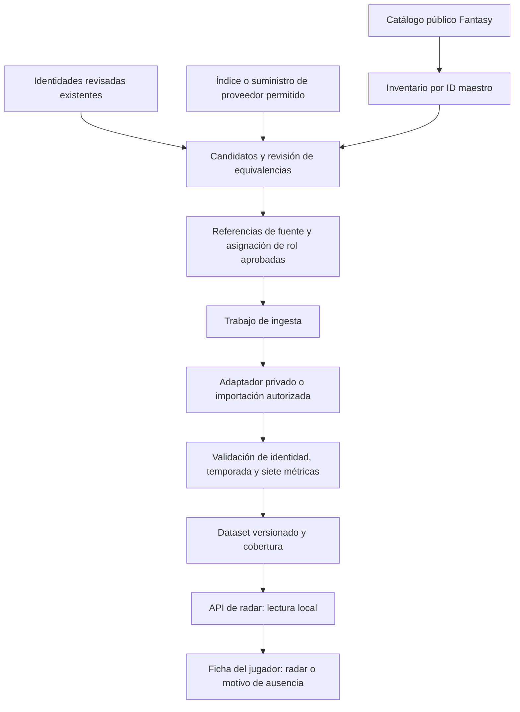

# Plan de implementación: radares para el catálogo Fantasy

Fecha: 1 de noviembre de 2026. Estado: implementación entregada por fases,
posterior al MVP `e46d7e1`. La activación real sigue condicionada a suministro
revisado y piloto. Este documento no activa proveedores ni ejecuta una ingesta.

## Resultado que queremos conseguir

Cada futbolista del catálogo Fantasy tendrá una entrada de cobertura por
temporada, identificada por su **ID maestro**, y su ficha mostrará automáticamente
un radar cuando existan siete métricas válidas para su perfil. Si no existen,
mostrará el motivo concreto y las temporadas realmente disponibles.

La asociación cubre el 100 % del catálogo; un radar completo depende de la
disponibilidad de datos. No se pueden observar estadísticas de una temporada en
la que un jugador todavía no ha participado. Tampoco se pueden obtener siete
percentiles de una fuente que no publica a ese jugador.

La [guía oficial de DataMB](https://datamb.football/guide/), consultada el
1 de noviembre de 2026, describe actualización semanal y un umbral progresivo
de minutos: en ese momento, 300 para 2026/27, hasta 1000 al final de temporada.
También distingue seis grupos posicionales y percentiles por posición/temporada
frente al conjunto Top 7. Esos filtros impiden prometer cobertura total del
catálogo mediante sus perfiles. El umbral observado no será una constante del
código: cada dataset deberá documentar su elegibilidad real.

**Decisión:** ampliar el MVP con un registro revisado de identidades, una ingesta
desacoplada de las visitas y publicaciones persistentes del dataset. Mantener
los seis perfiles existentes. DataMB será el primer suministro si se acredita
acceso, descubrimiento y cobertura; cualquier alternativa deberá superar una
auditoría de las siete métricas, en lugar de rellenar huecos por jugador.

## Punto de partida comprobado

| Pieza existente | Qué se reutiliza | Qué falta |
| --- | --- | --- |
| Catálogo público Fantasy y `PlayersRepository` | IDs maestros, nombres, posición Fantasy y club | Snapshot actualizado, altas/bajas y registro de cobertura |
| `scraper/data/player_names.json` | Nombres y procedencia revisados para proponer candidatos | Es un inventario de FutbolFantasy; no acredita identidades DataMB |
| Registro `radar/profiles.py` | Seis perfiles versionados y orden de siete métricas | Asignación revisada de roles para el catálogo |
| `RADAR_STORE_PATH` | Importación validada de snapshots, límite de 5 MiB | Generación, publicación y refresco automáticos |
| Adaptador privado DataMB | Parser, comprobación de etiquetas y límites HTTP | Descubrimiento utilizable, auditoría de los seis roles e ingesta programada |
| `PlayerRadarService` y endpoint con JWT | Construcción del radar y comparación estricta | Cobertura explícita e índice persistente de candidatos |
| `PlayerRadarSection` y gráfico | Radar y tabla accesible, temporadas y comparación | Carga automática de datos locales y motivos de ausencia específicos |

El inventario local revisado el **11 de octubre de 2026** contiene 829
futbolistas: 89 porteros, 289 defensas, 262 centrocampistas y 189 delanteros;
826 tienen ruta FutbolFantasy confirmada. No es un recuento del catálogo en
vivo ni una estimación de cobertura DataMB. Ver [identidades](player-aliases.md).

El repositorio de radar consulta hoy el proveedor durante una lectura cuando
hay un `datamb_mapping`. Sus candidatos DataMB dependen de `_observed`, una
memoria local al proceso; el scraper conserva como máximo 256 perfiles. Este
mecanismo sirve para el MVP, pero no será la persistencia del catálogo completo.

## Flujo propuesto



El trabajo se ejecutará con la aplicación API como orquestador de dominio;
las descargas de proveedores seguirán en scraping, mediante `X-Service-Token`.
Reutilizar el cliente del catálogo público sin bearer LaLiga. Auth e identity no
cambiarán. Abrir una ficha no lanzará scraping ni una búsqueda de identidad.

## 1. Inventario completo y auditoría inicial

Crear un comando de inventario que consuma el catálogo público mediante el
repositorio existente y guarde un snapshot fechado y validado. Incluir posiciones
Fantasy 1–4; excluir entrenadores (`positionId=5`) del denominador de futbolistas.
Las posiciones ausentes o nuevas se enviarán a revisión, sin descartarlas.

Incluir suplentes, canteranos y registros fuera de LaLiga que sigan presentes en
Fantasy; diferenciarlos mediante atributos de alcance. No reducir el universo a
los jugadores con minutos para aumentar artificialmente la cobertura.

Comparar con la ejecución anterior para detectar altas, cambios de nombre/club,
cambios de posición y bajas. Una baja se archiva; conserva sus datos históricos.
Validar ID numérico, unicidad y forma del catálogo antes de publicar el inventario.
Un catálogo incompleto o corrupto no sustituye al último válido.

**Entrega:** `catalog.json`, `coverage.json` y un informe por club/posición, con
fecha del catálogo, total de futbolistas y todas las ausencias clasificadas.

## 2. Resolver identidades sin depender del nombre

Mantener un registro revisable separado de las observaciones estadísticas:

| Registro | Campos mínimos |
| --- | --- |
| Identidad Fantasy | `player_id`, nombres publicados, club y posición, snapshot del catálogo |
| Referencia externa | proveedor, clave externa observada, URL de evidencia, nombre publicado, fechas de validez y de revisión |
| Decisión de equivalencia | `pending_review`, `matched`, `ambiguous` o `not_found`; evidencias y versión de la decisión |
| Asignación de perfil | `profile`, temporada, origen de la asignación, perfil por defecto y evidencia del rol |

Los alias actuales podrán generar candidatos mediante un exportador offline;
la API no importará internals de `fantasy_scraping`. Ni un slug FutbolFantasy,
ni un apellido, ni una coincidencia difusa verificarán automáticamente DataMB.

Usar nombre completo, evidencia de identidad y trayectoria/club en el periodo;
fecha de nacimiento o ID estable cuando la fuente los publique. La edad sola no
equivale a fecha de nacimiento. Mantener los casos ambiguos pendientes. Si el
proveedor sólo publica nombre/edad/club, resolverlos con evidencia adicional
revisada antes de activar el vínculo.

No construir URLs adivinando nombres. Obtener claves desde un índice permitido,
un manifiesto acordado o una lista de perfiles públicos ya verificados. La
investigación [DataMB](datamb-feasibility.md) no acredita un índice completo
utilizable: su revisión de robots excluyó los CSV/XLSX. Esta dependencia se debe
resolver antes de planificar una ingesta exhaustiva. Una suscripción de interfaz
no se tratará automáticamente como un feed automatizable.

No exigir igualdad con el club actual para un snapshot histórico: validar el
club del periodo y conservar ambos contextos. Las referencias tienen historia;
un fichaje no crea otra persona. Posibles duplicados de IDs maestros se revisan
explícitamente, sin fusionarlos por nombre.

**Entrega:** registro versionado de referencias aprobadas y cola de revisión con
candidatos/evidencias. Ninguna referencia pendiente alimenta una ficha real.

## 3. Asignar y auditar los seis perfiles

| Rol de la fuente, una vez verificado | Perfil existente |
| --- | --- |
| Central | `defense_progression_v1` |
| Lateral | `defense_fullback_v1` |
| Portero | `goalkeeper_v1` |
| Delantero centro | `attacker_finishing_v1` |
| Extremo | `attacker_winger_v1` |
| Centrocampista | `midfielder_v1` |

Los cuatro grupos Fantasy no distinguen central/lateral ni delantero/extremo.
Por eso la posición Fantasy sirve como control de coherencia, no como regla de
asignación del radar. Si contradice la fuente, revisar el rol y su periodo.

Permitir varios perfiles por persona cuando estén publicados y validados.
El perfil inicial será el aprobado para esa temporada; si hay varios y la fuente
no establece uno principal, registrar una decisión revisada y estable. No elegir
el que tenga percentiles más altos. Sin rol acreditado: `role_unresolved`.

Completar fixtures reales permitidas de central, lateral y extremo y ampliar las
de portero, centrocampista y delantero. Verificar siete etiquetas exactas,
definiciones, orden, unidades, escala, temporada y minutos. No usar el orden del
glosario como contrato de columnas. Cualquier cambio semántico crea una versión
nueva de perfil/receta, no una reasignación silenciosa de números.

**Entrega:** matriz fuente × perfil × métrica con evidencia y pruebas del parser.
Un perfil sólo pasa a producción después de validar sus siete columnas.

## 4. Ingesta reanudable y publicación persistente

Añadir un comando operativo, propuesto como `fantasy-radar-sync`, dentro de
`backend/api`. Será independiente del CLI de lectura de estadísticas. Tendrá
modos explícitos `inventory`, `plan`, `fetch`, `validate`, `publish` y `report`.
`plan` será offline sobre manifiestos ya descargados; `fetch` escribirá staging;
`publish` sólo promoverá un dataset previamente validado. No añadir un endpoint
público de escritura ni lanzar trabajos desde el navegador.

El trabajo debe:

1. Fijar catálogo, temporada, referencias aprobadas, perfiles y receta de fuente.
2. Descargar sólo referencias aprobadas y vencidas; deduplicar perfil/temporada.
3. Usar el adaptador existente y respetar robots, límites, bloqueo y ausencia de
   redirecciones. El límite actual de una petición cada cinco segundos es una
   configuración conservadora, no una cuota garantizada por el proveedor.
4. Validar cada respuesta antes de persistirla. Guardar observaciones válidas y
   fallos de forma independiente, con checkpoint para reanudar.
5. Conservar la última observación válida en un fallo temporal, con su fecha
   original y estado antiguo. No sobrescribirla con ceros ni datos inválidos.
6. Construir las vistas y el índice de candidatos; publicar mediante sustitución
   atómica únicamente después de validar el artefacto completo.

Guardar claves con temporada: `(provider, source_key, season, profile)`. Para la
vista publicada: `(player_id, season, profile)`. Un ID de contenido se calculará
sobre datos/contexto/receta; `fetched_at` y flags operativos no crearán por sí
solos un nuevo contenido. Mantener ambos tiempos: descarga y fecha de datos, si
se conoce. Preservar hashes, versión de parser, referencias y manifiesto del run.

Una segunda ejecución sin novedades no duplica observaciones. Un único trabajo
publicador tendrá un bloqueo entre procesos; un lock de `asyncio` no coordina
contenedores. El API tendrá lectura, el publicador escritura. La ejecución
concurrente, una interrupción o un disco lleno no deben dejar JSON parcial.

**Persistencia inicial:** volumen durable compartido, registros de staging y
releases inmutables. Cada release contiene `radar-store.json`, `coverage.json`,
índices y manifest; un puntero `current` cambia atómicamente. API fija un release
por petición para no mezclar cobertura y métricas de dos publicaciones.
Mantener el `radar-store.json` publicado dentro de los límites actuales de
5 MiB/10 000 snapshots, comprobados sobre bytes serializados. Archivar releases
anteriores fuera del fichero servido. No aumentar los límites a ciegas.

La primera entrega publicará la temporada actual. Las temporadas previas sólo
aparecerán cuando tengan un artefacto retenido o un suministro validado; no se
pueden recuperar consultando una página que sólo publica la temporada actual.
Cuando el producto requiera servir varios archivos históricos, añadir un índice
por temporada y un lector de releases con límites por archivo. Postgres con rol
y almacenamiento propios del dominio queda como evolución si hay varios hosts
o consultas que lo justifiquen; no reutilizar tablas de auth/identity.

**Entrega:** un dataset que sobrevive a reinicios y sirve sin consultar al
proveedor. La caché de 256 perfiles pasa a ser sólo una optimización de descarga.

## 5. Cobertura y contrato de lectura

Separar identidad, disponibilidad de datos y frescura. Encontrar un perfil no
implica que existan datos de la temporada solicitada.

| Campo propuesto | Estados o significado |
| --- | --- |
| `identity_status` | `pending_review`, `matched`, `ambiguous`, `not_found` |
| `data_status` | `ready`, `role_unresolved`, `not_published`, `insufficient_minutes`, `incomplete_metrics`, `out_of_scope`, `season_unavailable` |
| `reason_code` | Causa estable consumida por frontend; el texto visible se traduce en producto |
| `last_success_at`, `last_attempt_at` | Éxito y último intento separados |
| `last_error_code`, `stale` | Fallo de refresco sin borrar el último dataset válido |
| `dataset_id`, `catalog_snapshot_id` | Trazabilidad de la cobertura y los valores |

`insufficient_minutes` sólo se asigna con evidencia de minutos y umbral de la
misma muestra. Un jugador ausente de un índice no demuestra minutos
insuficientes: usar `not_published` o dejar elegibilidad desconocida. Un error
HTTP tampoco demuestra ausencia en la fuente. Los estados ambiguos conservarán
su incertidumbre; no publicar una causa más precisa de lo que sabemos.

Mantener `GET /players/{player_id}/stats/radar` y su autenticación actual. Añadir
cobertura y perfil por defecto como campos compatibles de lectura; conservar
`status: available|unavailable`. Si un perfil válido existe, devolverlo aunque
otro perfil falle y documentar el fallo parcial. Si no existen datos publicados,
devolver ausencia explicada. Un store corrupto o una avería sin copia utilizable
seguirá siendo un error operativo, no una ausencia válida con 200.

En modo dataset publicado, el repositorio no resolverá `datamb_mappings` en cada
GET. Las referencias de ingesta vivirán fuera del store servido, que contendrá
snapshots. Esto respeta la validación actual que rechaza mapping y snapshot para
el mismo jugador/perfil. Mantener el modo manual anterior como transición
explícita, sin que compita con el dataset publicado.

Crear un índice persistente de comparación por `comparison_key`; retirar su
dependencia de las visitas anteriores y de `_observed`. Filtrar por perfil,
temporada y población y limitar/paginar candidatos cuando sea necesario. Un
fallo de comparación mantiene el radar principal.

El `reference_snapshot` de la población debe reflejar una revisión de datos
acreditada. Haber descargado dos páginas el mismo día no prueba que compartan
esa revisión. Sin evidencia, conservar `cohort: null` y comparación deshabilitada.
Si se calculan percentiles propios, publicar todos los miembros del perfil con
la misma población congelada en una única release; no mezclar rangos nuevos con
antiguos. Los nativos sólo serán comparables cuando se verifique su referencia.

**Entrega:** lecturas locales estables, ausencias explicadas y candidatos iguales
después de un reinicio o entre workers que leen la misma release.

## 6. Integración en la ficha y actualización programada

Reutilizar `PlayerRadarSection` y `PlayerRadarPlot`. Activar la consulta cuando
la sección entre en pantalla o reciba foco, manteniendo una carga
independiente de `stats/detail`. Con lectura local ya no será necesario pulsar
«Load performance radar» para descubrir si hay datos.

Seleccionar el perfil por defecto aprobado; mantener el selector si existen
varios. Mostrar mensajes específicos para falta de publicación, revisión de
identidad, rol pendiente, muestra insuficiente y error temporal. Un entrenador
no verá un radar de futbolista. Una temporada anterior sólo se muestra como tal;
nunca sustituye silenciosamente la actual. Mantener tabla y valores ausentes
sin cerrar un polígono incompleto.

Si el catálogo necesita indicar cobertura, usar un índice resumido o una consulta
batch acotada con JWT. No lanzar un GET de radar por cada tarjeta ni incluir
información protegida en el catálogo público sin cambiar su contrato de acceso.
Ese indicador es posterior a la cobertura de fichas, no un requisito del primer
despliegue.

Programar inventario diario y refresco estadístico semanal, ajustado al suministro
verificado. Altas nuevas entran en revisión; no inician búsquedas ilimitadas.
Los reintentos serán acotados para fallos transitorios, con parada/backoff ante
bloqueo o límites; los fallos de esquema o identidad requieren revisión. Política
inicial de antigüedad: aviso tras ocho días desde el último éxito y máximo de
treinta días para servir una captura de la temporada activa, ambos configurables.
Tras ese máximo conservar el archivo histórico, pero no presentarlo como dato
actual utilizable. Sustituir el aviso fijo actual de 72 horas para este modo;
consultar una caché no renueva `last_success_at`.

Añadir volumen/configuración a Compose y a su plantilla de despliegue. En el
despliegue actual sobre VM, usar un job contenedor y un timer del host con un
solo publicador; no hace falta un servicio nuevo permanente. En más de un host,
replantear almacenamiento compartido y exclusión antes de escalar. No activar el
timer de producción hasta superar el piloto.

## 7. Qué hacer con quienes sigan sin radar

| Caso | Tratamiento |
| --- | --- |
| Sin minutos o bajo el mínimo del proveedor | Estado explícito; revaluar cuando cambie la muestra |
| Fuente sin ese jugador o liga | Medir el hueco; evaluar un suministro más amplio |
| Homónimo o referencia dudosa | Revisión de identidad, sin estadísticas ajenas |
| Perfil/columnas no validados | Mantenerlo pendiente hasta acreditar sus siete ejes |
| Sólo temporada anterior disponible | Ofrecer esa temporada con etiqueta y contexto propios |
| Falta alguna métrica | Tabla parcial; polígono sin dibujar |

Si la auditoría muestra que DataMB no cubre la población objetivo, evaluar un
feed de eventos/temporada que entregue **las siete métricas y los denominadores
necesarios para toda la población de cada rol**. Usar la matriz del
[gap analysis](provider-gap-analysis.md) para priorizar la evaluación; no asumir
que añadir ScoutingStats, Understat o Sofascore garantiza completitud.

Los percentiles propios serían una segunda entrega: contratos de métricas,
normalización por 90 cuando corresponda, porcentajes ponderados, empates,
elegibilidad y cohortes reproducibles. Se identifican como metodología propia y
no se comparan con nativos DataMB. Una receta se fija para toda la población,
nunca como fallback distinto para un jugador. Los jugadores sin observaciones
seguirán sin poder tener un radar de rendimiento de esa temporada.

## Criterios UX para la implementación

Aplicar la [skill del repositorio](../../.agents/skills/ux-design/SKILL.md), sus
[leyes aplicadas](../../.agents/skills/ux-design/references/laws-of-ux.md) y
[patrones de producto](../../.agents/skills/ux-design/references/product-patterns.md).
Esta evaluación se basa en el código y la documentación actuales. No constituye
una nueva inspección de la interfaz en ejecución, una auditoría completa de
accesibilidad ni una prueba con usuarios. Las mejoras esperadas son hipótesis
que se validarán durante la implementación.

### Tarea y recorrido

Hipótesis de tarea: una persona consulta una ficha desde catálogo, mercado o
plantilla para entender el rendimiento por rol y, si lo necesita, compararlo
con otro futbolista. Debe poder distinguir percentiles, puntos Fantasy, muestra
y actualidad de los datos sin conocer los proveedores ni configurar el radar.

Recorrido previsto: ficha → Overview → Performance profile → contexto y radar ya cargado
→ lectura de una métrica → comparación compatible opcional → regreso a la ficha
o al listado conservando filtros y posición. Una ausencia tiene una explicación
en el mismo panel, sin enviar a otra pantalla para averiguar qué ha ocurrido.

### Hallazgos del código y decisiones

| Observación actual | Decisión de implementación y motivo | Coste o límite que conservar |
| --- | --- | --- |
| `PlayerRadarSection` comienza cerrado y exige «Load performance radar» | Cargar snapshots locales al llegar a la sección; feedback inmediato y sin un clic de descubrimiento. Aplicación de [Doherty](https://lawsofux.com/doherty-threshold/) | La carga sigue siendo independiente; no descargar fuentes ni bloquear el resto de la ficha |
| El primer perfil se toma del orden del array si no hay selección | Usar el perfil por defecto revisado y un nombre de rol comprensible; selector sólo si hay varios. Aplicación de [Hick](https://lawsofux.com/hicks-law/) | La automatización no ocultará la existencia de otros perfiles publicados |
| La comparación utiliza un `select` con nombres | Para el catálogo completo, búsqueda de candidatos compatibles con nombre, club y rol; máximo un comparador activo | Añade interacción de búsqueda; requiere teclado, foco y resultados vacíos claros |
| Cada ficha muestra un enlace a seis ejemplos no vinculados a IDs reales | Mantener `/players/radar-preview` como recurso de ayuda/desarrollo, fuera del panel habitual de un jugador | La vista previa sigue accesible por su ruta; nunca se presenta como alternativa estadística de ese jugador |
| La antigüedad se avisa remitiendo a una fecha dentro de metodología | Mostrar junto al contexto la fecha de datos o su ausencia y la fecha de recuperación por separado | No convertir la fecha de descarga en fecha de actualización |
| Hay una explicación de P80 y una tabla de siete métricas | Conservarlas; etiquetas legibles y precisiones consistentes, sin promedio o área como nota global | La tabla es necesaria aunque añada altura en móvil |
| El gráfico ya oculta el polígono cuando falta un eje | Mantener ese comportamiento y expresar «6 of 7 metrics available», si el conteo lo permite | Un cero publicado conserva su significado; no sustituir ausencias por cero |

La consistencia con navegación, controles y diseño de otras fichas aplica
[Jakob](https://lawsofux.com/jakobs-law/). Los siete ejes proceden del contrato
estadístico; no se justifican mediante un supuesto límite de memoria de siete
elementos. La información técnica de fuentes y recetas se queda en el backend
y el detalle de metodología; las decisiones del usuario son temporada, rol y
comparador.

### Jerarquía y layout

```text
Performance profile                         Season [2026/27]
Centre-back [cambiar sólo si hay otro perfil publicado]
Player · club · 668 minutes in sample
Percentiles against [población acreditada]
Data updated [fecha o Not published] · Retrieved [fecha]

[radar de siete ejes]             [tabla: métrica · percentil]
P80 is a percentile, not an 80% success rate.

Compare with a centre-back [buscar jugador compatible]
[Source and methodology ▸]
```

En móvil: mismo orden semántico, gráfico seguido de tabla y comparación.
En escritorio: gráfico y tabla próximos. Agrupar minutos, temporada y población
con el radar; usar espacios y tipografía para separar contexto, lectura y
acciones. Mantener visibles los límites que afectan a la interpretación; el
panel desplegable contiene definiciones ampliadas y trazabilidad.

Mantener el inglés de la interfaz actual; los textos siguientes son propuestas
de producto, no mensajes técnicos del proveedor. Reutilizar Anton, LALIGA Text,
tokens de color y superficies rectangulares. Reservar coral para selección y
acciones relevantes; un aviso de datos antiguos no debe parecer un error fatal.

### Estados, mensajes y recuperación

| Estado | Mensaje o información propuesta | Acción pertinente |
| --- | --- | --- |
| Primera carga | «Loading performance profile…», con espacio reservado | Mantener accesibles el resto de la ficha y su navegación |
| Perfil disponible | Rol, temporada, minutos, población y fechas junto al radar | Lectura y comparación opcional |
| Identidad/rol pendientes | «We haven't confirmed a performance profile for this player yet.» | Mantener el contexto; no pedir al usuario que resuelva IDs o configure un scraper |
| Sin publicación | «The source has not published a radar for this player this season.» | Ofrecer temporadas acreditadas, si existen; sin botón de reintento que no cambie la disponibilidad |
| Minutos insuficientes acreditados | «Not enough minutes for this reference group.» y minutos/umbral verificados | Explicar la regla; no prometer fecha de disponibilidad |
| Métricas parciales | «6 of 7 metrics available. No radar is drawn.» si realmente son seis | Tabla con «Not published» en la ausencia |
| Copia antigua utilizable | «Saved data from [fecha]. The latest update could not be loaded.» | Conservar radar y selección; reintentar lectura sólo si es útil |
| Sin captura y fallo temporal | «Performance data could not be loaded.» | «Retry» local al panel; resto de la ficha disponible |
| Comparación no acreditada | «Comparison is unavailable because the reference group hasn't been verified.» | Explicación breve; no selector deshabilitado sin motivo |
| Búsqueda sin coincidencias | «No compatible players match your search.» | Permitir borrar/cambiar búsqueda; mantener el jugador principal |
| Temporada sin dataset | «No performance data is available for 2026/27.» | Cambiar explícitamente a una temporada disponible; no sustituirla automáticamente |

Traducir `reason_code` a estos textos en frontend. Los diagnósticos internos,
IDs, nombres de tablas, claves de receta y errores HTTP no serán el mensaje
principal. No mostrar «Retry» para un estado definitivo de cobertura. En modo
publicado, una acción de recarga lee snapshots: no promete actualizar la fuente
ni inicia una ingesta.

### Comparación y conservación del contexto

El buscador sólo ofrece candidatos del perfil/población/periodo compatibles.
Mostrar criterio y número de resultados; nombre y club ayudan con homónimos.
No ofrecer primero un catálogo de jugadores incompatibles para rechazarlos
después. La restricción debe explicarse cerca del control.

Conservar la selección durante un refresco de la misma consulta. Si cambia
temporada o rol, limpiar el comparador incompatible y explicarlo en línea.
Los dos polígonos y columnas deben proceder de una respuesta validada para la
misma release. Una actualización de población no mezclará el jugador principal
de una release antigua con un comparador de la nueva.

Registrar temporada/perfil en parámetros de navegación cuando se implemente su
persistencia, con validación y sin tokens. Atrás/adelante restaurará la selección;
la ficha seguirá respetando los filtros del listado de origen. Los cambios de
datos en segundo plano no moverán foco ni scroll, y no volverán a abrir detalles
que la persona haya cerrado.

### Accesibilidad y criterios de aceptación UX

Objetivo: WCAG 2.2 AA, con los patrones de accesibilidad ya usados en el producto.
Controles con etiqueta persistente y área objetivo de al menos 44 × 44 CSS px,
foco visible no tapado por cabeceras o navegación inferior; combobox navegable
con teclado y cierre/restauración de foco predecibles. Línea continua/discontinua,
leyenda con nombres y tabla; el color nunca será la única distinción.

No exigir hover para leer valores o definiciones. Anunciar carga/error/cambio de
estado de forma concisa, sin releer los siete valores en cada refresco. Respetar
movimiento reducido y evitar animar polígonos durante un cambio de población.
La tabla conservará encabezados semánticos y precisión uniforme. Nombres largos,
zoom y textos ampliados no deben ocultar controles o producir desbordamiento de
toda la página; cualquier scroll local necesario será reconocible y accesible.

Antes de cerrar PR 6 comprobar en interfaz ejecutada, no sólo en tests unitarios:

1. Encontrar el radar sin pulsar una carga inicial; identificar rol, temporada,
   muestra y fecha. El estado de carga recibe feedback, sin una promesa artificial
   de latencia de red de 400 ms.
2. Interpretar P80 sin confundirlo con 80 % de acierto ni con puntos Fantasy.
3. Buscar y comparar un candidato compatible usando teclado y toque; tabla y
   polígonos identifican a ambos y permiten retirar el comparador.
4. Entender por qué falta un radar y qué acción real existe, sin pulsar reintentos
   que no pueden resolver falta de minutos, identidad o publicación.
5. Volver desde otra temporada o ficha conservando el contexto previsto, sin
   presentar datos de otro jugador ni perder foco/scroll en un refresco.
6. Completar esos recorridos a 375 y 1440 px, ambos temas, zoom al 200 % y reflow
   a 320 CSS px. Verificar contraste, nombres accesibles y navegación inferior.

Capturar evidencia visual y añadir pruebas de comportamiento para carga,
selección, comparación y recuperación. Si hay usuarios disponibles, observar
estas tareas sin guiarlos y registrar interpretaciones erróneas y pasos de
recuperación. Hasta entonces, declarar evaluación heurística y validación técnica;
no afirmar mejoras de comprensión, tiempos o conversión no medidas.

## Secuencia de entregas

| PR | Alcance y archivos principales | Criterio para cerrar |
| --- | --- | --- |
| 1 | Inventario, modelos de cobertura y reporte; `cli/radar_sync.py`, `schemas/player_radar.py`, tests | El 100 % del catálogo validado tiene entrada; entrenadores y casos inciertos separados |
| 2 | Registro externo revisado y generador de candidatos; exportador offline de identidades | Homónimos quedan ambiguos; altas/traspasos/bajas preservan historia y evidencia |
| 3 | Auditoría del suministro y seis perfiles; `providers/datamb/`, fixtures | Acceso/descubrimiento utilizables y siete ejes verificados por rol; cobertura observada publicada |
| 4 | Ingesta, checkpoints, releases, lock y publicación; `services/radar_sync.py`, repositorios | Reanudación, idempotencia y fallo de publicación no dañan el dataset válido |
| 5 | Lectura local, cobertura y comparadores; `repositories/player_radar.py`, `services/player_radar.py`, API/Zod | GET sin peticiones externas; paridad entre workers/reinicios; fallos parciales correctos |
| 6 | Carga automática, jerarquía, búsqueda de comparadores y estados; `PlayerRadarSection.tsx`, `PlayerRadarPlot.tsx`, pruebas de interfaz | Cumplir los seis recorridos UX anteriores en interfaz ejecutada; no confundir ejemplos, percentiles, puntos Fantasy ni fechas |
| 7 | Volumen, timer, configuración, observabilidad y documentación | Piloto aprobado, rollback probado y refresco programado sin publicadores concurrentes |

PR 1–2 pueden avanzar sin activar DataMB. PR 3 es la puerta de decisión del
suministro: si no demuestra descubrimiento, acceso o cobertura suficientes,
continuar el pipeline con importaciones autorizadas y evaluar otro feed. No
prometer que cambiar el parser solucionará esa dependencia. PR 4 puede probarse
con fixtures/importaciones; la activación real de PR 7 depende del suministro.

Piloto: al menos dos jugadores por cada uno de los seis perfiles, una pareja
realmente comparable y casos de homónimo, traspaso, nuevo ID, sin minutos,
temporada no disponible y fuente caída. Ampliar después al catálogo completo,
dejando todas las excepciones en el reporte.

## Validación y definición de terminado

Registrar en cada ejecución:

- Asociación: IDs con referencia aprobada / futbolistas del catálogo.
- Radar completo: IDs con al menos un perfil de siete ejes / total del catálogo.
- Cobertura elegible: IDs con radar / IDs acreditados como elegibles para el
  mismo alcance. Publicar también el número de elegibilidad desconocida.
- Distribución por rol/club, ausencias por causa, edad de datos y última ingesta.
- Perfiles pendientes de revisión, fallos de identidad/esquema, 403/429,
  regresiones de cobertura, duración y publicación/rollback.

No fijar un porcentaje esperado de radares hasta medir la auditoría. El objetivo
de cobertura operativa sí es **100 % de IDs contabilizados**, sin exclusiones
silenciosas. Para el piloto y la expansión, ningún snapshot se publica con
identidad o columnas pendientes de verificar.

Pruebas necesarias: ID maestro frente a `playerTeamId`, homónimos, transferencias,
roles dobles, temporada incorrecta, nuevas altas y entrenadores; columnas
permutadas, escala, NaN, cero frente a ausencia y muestras mínimas; ejecución
concurrente, reanudación, archivo corrupto, reinicio y rollback; copia antigua
sin falsear fechas, comparación con población diferente y GET sin scraping.
En frontend cubrir carga automática, cambio de identidad/temporada sin arrastre
de datos, errores parciales, teclado, tabla y móvil/escritorio en ambos temas.

Ejecutar los checks del repositorio por paquete y regenerar API OpenAPI y
`docs/api/endpoint-schemas.md` al cambiar el contrato. Si cambia la interfaz de
scraping, regenerar también su OpenAPI. Actualizar Players API, arquitectura,
READMEs, configuración y runbook de publicación/rollback.

El hito final es: todo futbolista aparece en el inventario y recibe un estado
justificado; todo snapshot válido publicado se abre automáticamente desde su
ficha; las peticiones no descargan fuentes; y la cobertura puede explicarse y
reproducirse desde una release. No se incluyen valores inventados para alcanzar
un porcentaje de gráficos.

## Estado de la entrega

Implementación revisada el 2 de noviembre de 2026.

Las fases 1, 2, 4, 5 y 6 tienen implementación y pruebas: inventario, identidades,
checkpoints/releases, lectura local y UX. La fase 3 implementa el contrato y la
puerta de auditoría, pero **no aprueba el suministro real**: faltan manifiesto de
identidades y capturas permitidas revisadas para los seis roles. La fase 7 entrega
Compose, trabajo contenedor, timers optativos, reportes y rollback; **no activa
producción ni declara superado el piloto real**.

La importación autorizada permite completar la publicación sin depender de un
índice de scraping no permitido. El adaptador actual DataMB no acredita una
revisión de población por respuesta; en la ingesta masiva exige cohort nulo y no
habilita comparaciones nativas. Una importación congelada revisada puede incluir
su población verificada. Ver [operaciones](radar-operations.md) y
[auditoría de suministro](radar-supply-audit.md).

La integración conserva los commits `7e49f5b` y `65355d0`: estilos y encabezados
unificados, radar debajo de Fantasy outlook dentro de Overview y sin un enlace
Performance independiente. La publicación operativa no cambia esa disposición.
Cada release nueva conserva además la procedencia revisada en `provenance.json`,
verificada contra sus tareas y hashes de contenido.
