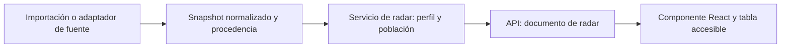

# Diseño del radar de jugador por perfil

Propuesta del 30 de octubre de 2026. No implementa endpoints, scrapers ni UI.
Parte de los seis bloques aportados por el usuario y del
[análisis de proveedores](provider-gap-analysis.md).

## Decisión

Crear **un componente de radar y seis perfiles versionados de siete ejes**.
Separar grupo de posición, perfil, significado de cada métrica y observaciones.
La selección de proveedor y el cálculo de percentiles pertenecen al backend;
el componente recibe un documento validado, listo para representar.

Para este objetivo, DataMB pasa a ser el primer candidato de suministro: ofrece
percentiles posicionales. ScoutingStats sigue siendo útil para estadísticas de
partido, pero no acredita todos los valores necesarios para estos seis radares.
No activar todos los scrapers para construir cada gráfico.

Los seis bloques pegados se tratarán como **datos importados aportados por el
usuario**. No atribuirles procedencia DataMB hasta verificarla. Permiten diseñar
y probar la representación sin disponer aún de una integración de red.

## Perfiles y orden

| Grupo de producto | Perfil estable | Jugador de ejemplo | Ejes, en orden horario desde arriba |
| --- | --- | --- | --- |
| Defense | `defense_progression_v1` | Pau Cubarsí | Passes cmp · Fwd pass% · Prog passes · Poss won · Def duel% · Aerial duel% · Prog carries |
| Defense | `defense_fullback_v1` | Xavi Espart | Crosses cmp · xA · Prog passes · Poss won · Def duel% · Aerial duel% · Prog carries |
| Goalkeeper | `goalkeeper_v1` | Joan García | Parada% · Aéreos ganados · Int (PAdj) · Pases cmp · Largo% · Corto% · PSxG-GA |
| Attacker | `attacker_finishing_v1` | Raphinha | NPG · npxG · Goal conv% · Aerial% · Touches in box · xA · Off duels won |
| Attacker | `attacker_winger_v1` | Lamine Yamal | Prog carries · Dribbles cmp · NPG · npxG +xA · Assists · Key passes · Crosses cmp |
| Midfielder | `midfielder_v1` | Pedri | Duel% · Poss won · Prog carries · Fwd passes · Fwd pass% · Key passes · Prog passes |

Conservar el orden Defense → Goalkeeper → Attacker → Midfielder solicitado.
`Forward` es un alias de importación para Attacker. Un lateral sigue siendo
Defense y un extremo sigue siendo Attacker. No reutilizar la posición Fantasy
para deducir automáticamente el perfil: no identifica el rol específico.

Un jugador puede tener varios perfiles disponibles si la fuente publica varias
clasificaciones, con contexto de temporada y periodo. Registrar el origen de esa
asignación: fuente, revisión manual o regla explícita. Cambiar de perfil selecciona
otro documento; no renombra los siete números existentes.

## Qué aporta cada proveedor

| Fuente | Uso para el radar | Límite |
| --- | --- | --- |
| Importación del usuario | Primeras seis fixtures del componente | Población y procedencia todavía no acreditadas; no afirmar comparación validada |
| DataMB | Percentiles nativos, minutos y metadatos por perfil | La prueba local sólo cubrió portero, centrocampista y delantero; validar central, lateral y extremo. Índices CSV/XLSX excluidos por robots; usar perfiles permitidos conocidos o suministro acordado |
| ScoutingStats | Estadísticas brutas compatibles para futuros percentiles propios | Sus atributos 1–20 no son percentiles. La muestra carece de progresiones, pases precisos individuales y varios desgloses necesarios |
| Sofascore | Métricas brutas candidatas para perfiles propios; atributos como producto separado | ATT/CRE/DEF/TAC/TEC no son estos siete ejes. Acceso HTTP bloqueado en el plan y cobertura exacta por auditar |
| Understat | npxG, xA, goles y desgloses ofensivos para perfiles propios | No completa por sí solo los siete ejes de estos perfiles; acceso bloqueado por el robots observado |
| FootyStats | Acumulados de temporada candidatos; preferir evaluar API oficial | Hay que comprobar definiciones, cobertura individual, acceso y población |
| FBref | Básicos complementarios si se resuelve acceso | No contar con las antiguas tablas avanzadas retiradas |
| Fantasy / FutbolFantasy existentes | Identidad, contexto y estadísticas de sus dominios | Los puntos Fantasy y la forma categórica no son percentiles de rendimiento |

La capacidad debe evaluarse por **fuente × perfil × métrica × periodo**, con
estados disponible, ausente, no equivalente o acceso no disponible. Una fuente
que publica xG no queda acreditada para todo el perfil de delantero.

## Dos modos estadísticos

### Percentiles publicados por la fuente

Conservar los siete percentiles tal como se publican. No volver a dividir por 90,
no volver a convertir a percentiles y no inferir el valor bruto desde su rango.
Convertir fracciones 0–1 a 0–100 sólo cuando el contrato del origen lo indique;
no detectarlo por el tamaño de un valor, porque 0,7 también puede ser un percentil
válido sobre 100.

La [guía de DataMB](https://datamb.football/guide/) describe grupos por posición y
temporada y distingue la población Top 7 de otras ligas. Su glosario distingue
tasas por 90, porcentajes de éxito y ajustes de posesión. Conservar esas
definiciones; no asignar automáticamente «LaLiga» como población comparativa
porque el jugador pertenezca al Barcelona.

### Percentiles calculados por la aplicación

Es un dataset nuevo y con metodología propia, no una reproducción de DataMB.
Requiere una población suficiente y documentada, con:

- Competición o ligas, temporada, perfil y ventana temporal.
- Regla de elegibilidad y mínimo de minutos; número de jugadores realmente incluidos.
- Definiciones y unidad de cada eje: conteo por 90, porcentaje, ajuste de posesión.
- Fuente y cobertura homogéneas para cada métrica en toda la población.
- Versión del método, tratamiento de empates, ausencias y snapshot de población.

Política inicial propuesta: una población común con los siete ejes válidos para
cada perfil. Si la cobertura es insuficiente, no publicar el radar calculado.
No calcular percentiles con estos seis jugadores: usan seis perfiles diferentes
y no constituyen una población representativa de ninguno.

Calcular tasas a partir de sumas y denominadores: sum(goals) × 90 / sum(minutes);
sum(completed) / sum(attempted) para precisión. No promediar porcentajes sin
ponderar ni volver a normalizar una tasa ya publicada por 90. Un porcentaje sin
intentos es desconocido, no cero. No sumar percentiles de npxG y xA: sumar sus
valores brutos compatibles y calcular después el rango del combinado.

Si se combinan fuentes, la receta se fija y versiona para **toda la población**.
Por ejemplo, usar npxG de Understat para todos los jugadores elegibles, nunca
sólo para rellenar el hueco de un jugador. Si falta cobertura, marcar ausencia.
Cambiar de fuente requiere reconstruir población y percentiles.

## Contrato y modelos

Mantener las seis clases `Stats` como validación explícita si resultan útiles.
Añadir a cada wrapper un `profile` Literal único y discriminar la unión por ese
campo. `position` no es único: lo comparten central/lateral y delantero/extremo.
Pydantic documenta las
[uniones discriminadas](https://docs.pydantic.dev/latest/concepts/unions/#discriminated-unions-with-str-discriminators).

La salida del servicio de radar será una vista común con:

| Parte | Campos principales | Regla |
| --- | --- | --- |
| Identidad | `player_id`, nombre y referencias de proveedor revisadas | ID maestro Fantasy; nunca `playerTeamId` ni nombre como clave |
| Contexto | club y ámbito, edad con fecha, temporada, competición, periodo, minutos | Los minutos corresponden a la misma muestra que las métricas y quedan fuera del radar |
| Perfil | `profile_id`, versión y grupo de posición | Fija los siete ejes y su orden |
| Dataset | ID, fuente/método, snapshot de datos | Distingue importado, percentil nativo y percentil de aplicación |
| Población | referencia, descripción, posición, temporada, ligas, elegibilidad y tamaño si se conoce | Ausencias explícitas; no inventar tamaño ni umbral |
| Ejes ordenados | siete objetos con clave estable, etiqueta y definición | La identidad no depende del idioma ni del orden de claves JSON |
| Observación | percentil nullable, bruto nullable, unidad y estado | Percentil finito 0–100; el bruto no es obligatorio si el origen no lo publica |
| Procedencia | fuente, métrica de origen, snapshot y transformación | Guardar por eje; el dataset fija la receta común |
| Calidad | warnings, cobertura, fecha de descarga, fecha de datos si se conoce y stale | Descargado hoy no significa actualizado hoy |
| Comparación | `comparison_key` nullable y motivo si no es comparable | Calculada/validada por backend; desconocido no equivale a compatible |

El registro de perfiles define orden, etiquetas y métricas aceptadas. El registro
de métricas conserva significado, unidad, dirección y versión. Para el MVP pueden
ser constantes tipadas del backend: no hace falta un framework de plugins ni un
servicio nuevo. La API devuelve los ejes ya ordenados; Zod valida el contrato en
frontend. No construir la API pública a partir de aliases como `Parada%`.

Definiciones de fuentes distintas permanecen separadas hasta verificar una
equivalencia. Ejemplos: `Poss won` de DataMB no se debe mapear sin más a
`recoveries`; `Int (PAdj)` no es intercepciones sin ajuste; PSxG-GA no es cualquier
campo llamado «goles evitados». Aciertos, intentos y porcentajes son dimensiones
distintas, aunque una etiqueta incluya `%`.

Un cambio semántico o de orden de ejes crea una nueva versión de perfil.
Una traducción o corrección ortográfica no cambia la identidad estadística.
Guardar snapshots de observaciones para conservar series históricas y poder
explicar por qué ha cambiado un rango.

## Reglas para comparar

Para superponer dos jugadores deben coincidir perfil/version, definiciones y
orden de ejes, población de referencia, metodología, receta de fuentes y periodo
del dataset. Comparar snapshots distintos de población puede cambiar los rangos
sin que cambie el rendimiento; el MVP exige el mismo snapshot de referencia.

- Cubarsí y Espart: mismo grupo Defense, **perfiles incompatibles**.
- Raphinha y Yamal: mismo grupo Attacker, **perfiles incompatibles**.
- Dos centrales con percentiles DataMB y aplicación: mismo perfil visual,
  **metodologías incompatibles**.
- Dos perfiles importados sin población conocida: representación individual
  permitida; comparación validada deshabilitada.

El backend devuelve candidatos compatibles y motivos de incompatibilidad.
No basta con comparar dos `null` de población ni con compartir el nombre de una
clase Python. Comparaciones entre temporadas o contextos se pueden diseñar más
adelante como modo explícito; no son el comportamiento inicial.

## Componente e interacción

Propuesta de sección **Perfil de rendimiento** dentro de la ficha de jugador,
aprovechando navegación de secciones, React Query, Recharts ya instalado y los
tokens visuales existentes. Contenido prioritario:

```text
Perfil de rendimiento                  Temporada [2026/27]
Pedri · Barcelona · 23 años             Perfil [Centrocampista]
769 minutos · muestra de temporada

Percentiles frente a [población documentada]
Fuente / método · fecha de datos o descarga

[radar de 7 ejes]                       [tabla de métricas]

[Comparar con un jugador compatible]    [Ver metodología]
```

En escritorio, gráfico y tabla próximos para facilitar la lectura del valor y
su significado. En móvil, gráfico seguido de tabla, con etiquetas abreviadas
legibles y nombres completos en tabla. Mantener controles de temporada y perfil;
fuente/metodología en detalle secundario, evitando seis selectores de proveedores
como primera decisión. El usuario elige qué comparar; el backend resuelve el
dataset válido. No confundir con selector de grupo de posición de un catálogo.

Geometría: siete radios fijos, dominio 0–100, marcas 25/50/75/100, mismo origen
angular y orden para todo un perfil. Un percentil 0 se dibuja en el centro; `null`
no se dibuja como cero. No mostrar un promedio general ni usar área del polígono
como puntuación global.

MVP: un jugador y, opcionalmente, un comparador compatible. Líneas continua y
discontinua, nombres visibles y colores distinguibles en ambos temas; relleno
suave o ausente para no ocultar valores. Mantener la tabla accesible sin depender
de hover, color o precisión táctil. Si hay interacción con ejes, ofrecer acceso
equivalente por teclado y toque. Respetar movimiento reducido.

Cada fila/tooltip distingue: «Percentil 97,1» y, sólo si existe, «valor publicado
por 90 / porcentaje de éxito». Por ejemplo, `Fwd pass%` con percentil 59,4 no
significa un 59,4 % de pases acertados. Los minutos, club y edad nunca se añaden
como ejes.

## Estados y calidad

| Estado | Comportamiento |
| --- | --- |
| Carga inicial | Reservar espacio para gráfico; mantener identidad/contexto disponible |
| Actualización de la misma selección | Conservar última captura con indicación de actualización |
| Cambio de jugador/temporada/perfil | No presentar datos anteriores como si fueran de la nueva selección |
| Siete ejes válidos | Dibujar radar y tabla |
| Un eje ausente | Mantener los siete rótulos y mostrar tabla con ausencias; no cerrar ni rellenar el polígono |
| Fuente bloqueada o caída | Última captura con stale y fecha, si existe; en otro caso indisponibilidad del radar, sin bloquear el resto de la ficha |
| Población desconocida | Radar individual identificado como importado/contexto sin verificar; comparación deshabilitada |
| Muestra insuficiente | Motivo visible según umbral documentado del dataset; no imponer el umbral de otra fuente |
| Error de estructura o parseo | Error explícito; no convertirlo en valores vacíos válidos |
| Comparación incompatible | Explicar perfil, población o metodología que difiere y ofrecer candidatos válidos |

Los dos valores 58,0 de Joan García no demuestran un error: dos métricas pueden
tener el mismo percentil. Conservar ambos con aviso de comprobación del origen
pendiente; verificar columnas y etiquetas antes de declarar la muestra validada.
No corregir ni eliminar uno de forma automática. Si se confirma un error de
mapeo, la observación afectada queda ausente hasta corregir el importador.

## Integración y fases



Las descargas permanecen en scraping, con robots y límites propios; el cálculo
de percentiles de población se hace en una ingesta o trabajo desacoplado de las
peticiones web. API lee los resultados, resuelve identidad y autoriza mediante
JWT. No necesita bearer LaLiga para el proveedor público. Las importaciones
autorizadas pueden alimentar snapshots sin pasar por una descarga de scraper.

Ruta candidata, **no implementada**:

`GET /players/{player_id}/stats/radar?season=2026-27&profile=midfielder_v1`

Empezar como consulta opcional separada del agregado `detail`, activada al usar
la sección. Clave de caché por jugador, temporada, competición/periodo, perfil y
dataset; dataset incluye fuente y método. Seleccionar proveedor no invalida toda
la ficha. El componente recibe props, sin hacer llamadas a scrapers.
Si se incorpora a `detail`, conservar respuestas parciales y `segment_errors`.
No reutilizar `StatValue.count`, que representa enteros y puntuación Fantasy.

1. **MVP de componente:** seis fixtures aportadas, registro de perfiles, contrato
   de vista, radar/tabla, selección, validaciones y estados; procedencia importada.
2. **Primer suministro:** DataMB con URLs verificadas, auditoría de las seis
   posiciones, etiquetas, temporada, población y escala; acceso compatible.
3. **Comparación:** añadir al menos dos jugadores con mismo perfil y población
   acreditada; los seis ejemplos originales no contienen una pareja compatible.
4. **Percentiles propios:** sólo después de demostrar cobertura del dataset bruto
   de la población objetivo; añadir fuentes por una necesidad concreta de métricas.

Validación de implementación futura: siete ejes exactos en orden para cada
fixture, límites y no finitos, minutos excluidos, cero frente a ausencia,
rechazo de comparaciones incompatibles, población desconocida, cambio de fuente,
asignación de varios perfiles, independencia de errores, lectura móvil/teclado y
ambos temas. Validar los seis valores de contexto y los 42 percentiles contra el
texto original; no interpretar esta propuesta como verificación de la fuente.

Esta propuesta se apoya en lectura de código y documentación, no en pruebas
con usuarios ni una auditoría de datos completa. No cambia contratos publicados,
no requiere regenerar OpenAPI y no activa integraciones externas.

## Implementación del 1 de noviembre de 2026

El MVP está implementado: registro versionado de los seis perfiles, vista común
validada, snapshots importados configurables, endpoint/CLI con JWT, comparación
por contexto, radar y tabla accesible, integración opcional en ficha y vista previa
separada. DataMB dispone de adaptador HTML opt-in con verificación de columnas e
identidad. Sigue desactivado por defecto; no se han verificado en producción el
acceso ni las tres posiciones pendientes. Los demás proveedores no rellenan ejes
automáticamente. No se calcula una población propia ni se activa una ingesta
histórica masiva. Configuración en [Players API](../api/players/README.md#role-specific-performance-radar).
